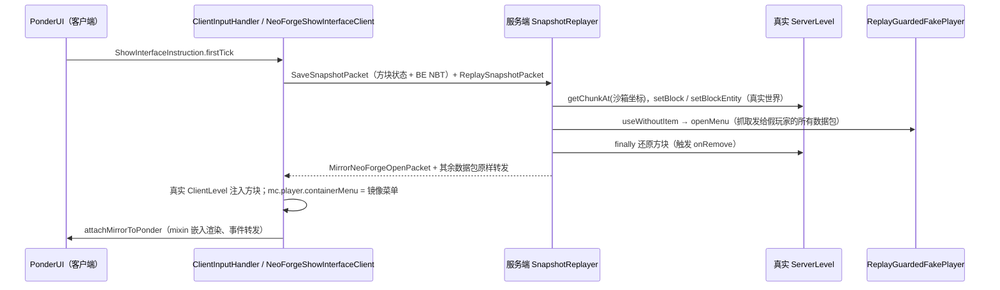
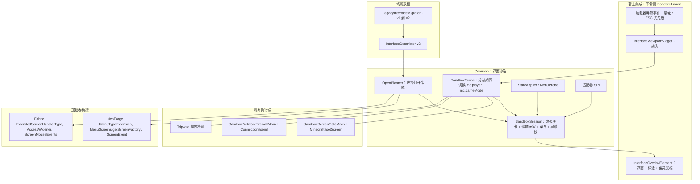

# Ponderer 界面型思索重构方案：客户端本地沙箱中的“真实界面”

> 状态：提案（Proposed）  
> 基线：Minecraft 1.21.1 分支 HEAD `6488a955`；活动模块以 `settings.gradle` 为准：`Common`、`NeoForge`、`Fabric`  
> 适用范围：`show_interface` / `change_interface_slot` / `click_interface` 的运行时、编辑器、JEI 集成与投影仪呈现；核心实现位于 `Common/`，加载器差异收敛到薄桥接层  
> 事实来源：本仓库代码；`NeoForge/build/moddev/artifacts/neoforge-21.1.219-sources.jar`（原版与 NeoForge 行为核对）；`ref/1.21.1/Ponder`、`ref/1.21.1/JustEnoughItems`；Fabric API 源码包 `fabric-networking-api-v1-4.2.2`；本地崩溃报告 `.minecraft/versions/1.21.1-NeoForge/crash-reports/`

## 1. 结论

建议把界面型思索从现在的“镜像架构”——服务端假玩家在**真实世界**里真实打开 GUI、抓取发给假玩家的数据包、转发给**真实玩家**、再用一组 mixin 把界面硬嵌进 PonderUI——整体替换为**客户端本地界面沙箱（Interface Sandbox）**：

1. **界面走模组自己的客户端路径构造**：`MenuType` 工厂 + `MenuScreens` 注册的屏幕构造器，也就是真实客户端收到“打开界面”数据包时执行的同一段代码。方块实体放在与真实世界无关的虚拟关卡里（Catnip `SchematicLevel`，或场景自身的 `PonderLevel`）。
2. **界面只接触沙箱对象**：独立的沙箱玩家（`LocalPlayer` 子类）、独立背包、独立菜单。只在把渲染/输入/tick 分派给嵌入界面的那一段调用里，把 `Minecraft.player`、`Minecraft.gameMode` 两个公共字段临时换成沙箱对象（`SandboxScope`），调用结束立即还原。
3. **网络隔离收敛到单一执行点**：沙箱作用域内、渲染线程上发往真实 `Connection` 的所有数据包都被拦截并交给沙箱（记录，不转发）。整个功能不再有任何服务端代码，7 个网络负载和 `sticksnapshot` 服务端链路全部删除。
4. **物品是真实的 `ItemStack`**：交互走原版 `AbstractContainerMenu#clicked` 的客户端预测。拾取、右键拆分、拖拽分配、Shift 快速移动、数字键交换、双击收集等行为与游戏内一致；但物品只存在于沙箱，没有通往真实背包的通道。

| 指标 | 现状（1.21.1 分支） | 重构后 |
| --- | --- | --- |
| 服务端组件 | 7 个负载 + 假玩家 + 在真实世界放置方块 | 无 |
| 界面相关 mixin 注入点 | 27 处：14 处在 `AbstractContainerScreen`，7 处在 `PonderUI`，5 处以 `@Pseudo` 注入 JEI 内部类，1 处在 `Minecraft#setScreen`；另有 5 个访问器，以及合并进 `PonderUI` 的 `keyPressed` 覆写 | 2 处，均为原版稳定方法（`Minecraft#setScreen`、`Connection#send`），`require = 0` 且带存活检测，失效时降级为只读观看；另保留访问器 |
| 依赖私有名或内部实现的反射 | 至少 8 处（JEI 覆盖层内部方法、`ServerPlayer` 私有方法、`PonderUI#replay`、`Screen` 私有字段、加载器类名等） | 0 |
| Fabric | 不支持（只画一行提示） | 支持 |
| 服务端要求 | 必须安装 Ponderer | 无：原版/插件服、未装 Ponderer 的服务器、单人暂停均可 |
| 槽位物品 | 镜像的只读显示 + JEI 图标覆盖层 | 真实 `ItemStack`，可拖动 |
| 删除代码 | — | `sticksnapshot/` 23 个文件约 3150 行，另 7 个文件约 900 行 |

当前版本还存在已核实的高危问题：真实世界中的物品生成/复制路径、镜像点击串到真实容器、JEI 升级导致游戏启动崩溃（本地已发生两次）。建议**先发止血补丁（阶段 0）**，再按阶段 1–4 完成重构。

## 2. 当前实现评估

### 2.1 当前链路



三种来源的差异：

- `block`（默认）：如上图。编辑器把方块坐标和 NBT 内嵌坐标归一化到原点（`ShowInterfaceScreen.java:22` 与 `sanitizeCapturedNbt`）。
- `held_item`：先在客户端以**真实玩家、真实世界**调用 `stack.use(...)`，并由 `MinecraftSetScreenCaptureMixin` 截获 `setScreen`；失败时再由服务端假玩家 `use`。
- `ui_id`：服务端假玩家 `openMenu(menuType.create(id, inv))`。

嵌入方式：`MirrorNeoForgeOpenClient.open` 用 `RemotePlayer` 的背包在客户端构造菜单和屏幕，`ClientInputHandler.attachMirrorToPonder` 把它挂到 PonderUI；渲染由 `PonderUIMirrorRenderMixin` 插在 `renderWidgets → renderSceneOverlay` 之前，z 层由 `EmbeddedMirrorContainerScreenMixin` 分段抬升；鼠标事件由 `ScreenEvent` 监听转发；JEI 的重复绘制由 `JeiGuiEventHandlerMixin` 屏蔽。

### 2.2 已核实的问题

严重度：严重 = 可被利用或导致崩溃；高 = 破坏真实状态或隔离；中 = 功能错误；低 = 维护负担。

**服务端安全**

| 编号 | 严重度 | 问题 | 证据 |
| --- | --- | --- | --- |
| S1 | 严重 | 在真实世界写方块，并强制加载/生成远处区块。沙箱坐标由 UUID 哈希得到，x、z ∈ [2,000,000, 2,524,256]，y = 最低高度 + 4，每个玩家各自一片。世界边界较小的服务器、领地/保护类模组下行为不可预期，还会让区域文件持续膨胀。 | `SnapshotReplayer.java:61-117`（`getChunkAt`、`setBlock(..., 0)`、`setBlockEntity`）；`ReplaySessionManager.java:30-38` |
| S2 | 严重 | 还原方块时触发 `onRemove`，容器内容物掉落到真实世界。`flags = 0` 并不能阻止：服务端 `LevelChunk#setBlockState` 无条件调用旧方块的 `onRemove`，`ChestBlock#onRemove` → `Containers#dropContentsOnDestroy`。带物品的界面每回放一次就在沙箱坐标“吐”一次物品；客户端可在 NBT 中填任意物品或 `LootTable`，构成刷物品漏洞。 | `ReplaySessionManager.java:58-68`；NeoForge 21.1.219 源码 `LevelChunk#setBlockState`、`ChestBlock#onRemove`、`Containers#dropContentsOnDestroy` |
| S3 | 严重 | `injectReferencedContextBlocks` 把 BE NBT 中出现的任意坐标（最多 8 个、任意已加载区块）上的**真实方块连同完整 NBT** 复制到沙箱附近，结束时再还原（同样触发 S2）。正常场景的坐标已被归一化，所以回放时复制的是**世界原点附近**的真实方块；恶意 NBT 可指向他人的箱子，复制加掉落等于复制物品。`decodeNeoForgeOpenPacket` 还会读取 `menuSourcePos` 上真实 BE 的完整 NBT 发给客户端，构成信息泄露。 | `SnapshotReplayer.java:315-373`、`577-586` |
| S4 | 高 | 服务端负载无权限、无频率限制；客户端给出的任意方块状态会由假玩家在真实世界执行 `useWithoutItem`（例如主世界里已充能的重生锚会直接爆炸）；快照写进 `player.getPersistentData()`，随玩家存档持久化。 | `NeoForgeNetworkHelper.java:79-96`；`SaveSnapshotPacket.java:32-38`；`SnapshotStorage.java:14-20`；`SnapshotReplayer.java:421` |
| S5 | 高 | 抓到的数据包除少数类型重映射外“原样转发”给真实玩家，`ClientboundContainerSetSlotPacket` 的 -1、-2、0 容器号也原样转发。假玩家收到的任何包（传送、背包变化等）都会作用到真实客户端。 | `SnapshotReplayer.java:512-557`（517-521、551-556） |
| S6 | 高 | 跨容器点击串线。NeoForge 额外数据菜单不重映射容器号，而每次都新建假玩家，计数器首值恒为 1（`ServerPlayer#nextContainerCounter` 为 `containerCounter % 100 + 1`）。客户端又把 `mc.player.containerMenu` 换成镜像菜单，于是镜像界面里的点击以容器号 1 发给服务器；服务器只比对容器号就执行 `clicked`，stateId 不一致只会触发一次全量重同步。玩家从一个容器号恰为 1 的真实容器界面（例如本次登录后打开的第一个容器）经 JEI 打开思索时，镜像里的点击会真的搬动那个容器里的物品；反方向上，真实服务器发给容器 1 的同步包也会写进镜像菜单。 | `SnapshotReplayer.java:464-467`；`ClientInputHandler.java:187-197`；NeoForge 源码 `ServerGamePacketListenerImpl#handleContainerClick`、`ServerPlayer.java:1137-1138` |

**客户端耦合**

| 编号 | 严重度 | 问题 | 证据 |
| --- | --- | --- | --- |
| C1 | 高 | 镜像期间 `mc.player.containerMenu` 被替换，真实容器的同步包会被忽略或写错对象；点击预测以真实 `LocalPlayer` 执行 `menu.clicked`。嵌入屏幕的 `onClose` → `LocalPlayer#closeContainer` 会发出 `ServerboundContainerClosePacket`，服务端 `handleContainerClose` 不校验容器号就 `doCloseContainer()`，随后 `setScreen(null)` 直接关掉 PonderUI。 | `ClientInputHandler.java:187-197`、`404-414`；NeoForge 源码 `AbstractContainerScreen#onClose`、`ServerGamePacketListenerImpl#handleContainerClose` |
| C2 | 中 | 在**真实 ClientLevel** 的（玩家 X，最低高度 + 1，玩家 Z）写入快照方块和 BE，关闭时再“还原”；期间真实服务器对该坐标的更新会被覆盖或回滚。 | `MirrorNeoForgeOpenClient.java:117-148`；`SnapshotReplayer.java:589-592` |
| C3 | 高 | `held_item` 来源在客户端以真实玩家和真实世界调用 `stack.use(mc.level, mc.player, MAIN_HAND)`：冷却、消耗预测、客户端放置预测都落在真实对象上；物品若在客户端 use 时发送 C2S 包，服务器会为真实玩家执行对应动作。 | `NeoForgeShowInterfaceClient.java:120-152` |

**兼容性与健壮性**

| 编号 | 严重度 | 问题 | 证据 |
| --- | --- | --- | --- |
| K1 | 严重 | `JeiGuiEventHandlerMixin` 以 `@Pseudo` 注入 JEI 内部类 `mezz.jei.gui.events.GuiEventHandler`，并用 `@Group(min = 1)` 要求至少命中一处。本地已有两次因此导致的**启动崩溃**：“Critical injection failure: Callback group @Group(name=ponderer$skipEmbeddedMirrorJeiDraw …) expected 1 invocation(s) but 0 succeeded”。最近两次提交 `cd62b1fd`、`6488a955` 都是“修复 jei 兼容问题”。 | `crash-2026-07-29_10.44.29-client.txt`（JEI 19.42.0.385）；`crash-2026-09-01_21.27.24-client.txt`（JEI 19.51.0.417） |
| K2 | 高 | `EmbeddedMirrorContainerScreenMixin` 在 `AbstractContainerScreen` 上有 14 处注入。它是全游戏所有容器界面共享的基类，也是其它模组最常 mixin 的类之一；注入按阶段推拉 z 值，并按类名前缀硬编码 Mekanism 特例。 | `EmbeddedMirrorContainerScreenMixin.java`（特例在 220-223） |
| K3 | 高 | `PonderUIMirrorRenderMixin` 的 7 处注入里，有两处在注入点先 `popPose()` 再 `pushPose()`，依赖 `PonderUIMixin` 在 `renderWidgets` 开头压入的那一层 pose。两个 mixin 之间存在隐式的栈平衡约定，任何一方改动都会错栈。 | `PonderUIMirrorRenderMixin.java:52-53, 74-76, 87-88, 96-98`；`PonderUIMixin.java:164-175` |
| K4 | 中 | 反射依赖私有名或内部实现：`Screen.renderables/narratables`、`PonderUI#replay`、`AbstractContainerScreen` 字段（Fabric 运行时是 intermediary 名，必然失败后静默回退）、`Class.forName` 加载器类名、`ServerPlayer#nextContainerCounter/initMenu/containerCounter`、JEI 覆盖层内部方法。 | `ClientInputHandler.java:551-578`；`UiAnchorViewport.java:137-191`；`ReplayGuardedFakePlayer.java:26-31`；`PondererJeiPlugin.java:316-444` |
| K5 | 中 | 依赖服务端往返，于是有“自动重放”补丁：首帧等待镜像，到达后反射调用 `PonderUI#replay` 并借访问器重置进度条；跳转、重播每次都重新走服务器。Fabric 完全不可用；服务器未装 Ponderer 时无效果。 | `ClientInputHandler.java:298-310, 570-591`；`PonderProgressBarAccessorMixin`；`PonderUIMixin.java:352-436` |
| K6 | 中 | UI 锚点在**故事板构建期**解析，此时镜像界面还没打开，`UiAnchorViewport.resolve` 回退为居中 176×166，非标准尺寸 GUI 的文字指向必然错位。 | `DynamicPonderPlugin.java:1490-1519`；`UiAnchorViewport.java:103-135` |
| K7 | 低 | 死代码与字段误用：`ReplaySessionManager.beginSession` 和 `disableReachabilityCheck` 没有调用方（后者会把 `AbstractContainerMenu` 的全部 boolean 字段置 false），因此 `restoreSession` 永远是空操作；`ShowInterfaceScreen` 把命中点的 `inside` 标志存进了 `whileSneaking`，运行时 `block` 来源把它当 inside，`held_item` 来源又把同一字段当潜行。 | `ReplaySessionManager.java:40-42, 70-84`；`ShowInterfaceScreen.java:165, 277`；`NeoForgeShowInterfaceClient.java:79, 111` |

**体验**

- U1：`change_interface_slot` 只是在槽位上方贴 JEI 图标（`InterfaceSlotOverlayRenderer`），不能拖动；工具提示和真实槽位内容割裂，图标下面可能还压着镜像来的真实物品。
- U2：`click_interface` 只有归一化坐标加左/右键，没有语义目标，也没有可视化光标。
- U3：回放和跳转会闪烁；投影仪只显示“界面（仅渲染）”文字卡（`ProjectorSceneBundle.java:367-397`）。

### 2.3 值得保留的资产

- DSL 与编辑器框架：`AbstractStepEditorScreen`、`FieldSpecs`、表单快照与撤销。
- `UiAnchorCoords` 的居中归一化坐标约定（[-2, 2]），继续作为 `gui: [u, v]` 目标的格式。
- `ShowInterfaceScreen` 对 NBT 坐标的相对化处理（隐私与可移植性）。
- 受权限保护的 BE NBT 采集链路 `CaptureBlockEntityNbtRequestPayload`：要求 `canUpload`、6 格内且准星对准。
- `JeiCompat.resolveIngredientById` 对非物品配料（流体、化学品等）的渲染，用于“幽灵显示”。
- 投影仪的提示卡与时间线基础设施。

## 3. 目标与边界

### 3.1 目标

1. **兼容性**：界面通过模组自身的客户端构造路径生成；不需要服务端；Fabric 与 NeoForge 同等支持；单人暂停可用；界面功能的 mixin 只保留 2 个原版稳定目标且可降级；不再有依赖私有名的反射。
2. **安全性**：满足第 6.2 节的隔离契约——不发送任何服务端数据包，不写任何真实关卡，不把真实玩家对象交给模组界面代码，不改动真实玩家的背包、菜单和光标物品；场景数据按不可信输入处理。
3. **体验**：真实可拖动物品；观看/试玩双模式；语义化脚本动作与幽灵光标；运行期锚点；从世界一键捕获；直接在沙箱里编辑槽位；动作录制；JEI 查配方与拖入；可解释的降级。
4. **可维护性**：时间线确定（跳转 = 从 0 重放，不经网络）；核心逻辑在 `Common/`，可以单元测试。

### 3.2 非目标

- 不在客户端重现依赖服务端逻辑的**完整**模组行为（AE2 终端的网络库存、Mekanism 机器的内部同步等）。这类界面以“快照保真”呈现，可由可选适配器补全（7.3）。
- 不录制、不重放模组的服务端→客户端自定义负载。这类处理器常把工作 `enqueueWork` 到沙箱作用域之外执行，会落到真实玩家的菜单上；而且场景包里的负载字节属于不可信输入。
- 不提供任何把沙箱物品转入真实背包的通道。
- 不做长时间的全局替换（例如整个 PonderUI 期间都替换 `mc.player`）。

## 4. 设计原则

1. **客户端本地，零服务端。**
2. **走模组自己的客户端路径**：同一个 `MenuType` 工厂、同一个屏幕构造器、同一个 `clicked` 预测。
3. **隔离首先靠构造，其次靠单点执行，最后靠检测**；检测到越界时降级，不崩溃。
4. **公共 API 与加载器事件优先**；mixin 只放在原版稳定方法上，`require = 0`，并做运行期存活证明。
5. **确定性**：会话状态完全由“描述符 + 时间线上已执行的步骤”推导。
6. **分级降级**：每个界面都有明确的保真等级和回退形态（7.1）。
7. **场景数据不可信**：体积与深度限额、组件点击事件净化、异常隔离。

## 5. 目标架构

### 5.1 总览



| 组件 | 职责 | 位置 |
| --- | --- | --- |
| `InterfaceDescriptor` | 版本化的界面描述：目标、menuType、extraData、槽位/数据状态、布局、交互策略、回退信息 | `Common/.../interfaces/model` |
| `LegacyInterfaceMigrator` | 读取旧字段并转换为 v2（纯函数，可测） | 同上 |
| `OpenPlanner` | 根据描述符选择打开策略，产出 `OpenPlan` | `Common/.../interfaces/sandbox` |
| `SandboxSession` | 持有虚拟关卡、沙箱玩家、沙箱 `gameMode`、菜单、屏幕栈、保真等级、审计信息；所有调用经 `dispatch` | 同上 |
| `SandboxScope` | 分派期间切换 `Minecraft.player/gameMode`，出作用域时还原并执行 tripwire | 同上 |
| `InterfaceOverlayElement` | 作为 Ponder 覆盖层元素渲染界面、标注和幽灵光标 | `Common/.../interfaces/host` |
| `InterfaceViewportWidget` | 作为 PonderUI 子控件接收输入并转发 | 同上 |
| 指令 | `ShowInterface`、`SetInterfaceSlots`、`SetInterfaceData`、`InterfaceAction`、`HideInterface`、`AwaitInterface` | `Common/.../interfaces/instruction` |
| 创作工具 | 从世界捕获、沙箱内编辑、动作录制、兼容性扫描 | `Common/.../interfaces/authoring` |
| 平台服务 | 菜单/屏幕工厂、输入钩子、捕获监听 | `InterfaceSandboxPlatform` + 各加载器实现 |

### 5.2 会话生命周期

`Planned → Opening → Ready(Watch) ⇄ Try → Closing → Disposed`，任一阶段失败进入 `Degraded(T1/T0)`。

- 创建：`ShowInterfaceInstruction.firstTick` 同步完成（无网络），把元素加入场景（`PonderScene#addElement`）。
- 重播、跳转、切换片段：`PonderScene#begin()` 先对所有元素调用 `reset(scene)`，再清空元素集合（`PonderScene.java:225-246`）。元素在 `reset` 中销毁会话；跳转时指令从 0 重新执行，会话被确定性地重建。
- 其它销毁时机：PonderUI 关闭（NeoForge `ScreenEvent.Closing`、Fabric `ScreenEvents.remove`）、断开连接、资源重载。
- 销毁在作用域内执行：`screen.removed()`、`menu.removed(sandboxPlayer)`。

### 5.3 SandboxScope：分派期间的“当前玩家”

原版点击链路是 `AbstractContainerScreen#slotClicked → minecraft.gameMode.handleInventoryMouseClick(containerId, …, minecraft.player)`，后者读取 `player.containerMenu` 并调用 `menu.clicked(…, player)`（`MultiPlayerGameMode.java:455`）。模组界面和网络代码普遍使用 `Minecraft.getInstance().player` 与 `getConnection()`，而 `getConnection()` 就是 `player.connection`（`Minecraft.java:2311-2312`）。`Minecraft.player`、`gameMode` 都是公共字段（`Minecraft.java:340-344`）。所以只要在分派期间换掉这两个字段，界面代码看到的就全是沙箱对象，不需要任何 mixin。

规则：

- 只在渲染线程进入；可重入（深度计数）；同一时刻只有一个活动会话。
- 对嵌入屏幕和菜单的所有调用——`init`、`render`、`tick`、输入、脚本动作、`removed`——都必须经过 `session.dispatch(...)`。
- `finally` 中还原字段，随后执行 tripwire 检查（6.3）。

**沙箱玩家** `SandboxLocalPlayer extends LocalPlayer`：

- 用**真实的** `ClientLevel` 和**真实的** `ClientPacketListener` 构造，再 `setLevel(sandboxLevel)`（`Entity#setLevel` 为 protected）。不另建 `ClientPacketListener`：Fabric API 在该类构造函数末尾注入，调用全局的 `ClientNetworkingImpl.setClientPlayAddon(...)` 并执行 `lateInit()`（`fabric-networking-api-v1-4.2.2` 的 `ClientPlayNetworkHandlerMixin.java:44-49`），新建实例会篡改真实连接的网络状态；其它模组也可能挂在这个构造函数上。
- 覆写：`closeContainer` / `clientSideCloseContainer` → 转为会话的关闭请求，不发包、不 `setScreen`；`drop(ItemStack, …)` → 物品退回沙箱背包；`drop(boolean)` → 无操作；`displayClientMessage` → 会话提示；`hasInfiniteMaterials` / `isCreative` → 由会话策略决定（作者模式允许中键克隆）；`tick` → 空。
- 背包：独立 `Inventory`；配方书为真实配方书的拷贝（`RecipeBook#copyOverData`）；统计为新的空 `StatsCounter`。
- 身份：默认使用观看者自己的 GameProfile，使客户端侧的“所有者”判断自然成立；任何数据都到不了服务器。

**沙箱 gameMode**：`new MultiPlayerGameMode(mc, realListener)`。它发出的点击包、按钮包都会进入下一节的执行点。

### 5.4 网络隔离：单一执行点

`SandboxNetworkFirewallMixin` 在 `Connection#send(Packet, PacketSendListener, boolean)` 头部注入（其余重载都汇入这里），`cancellable`、`require = 0`：若 `SandboxScope.isActive()` 且当前在渲染线程，就把数据包交给活动会话并取消发送。

覆盖的路径：

- 原版点击、按钮点击：沙箱 `gameMode` → 真实 listener → `Connection#send`。
- NeoForge `PacketDistributor.sendToServer`：`Minecraft.getInstance().getConnection()` → `listener.send` → `Connection#send`。
- Fabric `ClientPlayNetworking.send`：network handler → `Connection#send`。
- 点击事件触发的命令（`sendCommand`）、关闭包、丢弃包。

不覆盖的路径：直接向 Netty channel 写数据（已知模组不这样做）、非渲染线程发送（沙箱分派不会在其它线程触发）。

存活证明：注入代码每次执行都置位一个静态标志。进入试玩模式前要求该标志已置位（进入世界后必然有包经过）；否则会话只允许观看（T1）。拦截到的包用于动作录制（`ServerboundContainerClickPacket` 可直接还原为语义动作）、适配器模拟服务端响应、审计日志。

入站方向天然隔离：沙箱菜单从不赋给真实玩家；真实服务器的包在作用域之外、针对 `realPlayer.containerMenu` 处理。沙箱窗口号取自保留区间（例如 10000 起），仅用于诊断。

### 5.5 屏幕闸门

`SandboxScreenGateMixin` 由现有 `MinecraftSetScreenCaptureMixin` 泛化而来，仍注入 `Minecraft#setScreen` 头部，`require = 0`。仅在作用域内生效：

- `setScreen(null)` → 会话关闭请求（试玩模式下退出试玩，观看模式下忽略）。
- `setScreen(x)` → 压入会话的嵌套屏幕栈，例如 Mekanism 侧面配置、过滤器子界面；`ConfirmLinkScreen`、`ConfirmScreen`、`ChatScreen`、`PauseScreen`、`DisconnectedScreen` 等拒绝并提示。
- 作用域外不做任何事。

它同时承担创作捕获（原 `ClientScreenCapture`）。NeoForge 在闸门失效时以 `ScreenEvent.Opening` 兜底拦截打开（原版 `setScreen` 只对非空屏幕发该事件，所以关闭无法兜底）。存活证明方式同 5.4；闸门不存活时只允许观看。

### 5.6 打开管线（OpenPlanner）

| 来源 | 输入 | 首选策略 | 回退 |
| --- | --- | --- | --- |
| `captured`（新捕获） | menuType + 捕获的 extraData（坐标已相对化）+ BE 快照 + 槽位/数据快照 | ClientFactory：`MenuType` 工厂 + extraData，坐标改写到沙箱位置 | MenuProbe → T0 |
| `block`（旧数据或手填） | 方块状态 + BE NBT | MenuProbe 推断 menuType、标题和初始槽位；合成“BlockPos 在前”的 extraData | T0，并提示“重新捕获” |
| `scene_block` | 场景坐标，BE 取自场景自己的 `PonderLevel` | 同 `block`，关卡换成场景 | 同上 |
| `menu`（原 ui_id） | menuType | 无额外数据的工厂 `create(id, inv)` | 需要上下文时提示改用捕获 |
| `item` | 完整组件的 `ItemStack` + 可选 extraData + 所在槽位 | 客户端屏幕型：沙箱内 `item.use` + 闸门捕获；菜单型：ClientFactory + extraData | T0 |
| `adapter` | 适配器声明 | 适配器 | — |

**ClientFactory**（加载器桥接）：

- NeoForge：`menuType.create(windowId, inventory, RegistryFriendlyByteBuf)`（`IMenuTypeExtension`），屏幕用 `MenuScreens.getScreenFactory(type)`。
- Fabric：`ExtendedScreenHandlerType#getPacketCodec().decode(buf)` 后 `create(id, inventory, data)`；屏幕构造器用 access widener 打开 `MenuScreens#getConstructor` 与 `MenuScreens$ScreenConstructor`（编译期生效，不存在运行时冲突）。
- 两端的原版菜单：`menuType.create(id, inventory)`。

**MenuProbe**：仅在没有捕获槽位状态时使用。作用域内执行 `state.getMenuProvider(sandboxLevel, pos)` → `provider.createMenu(probeId, probeInventory, sandboxPlayer)`，读出 `getType()`、标题、`getItems()` 后 `removed()` 并丢弃。这是“服务端风格”的构造，但只接触沙箱对象；任何异常（包括强转 `ServerPlayer` 失败）都只让该策略失败。它是信任度最低的策略，可在配置中关闭。

### 5.7 状态管线

- 快照模式下，客户端菜单就是权威状态：用 `initializeContents(stateId, items, carried)` 写入槽位，等价于收到 `ClientboundContainerSetContentPacket`；用 `setData(id, value)` 写数据槽，等价于 `ClientboundContainerSetDataPacket`。
- BE 状态：从净化后的 NBT 加载到沙箱 BE。很多模组的客户端菜单直接把槽位绑定到 BE 的物品处理器，二者自然一致。
- 沙箱背包：由描述符的 `playerInventory` 决定——空、预设，或打开时对真实背包做一次**单向**拷贝。
- 脚本步骤复用同样的写入口：`set_interface_slots` 写槽位差量，`set_interface_data` 写数据槽（可插值）。
- 会话记录已执行的脚本操作日志；“重置”即重建会话并重放日志，不需要动 Ponder 时间线。
- 可选适配器挂在 `afterClick` / `onOutbound` 上，例如原版工作台：服务端版 `CraftingMenu#slotChangedCraftingGrid` 会强转 `ServerPlayer`，沙箱里改用客户端配方管理器计算结果槽。

### 5.8 渲染

**决定**：在 Ponder 的覆盖层通道渲染。`InterfaceOverlayElement` 继承 Ponder 公开的 `AnimatedOverlayElementBase`，Ponder 在 `PonderUI#renderSceneOverlay` 中调用它（`PonderScene.java:283-287`，`PonderUI.java:922-932`）。每帧流程：

1. `graphics.flush()`，清深度缓冲。
2. 把 pose 的 z 平移归零到基线，再施加布局变换（居中、必要时缩放、入场动画）。
3. 在作用域内调用 `screen.render(graphics, localMouseX, localMouseY, pt)`，外面包 `RenderGuard`。
4. 再次 `flush()`；绘制界面标注与幽灵光标。
5. 清深度缓冲，恢复渲染状态（混合、深度、着色器颜色、剪裁）。

**绘制顺序**：Ponder 把元素存在 `HashSet` 里（`PonderScene.java:134`），同一通道内元素之间的先后不确定，界面可能盖住先画的文字框。解决办法是：**界面可见期间，`text`、`shared_text`、`show_controls` 步骤都编译成界面元素自带的标注**。UI 锚点在运行期按真实界面矩形求值（修复 K6）；世界锚点用公开的 `SceneTransform#sceneToScreen` 投影；外观用公开的 `PonderUI.renderSpeechBox` 复刻 Ponder 风格；文本索引继续用 `TextMarkerInstruction`。现行编译逻辑本来就在 `show_interface` 之后切换到 `uiAnchorMode`（`DynamicPonderPlugin.java:1114`），改造范围可控。

**背景**：嵌入屏幕自己的 `renderBackground` 在 1.21.1 会模糊并压暗此前画出的全部内容。默认 `backdrop: dim`：渲染调用期间把 `menuBackgroundBlurriness` 临时设为 0、结束后还原——该选项的更新回调是空操作（`Options.java:249` 附近），交换没有副作用，也不写盘；原版暗化保留，作为聚焦效果。`backdrop: vanilla` 保留模糊。

**为什么不用离屏帧缓冲**：`Screen#renderBlurredBackground` 在处理模糊后**总是**执行 `getMainRenderTarget().bindWrite(false)`，渲染到一半就会切回主缓冲。离屏方案只留给投影仪（阶段 4），在世界渲染之前的预通道里借用主缓冲并拷出。

**为什么不在场景通道（`renderLast`）渲染**：该通道处于 3D 投影下，其后还有实体、粒子、轮廓和其它元素的 `renderLast`，深度关系难以保证。

**RenderGuard**：记录 pose 栈深度与剪裁状态；异常时弹栈到原深度、关闭剪裁、复位状态，把会话降级为 T1 或 T0，同一异常只记录一次。

**缩放**：界面矩形（含边距）放不进可用区域时才等比缩放，派发前对鼠标坐标做逆变换。少数界面直接读取 `mouseHandler` 的原始坐标，缩放下会错位，因此默认原生尺寸，并支持按界面类型强制原生。

**入场/退场动画**：用缩放和位移，不用透明度（界面代码会覆盖着色器颜色）。

**界面片段的背景**：与现在相同，场景世界为空、去掉阴影；不再需要取消 `renderScene`。

### 5.9 输入

| 事件 | NeoForge | Fabric | 行为 |
| --- | --- | --- | --- |
| 添加视口控件 | `ScreenEvent.Init.Post#addListener` | `ScreenEvents.AFTER_INIT` + `Screens.getButtons(screen).add` | 控件加在 PonderUI 自带按钮之后，按钮天然优先（取代 `PonderUiInteractionHelper` 的特判） |
| 点击、释放、拖动、字符、非 ESC 按键 | 控件作为焦点子元素接收 | 同左 | 试玩模式下经 `dispatch` 转发，做坐标变换 |
| 滚轮 | `ScreenEvent.MouseScrolled.Pre` | `ScreenMouseEvents.allowMouseScroll` | `PonderUI#mouseScrolled` 会先切换片段（`PonderUI.java:539-544`），试玩模式下光标在界面上时拦截 |
| ESC | `ScreenEvent.KeyPressed.Pre` | `ScreenKeyboardEvents.allowKeyPress` | `Screen#keyPressed` 先于子元素处理 ESC；第一次退出试玩，第二次关闭思索 |
| tick | 控件实现 Catnip `TickableGuiEventListener` | 同左 | PonderUI 每 tick 调用，控件在作用域内调用 `screen.tick()` |

- **观看模式**：控件不获取焦点，只把鼠标位置传给界面渲染，用于悬停提示。
- **试玩模式**：控件获取焦点并转发全部输入；时间线暂停——每个客户端 tick 调用公开的 `PonderUI#coolDownAfterSkip()`，使 `skipCooling` 保持大于 0，场景不再 tick（`PonderUI.java:437-438, 470-476, 1203-1205`）。Ponder 若改变该语义，只会导致试玩时不暂停，不会出错。

### 5.10 与时间线的关系

- 指令均为 `TickingInstruction` 子类，只调用会话 API。
- `InterfaceAction`：运行期解析目标（槽位下标 → 界面左上角 + `slot.x/y`；控件选择器；`gui: [u, v]`），生成幽灵光标路径，在对应 tick 通过 `dispatch` 合成 `mouseMoved`、`mouseClicked`、`mouseDragged`、`mouseReleased`。按钮、标签页、槽位都由模组自己的 GUI 逻辑处理。跳转时立即执行、不播放动画。
- 自由操作与脚本的关系：进入试玩即暂停时间线；退出试玩时默认把界面重置为当前时间点的脚本状态（5.7 的日志重放），可选“保留我的改动”。
- 投影仪上下文（`ProjectorRenderContext.isActive()`）在阶段 4 之前不创建会话，沿用提示卡。

## 6. 隔离与安全模型

### 6.1 威胁模型

| 资产 | 威胁来源 | 现状 | 新方案 |
| --- | --- | --- | --- |
| 真实玩家：背包、打开的菜单、光标物品、位置、统计 | 嵌入界面代码、跨容器串线 | 被替换 `containerMenu`、以真实玩家做点击预测、转发包作用于真实客户端 | 界面只接触沙箱玩家；真实菜单从不被替换；tripwire 校验 |
| 真实世界（服务端） | 恶意客户端、正常回放的副作用 | 放方块、强制生成区块、掉落物品、复制真实方块 | 无服务端代码 |
| 真实世界（客户端） | 注入方块、客户端 use 预测 | 真实 ClientLevel 被写入 | 沙箱关卡独立；物品 use 只在沙箱内 |
| 服务器与其他玩家 | 无权限的负载、跨玩家的 NBT 引用 | 可读他人 BE、可刷物品 | 服务端攻击面为零 |
| 客户端稳定性与隐私 | 恶意场景包、脆弱 mixin | JEI 升级导致启动崩溃 | 限额、净化、fail-soft 执行点、降级 |

### 6.2 隔离契约

- **I1** 界面功能不包含任何服务端代码与负载，服务器既不需要也无法参与。
- **I2** 不写任何真实关卡，沙箱方块只存在于 `SchematicLevel` 或场景 `PonderLevel`。
- **I3** 真实 `LocalPlayer` 对象不会作为参数进入任何模组菜单或屏幕代码。
- **I4** 每次分派前后，真实玩家的 `containerMenu`（同一性与 stateId）、背包（`Inventory#getTimesChanged`）和光标物品保持不变。
- **I5** 沙箱作用域内由渲染线程发往真实连接的数据包一律被拦截：记录，不转发。
- **I6** 沙箱屏幕不能替换或关闭宿主屏幕。
- **I7** 沙箱物品没有通往真实背包的通道。
- **I8** 场景数据进入沙箱前经过限额与净化。

### 6.3 执行层

| 层 | 机制 | 覆盖 | 失效表现 |
| --- | --- | --- | --- |
| 构造 | 删除服务端链路；沙箱对象与真实对象不共享实例 | I1、I2、I3、I7 | 不适用 |
| 作用域 | `SandboxScope` 切换 `player/gameMode` | I3、I5 的主体 | 不适用 |
| 执行点 | 防火墙与闸门 mixin，带存活证明 | I5、I6 | 不存活 → 只读观看（T1） |
| 检测 | 出作用域时校验 I4 与 `mc.screen` 同一性 | 模组绕过单例、缓存真实玩家 | 记录错误，该 menuType 本次会话禁用交互 |
| 数据 | 6.4 的限额与净化 | I8 | 解析失败 → 降级并在报告中列出 |
| 资源 | 每个宿主至多 1 个可见会话；构建耗时告警；异常熔断 | 性能与稳定性 | 熔断后显示 T0 |

### 6.4 数据净化细则

- SNBT 字符串上限（建议 256 KiB）、嵌套深度不超过 512、解析使用 `NbtAccounter` 配额；超限直接降级。
- `ItemStack` 用 `ItemStack.OPTIONAL_CODEC` 配合 `RegistryOps` 解析，错误汇总进兼容性报告，不抛出。
- 组件净化：标题、自定义名、lore、成书页面中的 `RUN_COMMAND`、`SUGGEST_COMMAND`、`OPEN_URL`、`OPEN_FILE`、`COPY_TO_CLIPBOARD` 点击事件全部移除。
- 删除 BE NBT 中的 `LootTable`、`LootTableSeed`。
- 坐标沿用现有相对化方案；extraData 中的方块坐标按捕获时记录的字节偏移改写，而不是猜测“第一个 long 就是坐标”。

### 6.5 残余风险

- 模组界面代码直接写 `Minecraft.getInstance().level`（真实客户端世界）：无法低成本检测；只影响本地显示，下一次区块更新即纠正；提供 denylist。
- 模组在作用域外缓存真实玩家、在作用域内修改：由 tripwire 检出并降级。反过来缓存到沙箱玩家是无害的。
- 模组的客户端静态单例被沙箱界面改动：影响仅限客户端显示，无法完全排除。
- JEI 作弊模式“给予物品”由 JEI 在作用域外执行，等价于玩家本来就有的权限，不构成越权；文档中提示。
- 单人模式下客户端代码访问 `getSingleplayerServer()`：罕见，纳入检测与 denylist。

### 6.6 服务端侧变化

- 删除 7 个负载注册（`NeoForgeNetworkHelper.java:79-96, 134-136`）、`ReplaySessionManager` 与 `ReplayEventInterceptors` 的事件注册（`PondererNeoForge.java:52-53`）以及整个 `sticksnapshot` 包。
- `NeoForgeNetworkHelper.VERSION` 由 `"3"` 升到 `"4"`，新旧版本在协商阶段即被区分，不会出现“半个功能”。
- Fabric 端原本就没有这些负载。

## 7. 兼容性策略

### 7.1 保真等级

| 等级 | 含义 | 交互 | 典型 |
| --- | --- | --- | --- |
| T3 Live | 适配器补全服务端行为（合成结果、熔炉进度等） | 完整 | 原版工作台（内置适配器） |
| T2 交互快照 | 模组的客户端菜单与屏幕构造成功，状态由快照和步骤驱动 | 真实物品交互（客户端预测） | 大多数原版与简单模组界面 |
| T1 只读快照 | 可构造、可渲染，但交互被禁用（检测到越界、分派异常或执行点不存活） | 悬停提示 | 少数复杂界面 |
| T0 示意 | 无法构造：按捕获的槽位几何画通用面板和物品；有截图时显示截图 | 悬停提示 | 缺少模组、构造失败 |

每个会话都报告自己的等级，编辑器中显示。

### 7.2 界面类别与预期

| 类别 | 预期 | 说明 |
| --- | --- | --- |
| 原版简单容器：箱子、漏斗、发射器、熔炉类、酿造台、铁砧、砂轮、切石机、织布机、制图台、锻造台、信标、潜影盒 | T2 | 进度箭头、火焰由数据槽快照或 `set_interface_data` 驱动 |
| 原版需服务端计算：工作台、背包合成 | T2，配合内置适配器达到 T3 | 用客户端配方管理器计算结果 |
| NeoForge 额外数据菜单（`IContainerFactory`，客户端构造器读 BlockPos 查 BE） | 捕获 extraData 后 T2 | 旧数据经 MenuProbe 多数可达 T2 |
| Fabric `ExtendedScreenHandlerType` | 同上 | |
| 重度自定义同步：AE2 终端、部分 Mekanism 机器、RS | 框架、槽位和 BE 渲染数据可 T2；依赖服务端推送的数据为空或静态 | 适配器扩展 |
| 纯客户端屏幕（无菜单）：tetra 全息球、指南书等 | `item` 来源 + 闸门捕获，T2 | 屏幕自身交互可用 |
| 多方块 GUI（需结构成型） | 视模组而定 | 用 `scene_block` 取场景结构，或只使用捕获数据中的邻接方块快照，**绝不**从真实世界复制 |
| 实体界面：马、村民交易 | 阶段 4 | 捕获开屏与交易数据，沙箱中构造 `HorseInventoryMenu`、`MerchantMenu#setOffers` |

### 7.3 适配器 SPI

```java
public interface InterfaceSandboxAdapter {
    boolean supports(MenuType<?> type);
    default @Nullable OpenPlan planOpen(InterfaceDescriptor descriptor, SandboxContext ctx) { return null; }
    default void afterMenuCreated(SandboxContext ctx, AbstractContainerMenu menu) {}
    default void afterClick(SandboxContext ctx, AbstractContainerMenu menu, ServerboundContainerClickPacket click) {}
    default void onOutbound(SandboxContext ctx, Packet<?> packet) {}
}
```

- 通过 `ServiceLoader`（`META-INF/services`）发现，第三方模组无需 mixin 即可提供适配器。
- 约束：适配器只能操作 `SandboxContext` 提供的沙箱对象；不提供网络能力。
- 内置：原版工作台/背包合成结果、熔炉类进度动画（按 `cookingTotalTime` 插值）、村民交易（阶段 4）。

### 7.4 JEI：只用公共 API

- 删除 `JeiGuiEventHandlerMixin`，以及 `PondererJeiPlugin` 中反射绘制 JEI 覆盖层的代码（`OverlayMethods`、`UpdaterMethods`、`renderPonderUiOverlay` 等）。
- 为 PonderUI 注册：
  - `IGlobalGuiHandler#getClickableIngredientUnderMouse`：返回沙箱槽位里的物品，悬停按 R/U 查配方；
  - `IGhostIngredientHandler<PonderUI>`：试玩/作者模式下以沙箱槽位为目标，接受后通过会话 API 放入真实 `ItemStack`；
  - `IGuiScreenHandler<PonderUI>`：试玩/作者模式下以嵌入界面矩形作为 GUI 属性，让 JEI 列表贴在界面旁。
- 深度顺序：NeoForge 上在 `ScreenEvent.Render.Post` 以 `HIGH` 优先级清深度（JEI 以 `NORMAL` 订阅，见 `mezz/jei/neoforge/events/EventSubscription.java:35`），JEI 列表就画在最上层；Fabric 上把 `ScreenEvents.afterRender` 注册在更早的阶段。
- 可以接受的副作用：嵌入屏幕 `init` 会触发 `ScreenEvent.Init.Post`，JEI 的 `onGuiInit` 会把目标切到嵌入屏幕一帧，下一次 PonderUI 的 `Render.Post` 又切回（`GuiEventHandler.java:41-62, 79-93`）；嵌入屏幕的 `ContainerScreenEvent.Render.Foreground` 只在 JEI 列表对当前目标显示时才绘制前景。阶段 1 原型中验证。

### 7.5 其他模组对嵌入屏幕的挂钩

整理/排序类模组在 `ScreenEvent.Init.Post` 中添加的按钮会出现在嵌入界面上，这正是玩家平时看到的样子。这些按钮的点击在作用域内执行，作用于沙箱对象，发出的包被执行点拦截。工具提示类模组在作用域内拿到的是沙箱玩家。

### 7.6 Fabric 对齐

- 桥接：`ExtendedScreenHandlerType` 菜单工厂、access widener 暴露屏幕构造器、`ScreenMouseEvents` / `ScreenKeyboardEvents` 输入钩子、捕获监听的负载类型。
- Common 中的 mixin（闸门、防火墙、访问器）两端共用。按 `AGENTS.md`，涉及映射名的成员不得加 `remap = false`，由注解处理器生成 refmap。
- Fabric 扩展菜单的开屏数据如何在捕获时取得原始字节，需在阶段 3 原型中核实 Fabric screen-handler API 的开屏负载类型；若拿不到原始字节，就缓存解码后的数据对象，再用 `getPacketCodec()` 重新编码。

### 7.7 1.20.1 分支的可移植性

架构相同，桥接层不同：Forge 的 `IForgeMenuType` 与 `FriendlyByteBuf`、Forge 的 `MenuScreens.getScreenFactory`、没有数据组件（改用 NBT）、`Connection#send(Packet, PacketSendListener)` 的签名不同；1.20.1 没有菜单背景模糊，`renderBackground` 只压暗。

### 7.8 Mixin 与反射清单

| 现有项 | 类型 | 处理 |
| --- | --- | --- |
| `EmbeddedMirrorContainerScreenMixin` | 14 处注入 `AbstractContainerScreen` | 删除：深度清除 + 正常 GUI z 取代分段抬升 |
| `PonderUIMirrorRenderMixin` | 7 处注入 `PonderUI`（含跨 mixin 的 pose 出入栈） | 删除：覆盖层元素 + 元素生命周期 + 屏幕事件 |
| `JeiGuiEventHandlerMixin` | 5 处 `@Pseudo` 注入 JEI 内部类 | 删除：JEI 公共 API |
| `PonderProgressBarAccessorMixin` | 访问 Ponder 私有字段 | 删除：不再需要“自动重放” |
| `MinecraftSetScreenCaptureMixin` | 1 处注入 | 泛化为 `SandboxScreenGateMixin` |
| `AbstractContainerScreenAccessor` | 4 个访问器 | 保留（Fabric 需要；NeoForge 也可用） |
| `PonderUIMixin` 中的界面分支：`keyPressed` 覆写、Fabric 提示、槽位编辑提示 | 合并方法 + 注入 | 移到输入事件与覆盖层元素；拾取模式的 ESC 也可一并迁到事件，从而删掉 `keyPressed` 覆写 |
| 新增 `SandboxNetworkFirewallMixin` | 1 处注入 `Connection#send` | 新增，fail-soft |
| 新增 `AbstractContainerMenuAccessor` | 1 个访问器（`dataSlots`） | 新增，仅用于捕获时读取数据槽 |
| 反射：`Screen.renderables/narratables`、`PonderUI#replay`、`AbstractContainerScreen` 字段、`Class.forName` 加载器类、`ServerPlayer` 私有方法、JEI 覆盖层内部方法 | 反射 | 全部删除 |

## 8. 体验设计

### 8.1 观看与试玩

- 默认**观看**：界面是真实的、实时渲染的，悬停显示原生工具提示；点击穿透给思索的导航。
- 界面右上角的小标签：“▶ 试一试”“⟲ 重置”“✕ 退出”。进入**试玩**后时间线暂停，玩家可以自由操作；标签旁常驻提示“物品只存在于演示中”。
- `await_interface` 步骤可把试玩变成练习：例如“把铁矿放进熔炉”，达成目标后自动继续；提供“跳过”；在投影仪和自动播放场景中由脚本演示自动完成。

### 8.2 真实物品交互规格

- 物品是 mod 自己的 `MenuType` 工厂创建的真实菜单中的真实 `Slot` 与 `ItemStack`。交互走原版 `AbstractContainerMenu#clicked`：拾取/放下/交换、右键拆分、拖拽分配（`QUICK_CRAFT`）、双击收集（`PICKUP_ALL`）、Shift 快速移动（菜单自己的 `quickMoveStack`）、数字键与副手交换、丢弃（`THROW`）、作者模式下的中键克隆。槽位限制（`mayPlace`、堆叠上限、过滤）由模组的槽位类照常执行。
- 丢弃到界面外时，物品退回沙箱背包（沙箱玩家的 `drop` 覆写），不会消失，也不会进入任何世界。
- 关闭界面时光标物品随会话丢弃；重播、切换片段、点击“重置”都恢复脚本状态。
- 快照模式下没有服务端的反应（合成结果、机器加工）。对应的结果由适配器补齐，或由作者用 `set_interface_slots` 写出，例如“放入原料后，结果槽显示 X”。
- 作者模式额外提供：中键克隆、JEI 拖入即放置真实物品、滚轮调整数量、按住修饰键右键清空槽位。

### 8.3 语义化脚本动作与幽灵光标

- `interface_action` 支持 `click`、`right_click`、`quick_move`、`drag`、`swap_hotbar`、`hover`、`type_text`、`press_button`。目标可以是 `{"slot": n}`、`{"widget": {...}}`，或 `{"gui": [u, v]}`（旧格式的归一化坐标）。
- 幽灵光标以缓动曲线从 A 移到 B，按下时显示点击波纹，拖动时光标旁显示正被携带的真实物品；目标在运行期解析，因此不受 GUI 缩放和窗口大小影响。
- 动作通过真实输入管线执行，模组的按钮、标签页、文本框都会给出真实反馈。

### 8.4 运行期锚点与界面标注

- 标注可以指向槽位、控件或界面内的归一化坐标，每帧按真实界面矩形求值。
- 界面可见期间，所有文字与操作提示由界面元素统一绘制（5.8），不会被界面遮住，并保持 Ponder 的视觉风格。
- 已知的小缺口：Ponder 的“舒适阅读”只识别 `TextWindowElement`，界面标注暂不自动放慢；可按配置对标注时长乘一个系数。

### 8.5 创作：从世界捕获

1. 在 `show_interface` 编辑器中点“从世界捕获”。编辑器收起，提示“像平时一样打开目标界面（右键方块或使用物品）”。
2. 作者在真实世界里正常打开界面，由真实服务器按正常规则打开，Ponderer 不参与。
3. 捕获期间，Ponderer 在真实连接的 Netty 管线中临时插入一个**只读入站监听**（`Connection#channel()` 为公共方法），只记录打开界面的数据包：原版 `ClientboundOpenScreenPacket`、NeoForge `AdvancedOpenScreenPayload`（含 extraData 原始字节）、Fabric 的对应负载。捕获完成或超时即移除。
4. 真实界面打开后，Ponderer 通过屏幕初始化事件在界面旁加一个“📷 捕获此界面”按钮（不用 mixin）。
5. 点击后读取：真实客户端菜单的槽位内容、光标物品、数据槽（`AbstractContainerMenuAccessor`）、槽位几何、界面矩形、标题、屏幕类名；目标方块的状态和命中信息；BE NBT 通过现有的受权限链路 `CaptureBlockEntityNbtRequestPayload` 获取，拿不到时退回客户端 BE 数据；可选截取界面区域截图，用作 T0 回退。
6. 规范化：坐标相对化；记录 extraData 中方块坐标的字节偏移；组件净化。
7. 返回编辑器，表单已填好，右侧显示沙箱实时预览与保真等级。

### 8.6 直接编辑槽位、动作录制、兼容性报告

- **直接编辑**：`change_interface_slot` 原先的“回到思索 + JEI 拖图标”流程，替换为在沙箱预览里直接摆放真实物品（作者模式，8.2），然后“保存为槽位状态”，写入与基础快照的差量，接入现有撤销。
- **动作录制**：作者在试玩模式里操作；执行点拦截到的 `ServerboundContainerClickPacket`（槽位、按键、点击类型）与 `ServerboundContainerButtonClickPacket` 会被还原成语义化的 `interface_action` 步骤，附带时间间隔，作者可以再编辑。
- **兼容性报告**：显示打开策略、保真等级、菜单与屏幕是否构造成功、数据槽数量、分派异常、被拦截的数据包统计，以及“重新捕获可获得更高保真”之类的建议。
- **编辑器预览**：同一套会话 API 可以挂在编辑器面板里；渲染时开启剪裁，把暗化限制在面板内。

### 8.7 降级展示

- T0“示意图”：按捕获的槽位几何画原版风格的通用面板、槽位和真实物品图标，悬停显示工具提示；不依赖任何模组类，所以观看者缺少对应模组时也能显示。
- 有截图时显示截图，并叠加槽位热区与物品提示。
- 始终显示一枚小徽标说明原因，例如“缺少模组 X”“此界面需要重新捕获”。

### 8.8 投影仪（阶段 4）

投影仪中的 `show_interface` 目前只显示文字卡。阶段 4 引入“界面投影”：在世界渲染之前的预通道里，把沙箱界面画进主缓冲并拷贝到纹理（这时 `renderBlurredBackground` 切回主缓冲也无害），再把主缓冲那块区域还原；随后在投影面上以纹理四边形显示。只读，每秒刷新有上限，默认只对原版和白名单界面开启，其余使用 T0 示意。

### 8.9 AI 生成与导出

- AI 生成：对原版界面，只凭 `menuType` 和 `set_interface_slots` 就能生成可交互的 GUI 教程，不需要捕获；`AiSceneValidator` 与 DSL 提示词补充新步骤。
- Java 导出与 PonderJS 转换：界面步骤维持“警告/跳过”（`JavaModuleExportService.java:79-84` 的 `WARNING_STEP_TYPES`）。

## 9. 数据模型与迁移

### 9.1 新格式

```json
{
  "type": "show_interface",
  "duration": 60,
  "interface": {
    "schema": 2,
    "target": {
      "kind": "block",
      "block": "minecraft:furnace",
      "properties": { "facing": "north", "lit": "false" },
      "nbt": "{CookTime:0s,CookTimeTotal:200s}",
      "hit": { "face": "north", "point": [0.5, 0.5, 0.0], "inside": false }
    },
    "menuType": "minecraft:furnace",
    "extraData": null,
    "extraDataPosOffsets": [],
    "title": { "translate": "container.furnace" },
    "slots": [
      { "index": 0, "item": { "id": "minecraft:raw_iron", "count": 8 } },
      { "index": 1, "item": { "id": "minecraft:coal", "count": 4 } }
    ],
    "data": [ { "id": 2, "value": 100 }, { "id": 3, "value": 200 } ],
    "playerInventory": {
      "mode": "preset",
      "items": [ { "slot": 0, "item": { "id": "minecraft:raw_iron", "count": 16 } } ]
    },
    "interaction": "try",
    "layout": { "anchor": "center", "scale": "auto", "backdrop": "dim" },
    "fallback": {
      "geometry": [ { "index": 0, "x": 56, "y": 17 }, { "index": 1, "x": 56, "y": 53 }, { "index": 2, "x": 116, "y": 35 } ],
      "image": null
    }
  }
}
```

- `target.kind`：`block`、`scene_block`（`pos` 为场景坐标）、`menu`、`item`（`item` 为完整组件的物品，`slot` 为其所在沙箱背包槽位，`sneaking` 为使用时是否潜行）、`adapter`。
- `extraData`：Base64；`extraDataPosOffsets` 记录其中方块坐标（`BlockPos#asLong`）的字节偏移，运行时改写为沙箱位置。
- `interaction`：`view`（只观看）、`try`（允许试玩）、`exercise`（配合 `await_interface`）。

### 9.2 新步骤

```json
{ "type": "set_interface_slots",
  "slots":  [ { "index": 2, "item": { "id": "minecraft:iron_ingot", "count": 1 }, "expect": { "x": 116, "y": 35 } } ],
  "ghosts": [ { "index": 5, "ingredient": { "kind": "fluid", "id": "minecraft:water" } } ] }

{ "type": "set_interface_data", "data": [ { "id": 2, "from": 0, "to": 200 } ], "duration": 100 }

{ "type": "interface_action", "action": "drag", "from": { "slot": 30 }, "to": { "slot": 1 },
  "button": "left", "duration": 20, "cursor": true }

{ "type": "interface_action", "action": "click", "target": { "gui": [0.72, -0.35] }, "button": "left" }

{ "type": "hide_interface", "duration": 10 }

{ "type": "await_interface",
  "goal": { "slot": 2, "item": "minecraft:iron_ingot", "minCount": 1 },
  "hint": { "zh_cn": "试试把铁矿放进熔炉", "en_us": "Try putting raw iron into the furnace" },
  "timeout": 600 }
```

`expect` 是布局校验：槽位位置对不上时跳过该条并记录，与现行 `InterfaceSlotOverlayRenderer#findMatchingSlot` 的保护一致。

### 9.3 旧格式迁移

读取时永久兼容旧字段与旧步骤名，写回时一律写新格式。

| 旧字段 | 新字段 | 说明 |
| --- | --- | --- |
| `interfaceSource` 缺省或 `block`，`block`，`blockProperties`，`nbt`（`enableNbt` 不为 false） | `target.kind = block`，`target.block / properties / nbt` | 缺 `menuType` 时运行期用 MenuProbe 推断，作者保存时写回 |
| `blockPos`（恒为 0,0,0） | 丢弃 | 沙箱位置由运行时决定 |
| `direction` / `point` | `target.hit.face` / `target.hit.point` | `point` 已是相对坐标 |
| `whileSneaking`（`block` 来源） | `target.hit.inside` | 旧实现把 inside 存进了 `whileSneaking`（K7） |
| `held_item` + `item` + `nbt` | `target.kind = item`，`item.components.custom_data` | 旧数据只有 custom_data；新捕获保存完整组件补丁 |
| `whileSneaking`（`held_item` 来源） | `target.sneaking` | |
| `ui_id` + `uiId` | `target.kind = menu`，`menuType` | |
| `enableNbt = false` | 省略 `target.nbt` | |
| `change_interface_slot.interfaceSlots[]`，kind 为空或 `item` | `set_interface_slots.slots[]`，count 为 1，`slotX/slotY` 转为 `expect` | 变成真实物品 |
| 同上，kind 为 fluid、chemical 等 | `set_interface_slots.ghosts[]` | 仍是显示层 |
| `click_interface.pos[u, v]` + `action` | `interface_action`：`action = click`，`target.gui = [u, v]`，`button` | 坐标语义不变 |
| UI 锚点模式下 `text` / `show_controls` 的 `point` | 字段不变，改为运行期对真实界面矩形求值 | 修复 K6 |

旧版 Ponderer 读到新步骤类型时会走 `DynamicPonderPlugin.java:811` 的 `default` 分支，跳过并告警，不会崩溃。

### 9.4 包、同步与校验

- 包格式版本号加一；截图（可选）放在 `interface_snapshots/`，随导出、导入和服务器同步传输，单张上限（例如 256 KiB）与每个场景的总量上限在导出和上传两侧都校验。
- `AiSceneValidator`、`SceneStore` 的首步规则（首个有效步骤是 `show_structure` 或 `show_interface`）保持不变；校验新增：`menuType` 存在、槽位下标非负、`extraData` 大小不超过上限、组件可解析。

## 10. 建议代码组织

```text
Common/src/main/java/com/nododiiiii/ponderer/interfaces/
  model/        InterfaceDescriptor, InterfaceTarget, InterfaceSlotState, InterfaceDataState,
                InterfaceLayout, InterfaceActionSpec, LegacyInterfaceMigrator, InterfaceDataSanitizer
  sandbox/      InterfaceSandbox, SandboxSession, SandboxScope, SandboxWorld, SandboxLocalPlayer,
                SandboxTripwire, SandboxAudit, SandboxNetworkFirewall, SandboxScreenGate,
                OpenPlanner, OpenPlan, MenuProbe, StateApplier, FidelityReport, RenderGuard
  host/         InterfaceOverlayElement, InterfaceViewportWidget, InterfaceHostEvents,
                AnchorResolver, InterfaceCallouts, GhostCursor
  instruction/  ShowInterfaceInstruction, SetInterfaceSlotsInstruction, SetInterfaceDataInstruction,
                InterfaceActionInstruction, HideInterfaceInstruction, AwaitInterfaceInstruction
  authoring/    InterfaceCaptureSession, CaptureInboundTap, ActionRecorder, SandboxAuthorMode,
                InterfaceCompatSweep
  compat/       InterfaceSandboxAdapter, builtin/VanillaCraftingAdapter, builtin/FurnaceProgressAdapter,
                jei/InterfaceJeiBridge
  platform/     InterfaceSandboxPlatform
Common/src/main/java/com/nododiiiii/ponderer/mixin/
  SandboxScreenGateMixin（由 MinecraftSetScreenCaptureMixin 改名泛化）
  SandboxNetworkFirewallMixin（新增）
  AbstractContainerScreenAccessor（保留）、AbstractContainerMenuAccessor（新增）
NeoForge/src/main/java/com/nododiiiii/ponderer/neoforge/interfaces/
  NeoForgeInterfacePlatform（菜单/屏幕工厂、ScreenEvent 钩子、AdvancedOpenScreenPayload 捕获）
Fabric/src/main/java/com/nododiiiii/ponderer/fabric/interfaces/
  FabricInterfacePlatform（ExtendedScreenHandlerType、输入钩子、捕获）
Fabric/src/main/resources/ponderer.accesswidener（MenuScreens#getConstructor、ScreenConstructor）
```

删除与修改：

- 删除 `NeoForge/.../neoforge/sticksnapshot/**`（23 个文件）。
- 删除 `EmbeddedMirrorContainerScreenMixin`、`PonderUIMirrorRenderMixin`、`JeiGuiEventHandlerMixin`、`PonderProgressBarAccessorMixin`，并从 `NeoForge/src/main/resources/ponderer.mixins.json` 移除。
- 删除 `ClientScreenCapture`、`UiAnchorViewport`、`InterfaceSlotOverlayRenderer`、`PonderUiGhostHandler`、`InterfaceSlotGhostHandler`；`InterfaceSlotEditState` 由 `SandboxAuthorMode` 取代。
- `PonderRuntimeZLayers` 只删除嵌入界面相关常量；其余常量仍被 `PonderUIMixin` 使用。
- `PlatformHelper` 删除 `showInterfaceStep`、`clickInterfaceStep`、`closeInterfaceStep`、`supportsEmbeddedInterfacePreview`，改由 `InterfaceSandboxPlatform` 服务提供。
- `PondererJeiPlugin` 删除反射覆盖层代码，改为调用 `InterfaceJeiBridge`。
- `NeoForgeNetworkHelper`、`PondererNeoForge` 按 6.6 修改。
- `DynamicPonderPlugin` 的 `applyShowInterface` 及三个界面步骤改为生成新指令；`resolveOverlayPoint` 的 UI 锚点分支改为生成界面标注。

## 11. 分阶段落地计划

### 阶段 0：当前版本止血

- 服务端：新增配置，专用服默认禁用界面回放，单人保持可用；4 个 C2S 负载加频率限制与 NBT 体积上限；快照改存内存，不再写 `getPersistentData()`。
- 删除 `injectReferencedContextBlocks`，以及 `decodeNeoForgeOpenPacket` 读取真实 BE 的分支。
- 还原方块前先 `removeBlockEntity(pos)`，避开 `Containers#dropContentsOnDestroy`；从快照 NBT 删除 `LootTable`、`LootTableSeed`。
- 转发白名单：只转发打开界面的包，以及源容器号的 `SetContent`、`SetSlot`、`SetData`、`MerchantOffers`、`HorseScreenOpen`；其余一律丢弃。所有容器号（包括额外数据菜单）统一重映射到保留区间，代价是部分模组自定义同步失效。
- 客户端：`held_item` 的客户端 `stack.use` 路径默认关闭。
- `JeiGuiEventHandlerMixin`：去掉 `@Group(min = 1)`，改为 `require = 0` 且不设最小命中数。
- 验证：`./gradlew :NeoForge:compileJava`、`./gradlew build`；因为改了 mixin，还要跑 `./gradlew quickPlaySmoke`；手工回放一个装有物品的箱子界面 20 次，确认沙箱坐标附近没有掉落物，玩家存档大小不增长。

### 阶段 1：沙箱内核与观看模式（NeoForge 与 Fabric 同步）

- Common：描述符 v2 与迁移器（附单元测试）、`SandboxWorld` / `SandboxLocalPlayer` / `SandboxScope` / `SandboxSession`、`OpenPlanner`（`block` 经 MenuProbe、`menu`）、`StateApplier`、覆盖层渲染、标注编译、运行期锚点、`RenderGuard`、tripwire。
- Mixin：闸门、防火墙、访问器；两端各写桥接（Fabric 加 access widener）。
- 删除：`sticksnapshot/**`、4 个 NeoForge mixin、`PlatformHelper` 中的界面方法、`UiAnchorViewport`、`ClientScreenCapture`；删除负载注册并升级网络版本。
- 旧场景以观看模式播放（T2、T1 或 T0）。
- 原型验证项：JEI 在嵌入屏幕 init 时的目标切换；`backdrop: dim` 的观感；Mekanism 与 AE2 界面在深度清除方案下的绘制正确性。
- 验证：`:Common:compileJava`、`:Common:test`、`:NeoForge:compileJava`、`:Fabric:compileJava`、`build`、`quickPlaySmoke`（12.2 的自检场景）。
- 退出标准：所有原版容器菜单在观看模式下达到 T2；会话期间真实连接收到 0 个沙箱包，且防火墙拦截计数大于 0；原版扫描中 tripwire 不触发；Fabric 与 NeoForge 表现一致。

### 阶段 2：试玩模式与真实物品

- 视口控件与加载器事件；试玩模式（暂停、重置、退出）；8.2 的全部交互规格。
- 新步骤 `set_interface_slots`、`set_interface_data`、`interface_action`（含幽灵光标）、`hide_interface`；旧 `change_interface_slot`、`click_interface` 迁移生效。
- JEI 公共 API 集成（R/U、拖入、GUI 属性），删除 JEI 反射代码；内置工作台适配器。
- 验证：同阶段 1，自检场景增加拖动、快速移动、数字键交换、丢弃等动作。
- 退出标准：自检场景全部动作通过，I4 不变式在全部动作后成立；多人服务器（未装 Ponderer）与单人暂停下行为一致。

### 阶段 3：创作工具

- 从世界捕获（入站监听、实时读取、受权限的 BE NBT、可选截图）、兼容性报告、沙箱内直接编辑槽位、动作录制、编辑器预览、兼容性扫描命令；编辑器界面与语言文件更新；移除“实验性功能”提示。
- 验证：`build`、`quickPlaySmoke`；手工对照 12.4 清单完成捕获→编辑→回放闭环。
- 退出标准：捕获得到的描述符在另一台机器、另一世界、未装服务端 Ponderer 的环境中回放一致。

### 阶段 4：扩展

- `item` 来源（客户端屏幕与菜单型物品）、嵌套屏幕、`await_interface` 练习、实体界面、投影仪界面投影、公开适配器 SPI；可选：白名单内的“活体”逻辑（例如原版熔炉在沙箱关卡中 tick）。
- 每项独立开关，默认关闭直到通过扫描。

## 12. 测试与验收

### 12.1 单元测试（`:Common:test`）

- 迁移器：用现有场景 JSON 做夹具，覆盖三种旧来源、`whileSneaking` 的两种含义、`enableNbt = false`、非物品配料。
- 描述符编解码往返；净化器（体积、深度、点击事件）；extraData 坐标偏移改写。
- 锚点数学：槽位矩形在缩放、偏移下的求值；`gui: [u, v]` 与 `UiAnchorCoords` 一致。
- 动作录制：点击包序列到语义步骤的转换。
- 保真等级判定表。

### 12.2 运行时冒烟

扩展 `quickPlaySmoke`：开发构建识别系统属性 `ponderer.smoke.interfaces=true`，进入世界后自动打开内置测试场景（原版箱子、熔炉、工作台、铁砧，外加一个额外数据菜单），执行脚本动作，最后输出 `[PondererSmoke] interfaces PASS` 或 `FAIL <原因>`。断言：

- 真实背包的 `getTimesChanged` 与真实 `containerMenu` 的同一性和 stateId 不变；
- 防火墙拦截数大于 0，泄漏数为 0；闸门与防火墙均存活；
- 无 tripwire、无 `RenderGuard` 降级。

`test.py` 扫描该标记；超时与进程清理沿用现有的 `--smoke-timeout` 与进程树终止逻辑，满足 `AGENTS.md` 对长时间验证“必须自动停止”的要求。

### 12.3 兼容性扫描

客户端命令 `/ponderer interface sweep` 遍历 `BuiltInRegistries.MENU`，用合成上下文尝试构造每一种菜单，输出 `config/ponderer/reports/interface-sweep.json`：保真等级、异常摘要、构建耗时。用于发版前回归和整合包作者自查。

### 12.4 手工回归清单

- 原版全部容器；Create（原理图桌、工具箱、过滤器——物品打开）；Mekanism（机器、侧面配置嵌套界面）；AE2（接口、终端）；Sophisticated Backpacks（物品菜单）；tetra（客户端屏幕）。
- 环境：未装 Ponderer 的多人服务器、单人暂停、Fabric 对应模组、有无 JEI、Iris/Sodium、GUI 缩放 1–4、窗口缩放。
- 从真实容器界面经 JEI 打开思索后再操作（覆盖 S6 场景）。

### 12.5 准入指标

- 真实连接泄漏数为 0（自动化断言）。
- 代码中不存在任何写真实关卡的路径（评审项；服务端代码已不存在）。
- 原版菜单扫描：全部 T2 或以上，无崩溃；模组扫描：无崩溃，降级原因可读。
- 会话创建耗时：原版菜单低于 20 ms（扫描报告统计）。

## 13. 配置建议

客户端：

| 键 | 默认 | 说明 |
| --- | --- | --- |
| `interfaces.enabled` | `true` | 总开关 |
| `interfaces.tryMode` | `true` | 允许试玩 |
| `interfaces.backdrop` | `dim` | `dim` / `vanilla` |
| `interfaces.copyRealInventory` | `false` | 打开时把真实背包单向拷贝到沙箱背包 |
| `interfaces.menuProbe` | `true` | 旧数据是否允许 MenuProbe |
| `interfaces.maxNbtBytes` | `262144` | SNBT 上限 |
| `interfaces.denylist` | `[]` | 强制 T0 或只读的 menuType / 屏幕类 |
| `interfaces.audit` | `false` | 记录被拦截的包与 tripwire 详情 |
| `interfaces.projector` | `false` | 阶段 4 之前保持关闭 |

服务端：阶段 1 之后无。阶段 0 临时新增 `interfaceReplay.enabledOnDedicated = false`，阶段 1 随服务端链路一起删除。

## 14. 主要风险与缓解

| 风险 | 可能性 | 影响 | 缓解 |
| --- | --- | --- | --- |
| 模组屏幕在沙箱中构造或渲染时抛异常 | 中 | 该界面降级 | `RenderGuard`、熔断、兼容性报告、适配器 |
| 模组界面直接读写 `mc.level` | 低 | 本地显示偏差 | denylist；捕获时提示 |
| 作用域外缓存真实玩家、作用域内修改 | 低 | 违反 I4 | tripwire 检出并降级 |
| 防火墙或闸门注入被其它模组覆盖 | 很低 | 失去交互 | 存活证明 → 只读观看；不崩溃 |
| 客户端预测与服务端语义不同（某些限制只在服务端判定） | 中 | 试玩行为与实际略有差异 | 以客户端行为为准；适配器补齐；文档说明 |
| 缩放下界面读取原始鼠标坐标 | 低 | 点击错位 | 默认原生尺寸；按类型强制原生 |
| JEI 在嵌入屏幕 init 时短暂切换目标 | 中 | 一帧闪烁 | 下一帧自动恢复；阶段 1 原型验证 |
| `coolDownAfterSkip` 语义变化 | 低 | 试玩时不暂停 | 可接受的降级 |
| MenuProbe 在个别模组上有副作用 | 低 | 仅影响沙箱对象 | 只在没有捕获数据时使用；可关闭；提示重新捕获 |
| 每帧多渲染一个界面 | 低 | 帧耗时与正常打开 GUI 相当 | 每个宿主只保留一个可见会话 |
| 新格式被旧版本读取 | 中 | 旧版跳过新步骤 | 现有 `default` 分支告警；包格式版本号提示升级 |

## 15. 建议立即拍板的决策

1. 界面功能完全客户端化，删除服务端链路。（推荐：是）
2. 保留 2 处原版 mixin（`Minecraft#setScreen`、`Connection#send`），存活失败时降级为只读观看。（推荐：是）
3. 默认观看、点击进入试玩；退出试玩时重置为脚本状态。（推荐）
4. 沙箱玩家默认使用观看者自己的 GameProfile。（推荐）
5. 背景默认 `dim`：抑制模糊、保留原版暗化。（推荐）
6. 旧 `block` 场景允许 MenuProbe，并在编辑器提示“重新捕获以获得完整保真”。（推荐）
7. 阶段 0 在专用服默认禁用界面回放。（推荐：是）

## 附录 A：关键证据索引

| 事实 | 位置 |
| --- | --- |
| 服务端在真实世界放置、还原方块，强制加载区块 | `NeoForge/.../sticksnapshot/snapshot/SnapshotReplayer.java:61-117` |
| 沙箱坐标算法 | `ReplaySessionManager.java:30-38` |
| 还原即 `setBlock(原状态, 0)` | `ReplaySessionManager.java:58-68` |
| 服务端 `setBlockState` 调用 `onRemove`；箱子掉落内容物 | NeoForge 21.1.219 源码：`LevelChunk#setBlockState`、`ChestBlock#onRemove`、`Containers#dropContentsOnDestroy` |
| 复制真实方块、读取真实 BE | `SnapshotReplayer.java:315-373, 577-586` |
| 原样转发与容器号处理 | `SnapshotReplayer.java:464-467, 512-557` |
| 服务端按容器号执行点击；关闭不校验容器号 | NeoForge 源码：`ServerGamePacketListenerImpl#handleContainerClick`、`#handleContainerClose` |
| 容器计数器首值为 1 | NeoForge 源码：`ServerPlayer.java:1137-1138` |
| 替换真实玩家的 `containerMenu` | `ClientInputHandler.java:187-197` |
| 真实 ClientLevel 注入方块 | `MirrorNeoForgeOpenClient.java:117-148` |
| 以真实玩家调用 `stack.use` | `NeoForgeShowInterfaceClient.java:120-152` |
| JEI mixin 导致启动崩溃 | `.minecraft/versions/1.21.1-NeoForge/crash-reports/crash-2026-07-29_10.44.29-client.txt`、`crash-2026-09-01_21.27.24-client.txt` |
| `Minecraft.player/level/gameMode` 为公共字段；`getConnection()` 即 `player.connection` | NeoForge 源码：`Minecraft.java:340-344, 2311-2312` |
| 点击走 `minecraft.gameMode` 与 `minecraft.player` | NeoForge 源码：`AbstractContainerScreen#slotClicked`、`MultiPlayerGameMode.java:455` |
| `PacketDistributor.sendToServer` 经 `getConnection()` | NeoForge 源码：`PacketDistributor#sendToServer` |
| `Screen#init(Minecraft, int, int)` 发出 `ScreenEvent.Init.Pre/Post` | NeoForge 源码：`Screen#init` |
| 模糊后强制切回主缓冲；模糊选项回调为空 | NeoForge 源码：`Screen#renderBlurredBackground`、`Options.java:249` |
| `setScreen` 只对非空屏幕发 `Opening` | NeoForge 源码：`Minecraft#setScreen` |
| 工作台结果在服务端强转 `ServerPlayer` | NeoForge 源码：`CraftingMenu#slotChangedCraftingGrid` |
| Ponder 元素存于 `HashSet`；`begin` 重置并清空元素；覆盖层渲染 | `ref/1.21.1/Ponder/.../PonderScene.java:134, 225-246, 283-287` |
| PonderUI 滚轮先切片段；覆盖层 z+100；`coolDownAfterSkip`；暂停界面 | `ref/1.21.1/Ponder/.../PonderUI.java:539-544, 922-932, 1198-1205` |
| JEI 以 `NORMAL` 优先级订阅；Init/Render 处理 | `ref/1.21.1/JustEnoughItems/NeoForge/.../EventSubscription.java:35`；`Gui/.../GuiEventHandler.java:41-93` |
| Fabric API 在 `ClientPacketListener` 构造时设置全局网络附加件 | `fabric-networking-api-v1-4.2.2-sources.jar`：`ClientPlayNetworkHandlerMixin.java:44-49` |
| 构建期锚点与 176×166 回退 | `DynamicPonderPlugin.java:1490-1519`；`UiAnchorViewport.java:103-135` |

## 附录 B：关键代码草图

```java
public final class SandboxScope implements AutoCloseable {
    private static final SandboxScope HANDLE = new SandboxScope();
    private static SandboxSession active;
    private static int depth;
    private static LocalPlayer realPlayer;
    private static MultiPlayerGameMode realGameMode;

    public static SandboxScope enter(SandboxSession session) {
        RenderSystem.assertOnRenderThread();
        Minecraft mc = Minecraft.getInstance();
        if (depth == 0) {
            realPlayer = mc.player;
            realGameMode = mc.gameMode;
            active = session;
            session.tripwire().arm(realPlayer, mc.screen);
            mc.player = session.player();
            mc.gameMode = session.gameMode();
        } else if (active != session) {
            throw new IllegalStateException("nested sandbox sessions are not supported");
        }
        depth++;
        return HANDLE;
    }

    @Override
    public void close() {
        if (--depth > 0) {
            return;
        }
        Minecraft mc = Minecraft.getInstance();
        mc.player = realPlayer;
        mc.gameMode = realGameMode;
        SandboxSession session = active;
        active = null;
        realPlayer = null;
        realGameMode = null;
        session.tripwire().verify(mc.player, mc.screen); // 越界时记录并降级，不抛出
    }

    public static boolean isActive() {
        return depth > 0;
    }
}
```

```java
// SandboxSession
public <T> T dispatch(String phase, Supplier<T> call, T fallback) {
    if (state.isTerminal()) {
        return fallback;
    }
    try (SandboxScope ignored = SandboxScope.enter(this)) {
        return call.get();
    } catch (Throwable t) {
        degrade(phase, t); // T2 → T1 或 T0，同一异常只记录一次
        return fallback;
    }
}
```

```java
@Mixin(Connection.class)
abstract class SandboxNetworkFirewallMixin {
    @Inject(method = "send(Lnet/minecraft/network/protocol/Packet;Lnet/minecraft/network/PacketSendListener;Z)V",
            at = @At("HEAD"), cancellable = true, require = 0)
    private void ponderer$sandboxFirewall(Packet<?> packet, @Nullable PacketSendListener listener,
                                          boolean flush, CallbackInfo ci) {
        SandboxNetworkFirewall.markLive();
        if (SandboxScope.isActive() && RenderSystem.isOnRenderThread()) {
            SandboxNetworkFirewall.capture(packet);
            ci.cancel();
        }
    }
}
```

改动任何 mixin 后，按 `AGENTS.md` 对每个活动模块跑最小编译检查，检查 refmap 中的运行时名（Fabric 应为 `class_*` / `method_*`），并运行 `quickPlaySmoke`。

## 附录 C：迁移示例

旧：

```json
{ "type": "show_interface", "block": "minecraft:furnace", "blockProperties": { "facing": "north" },
  "blockPos": [0, 0, 0], "direction": "north", "point": [0.5, 0.5, 0.0], "whileSneaking": false,
  "enableNbt": true, "nbt": "{Items:[{Slot:0b,id:\"minecraft:raw_iron\",count:8}],x:0,y:0,z:0}" }
{ "type": "change_interface_slot", "interfaceSlots": [
  { "slotIndex": 1, "slotX": 56, "slotY": 53, "ingredientId": "minecraft:coal", "ingredientKind": "item" } ] }
{ "type": "click_interface", "pos": [0.1, -0.2, 0.0], "action": "left" }
```

新：

```json
{ "type": "show_interface", "interface": { "schema": 2,
  "target": { "kind": "block", "block": "minecraft:furnace", "properties": { "facing": "north" },
              "nbt": "{Items:[{Slot:0b,id:\"minecraft:raw_iron\",count:8}]}",
              "hit": { "face": "north", "point": [0.5, 0.5, 0.0], "inside": false } },
  "interaction": "try" } }
{ "type": "set_interface_slots", "slots": [
  { "index": 1, "item": { "id": "minecraft:coal", "count": 1 }, "expect": { "x": 56, "y": 53 } } ] }
{ "type": "interface_action", "action": "click", "target": { "gui": [0.1, -0.2] }, "button": "left" }
```

运行时：MenuProbe 推断出 `minecraft:furnace`，合成 extraData，用 BE 快照填充槽位；作者在编辑器中保存后，`menuType` 与槽位几何写回描述符。
