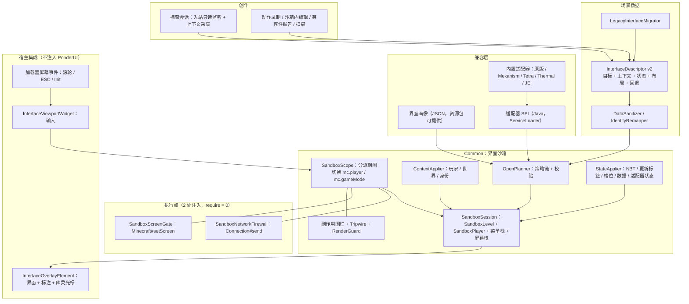

# Ponderer 界面型思索重构方案 v2：上下文完备的客户端界面沙箱

> 状态：提案 v2（Proposed）。本文自成一体，取代 `INTERFACE_PONDER_SANDBOX_PROPOSAL.md`（v1）；v1 保留作历史记录。  
> 基线：1.21.1 分支 `6488a955`（活动模块 `Common`、`NeoForge`、`Fabric`）；1.20.1 分支 `1141b04d`（`Common`、`Forge`、`Fabric`）。  
> 范围：`show_interface` / `change_interface_slot` / `click_interface` 的运行时、编辑器、捕获、JEI 集成与投影仪呈现。  
> 事实来源：本仓库代码；NeoForge 21.1.219 源码包（`NeoForge/build/moddev/artifacts/neoforge-21.1.219-sources.jar`）；`ref/1.21.1/Ponder`（含 Catnip）、`ref/1.21.1/Mekanism`（v1.21.1-10.7.19.85）、`ref/1.21.1/JustEnoughItems`；本地实例 `.minecraft/versions/1.20.1-Forge/mods` 中 tetra 6.12.0、thermal_expansion 11.0.1.29、thermal_core 11.0.6.24、cofh_core 11.0.2.56 的反编译结果；本地崩溃报告。  
> 未能核实：Tetra、Thermal 是否有 1.21.1 版本（联网检索失败，本地仅有 1.20.1 构建）。

---

## 0. 与 v1 的差异

v1 的方向（客户端本地沙箱、零服务端、单点网络隔离、覆盖层渲染）经 Mekanism、Tetra、Thermal 三个模组的源码核对后仍然成立，但它有两条核心假设不成立，并且低估了“玩家上下文”：

| v1 假设 | 实测 | v2 做法 |
| --- | --- | --- |
| 模组的客户端菜单工厂通过 `inv.player.level()` 找方块实体，所以只需切换 `mc.player` / `mc.gameMode` | 三个模组的方块菜单工厂都直接读 `Minecraft.getInstance().level`：Mekanism `MekanismContainerType.getTileFromBuf`（`:74-87`，找不到即抛 `IllegalStateException`）；Tetra `WorkbenchContainer.create`、`ForgedContainerMenu.create`；Thermal/CoFH 全部 37 个方块菜单经 `ProxyUtils.getClientWorld()`。`Minecraft.level` 类型为 `ClientLevel`，沙箱关卡换不进去 | **“提供者优先”打开管线**：用沙箱方块实体自己的 `MenuProvider#createMenu`（服务端式构造、全部客户端对象）作为首选通用策略；客户端工厂降为次选，并用“远端坐标 + 断言”保证它只能失败、不能误绑真实方块实体（第 7 节） |
| MenuProbe 是最低信任的探测策略，只读类型后丢弃 | 对 Tetra、Thermal、原版而言，方块实体的 `createMenu` 恰恰是最自然、完全只接触沙箱对象的构造路径；`EntityBlockCoFH` 未覆写 `getMenuProvider`（原版默认 null），所以必须直接探测方块实体 | 升格为正式策略 `Provider`，先探测方块实体本身，再探测 `BlockState#getMenuProvider` |
| 玩家上下文 = 观看者身份 + 背包 + 创造模式策略 | 实际依赖还包括：经验（Tetra 合成门槛、原版铁砧/附魔台）、主副手与选中槽（Tetra 工具腰带、CoFH 背包、Mekanism 物品菜单锁定选中槽）、盔甲/饰品（Mekanism 模块调整器、Tetra 腰带优先查 Curios）、位置（Mekanism 地震仪）、所有者身份（Mekanism 安全标签、CoFH 安全面板） | 新增**上下文模型**：玩家上下文、世界上下文、身份重映射（第 8 节） |
| 身份用观看者自己的 GameProfile，所有者判断“自然成立” | 只对作者本人成立；其他观看者看到“非所有者”视图，作者 UUID 和名字随场景包分发 | **身份重映射**：捕获时剥离作者身份，回放时按策略写入观看者身份（8.3） |
| “侧面配置”等是嵌套屏幕，由闸门接住 | Mekanism 侧面配置、升级、过滤器都是同屏 `GuiWindow`，不经过 `setScreen`；真正的独立子界面（数字矿机配置、QIO 频率、多方块统计页、CoFH 过滤器）都是“发 C2S 包 → 服务端 openMenu” | 子界面分两类处理；服务端打开的子界面由适配器在本地构造（14.3） |
| `set_interface_data` 通用可用 | Mekanism 覆写 `addDataSlot` 且不调 super，原版 `setData` 直接 `dataSlots.get(id)` 会越界；CoFH 的 `setData` 是空操作 | 数据槽写入加保护；模组自定义同步由适配器的 `captureState/applyState` 处理（第 9 节） |
| 残余风险“只影响显示” | 还有：客户端配置写盘（Mekanism 窗口位置）、静态单例（Tetra `HoloGui`、CoFH `PanelTracker`）、登记到真实世界的渲染（CoFH `onLoad` 区域效果）、真实聊天（`LocalPlayer#sendSystemMessage`）、作用域外延迟发包（Mekanism 便携传送器） | 新增**副作用围栏**与**窗口号污点**规则（6.6、6.4） |
| 仅考虑物品 `use` + 闸门 | Mekanism、CoFH 的物品界面和 Tetra 工具腰带在客户端 `use` 什么都不打开，全靠服务端 openMenu | 物品来源拆成 `item.screen` 与 `item.menu`（第 7 节） |

v2 同时把可声明的兼容信息从 Java 代码中剥离出来，引入**界面画像**（资源包可提供的 JSON），让多数模组无需写代码即可达到可交互保真（14.2）。

---

## 1. 结论

建议把界面型思索从当前的“服务端假玩家在真实世界打开 GUI → 转发数据包 → mixin 嵌入 PonderUI”的镜像架构，整体替换为**上下文完备的客户端界面沙箱**：

1. **零服务端**：界面、菜单、方块实体、玩家全部在客户端本地构造；删除 `sticksnapshot` 服务端链路与 7 个网络负载。原版服、插件服、未装 Ponderer 的服务器、单人暂停均可用。
2. **提供者优先的打开管线**：首选用沙箱方块实体自身的 `MenuProvider` 构造菜单。此时传入的是沙箱关卡（`isClientSide = true`）与沙箱玩家（`LocalPlayer`，不是 `ServerPlayer`），模组代码会自然走客户端分支；再依次回退到适配器、客户端工厂、裸菜单类型、示意图。三个典型模组的方块界面因此无需逐一适配即可构造。
3. **上下文完备**：描述符显式携带玩家上下文（游戏模式、能力、经验、手持与选中槽、背包/盔甲/副手、位置）、世界上下文（邻近方块、更新标签、实体）和身份策略；捕获时从真实世界读取、按隐私开关裁剪，回放时写入沙箱对象。
4. **彻底隔离**：隔离首先靠构造（沙箱对象与真实对象不共享实例、沙箱坐标位于真实客户端不可能加载的区域），其次靠作用域（仅在分派期间切换 `mc.player` / `mc.gameMode`），再次靠两个执行点（`Connection#send` 防火墙、`Minecraft#setScreen` 闸门），最后靠越界检测与副作用围栏；任何一层失效都降级为只读观看，不崩溃。
5. **真实物品**：界面里的物品是沙箱菜单中的真实 `ItemStack`，拾取、拆分、拖拽分配、Shift 快移、数字键交换、双击收集、丢弃全部走模组自己的 `clicked` 客户端预测；物品只存在于沙箱，没有任何通往真实背包的通道。
6. **更少的脆弱点**：界面功能只保留 2 处注入，均为原版稳定方法、`require = 0`、带存活证明；不需要访问器 mixin（NeoForge/Forge 有公开的 `getGuiLeft/getGuiTop/getXSize/getYSize`，Fabric 用编译期 access widener）；删除全部私有名反射与对 JEI 内部类的注入。

| 指标 | 现状（1.21.1） | v2 |
| --- | --- | --- |
| 服务端组件 | 7 个负载 + 假玩家 + 真实世界放方块 | 无 |
| 界面相关 mixin 注入点 | 27 处（`AbstractContainerScreen` 14、`PonderUI` 7、JEI 内部类 5、`Minecraft#setScreen` 1）+ 5 个访问器 | 2 处（`Connection#send`、`Minecraft#setScreen`），0 个访问器 |
| 依赖私有名的反射 | ≥ 8 处 | 0 |
| Fabric | 不支持 | 支持 |
| 槽位物品 | 镜像只读 + JEI 图标覆盖 | 真实 `ItemStack`，可拖动 |
| Mekanism / Tetra / Thermal 方块界面 | 依赖服务端镜像；在真实世界放方块 | 通用策略即可构造（见 14.5 兼容矩阵） |

---

## 2. 现状与已核实问题（摘要）

当前链路：`ShowInterfaceInstruction` → 客户端发 `SaveSnapshotPacket` + `ReplaySnapshotPacket` → 服务端在**真实 `ServerLevel`** 的沙箱坐标放置方块与方块实体 → 假玩家 `useWithoutItem` 打开界面并抓取发给它的数据包 → 还原方块 → 转发给真实玩家 → 客户端在**真实 `ClientLevel`** 注入方块、把 `mc.player.containerMenu` 换成镜像菜单 → 一组 mixin 把界面嵌进 PonderUI。

| 编号 | 严重度 | 问题 | 证据 |
| --- | --- | --- | --- |
| S1 | 严重 | 在真实世界写方块并强制加载远处区块（每玩家一片，x、z ∈ [2,000,000, 2,524,256]） | `SnapshotReplayer.java:61-117`；`ReplaySessionManager.java:30-38` |
| S2 | 严重 | 还原方块触发 `onRemove`，容器内容物掉落到真实世界；NBT 可由客户端任意填写 → 刷物品 | `ReplaySessionManager.java:58-68`；NeoForge `LevelChunk#setBlockState`、`ChestBlock#onRemove` |
| S3 | 严重 | `injectReferencedContextBlocks` 复制 NBT 引用坐标处的真实方块（含完整 NBT）再还原；`decodeNeoForgeOpenPacket` 读取真实 BE 完整 NBT 发给客户端 | `SnapshotReplayer.java:315-373, 577-586` |
| S4 | 高 | 负载无权限、无限频；任意方块状态由假玩家在真实世界 `useWithoutItem`；快照写入玩家存档 | `NeoForgeNetworkHelper.java:79-96`；`SnapshotStorage.java:14-20` |
| S5 | 高 | 抓到的数据包原样转发，含 -1/-2/0 容器号 | `SnapshotReplayer.java:512-557` |
| S6 | 高 | 额外数据菜单容器号恒为 1，镜像点击可串到真实容器 1 | `SnapshotReplayer.java:464-467`；`ServerPlayer.java:1137-1138` |
| C1 | 高 | 替换真实 `containerMenu`；嵌入屏幕 `onClose` 发真实关闭包并关掉 PonderUI | `ClientInputHandler.java:187-197, 404-414` |
| C2 | 中 | 在真实 `ClientLevel` 写快照方块（1.20.1 分支 `MirrorForgeOpenClient.java:117-140` 同样如此——这也是现有实现能构造 Mekanism/Tetra/Thermal 界面的真正原因） | `MirrorNeoForgeOpenClient.java:117-148` |
| C3 | 高 | `held_item` 以真实玩家、真实世界调用 `stack.use` | `NeoForgeShowInterfaceClient.java:120-152` |
| K1 | 严重 | `JeiGuiEventHandlerMixin` 的 `@Group(min = 1)` 已两次导致启动崩溃 | `crash-2026-07-29_10.44.29-client.txt`、`crash-2026-09-01_21.27.24-client.txt` |
| K2–K7 | 高～低 | `AbstractContainerScreen` 14 处注入并按类名硬编码 Mekanism 特例（整体抬高 z=400，`EmbeddedMirrorContainerScreenMixin.java:34-52, 219-223`）；跨 mixin 的 pose 栈约定；私有名反射；依赖服务端往返的“自动重放”；构建期锚点回退 176×166；死代码与 `whileSneaking` 字段误用 | v1 第 2.2 节 |

---

## 3. 三个典型模组的实测结论

| 维度 | Mekanism（1.21.1 源码） | Tetra（1.20.1 反编译） | Thermal / CoFH（1.20.1 反编译） |
| --- | --- | --- | --- |
| 方块菜单客户端工厂 | `WorldUtils.getTileEntity(type, Minecraft.getInstance().level, pos)`，且先检查区块已加载；找不到抛异常 | `(WorkbenchTile) Minecraft.level.getBlockEntity(pos)`，锻造容器同 | `new XMenu(id, ProxyUtils.getClientWorld(), pos, inv, ProxyUtils.getClientPlayer())`，菜单构造函数强转后直接解引用 |
| 服务端式构造 | 方块实体不实现 `MenuProvider`；公开 API：`Attribute.get(block, AttributeGui.class).getProvider(tile, false)`、`MekanismContainerType.create(int, Inventory, Object)` | `WorkbenchTile`、`ForgedContainerBlockEntity` 实现 `MenuProvider`，`createMenu` 用 `this` 构造 | 方块实体实现 `MenuProvider`，`createMenu` 用自身关卡与坐标；`ServerPlayer` 强转都在 `isServerWorld` 分支内 |
| 界面同步 | 自定义 `PacketUpdateContainer(List<PropertyData>)`；公开回写入口 `PropertyData.handleWindowProperty`；原版 `setData` 会越界 | 全在方块实体 NBT 与静态 DataManager，无数据槽 | 自定义 `TileGuiPacket`；可见数值几乎都在 `saveAdditional` 中，载入完整 NBT 即“正确但静止”；`setData` 为空操作 |
| 玩家上下文 | 安全标签比 UUID、主人名来自更新标签/静态缓存；物品菜单锁定选中槽；模块调整器槽位即盔甲/快捷栏/副手；地震仪扫描玩家脚下 | 背包材料、工具等级（背包 + 腰带，优先 Curios）、经验与创造（`isCreative() \|\| experienceLevel >= cost`）；腰带工厂找不到腰带即抛 `ClassCastException` | 安全面板比 UUID；背包只认主/副手并锁定选中槽 |
| 世界上下文 | 多方块成型状态只来自更新标签，成型只在服务端 tick | 工作台扫描 5×5×5（锻锤头须在正上方、锤座有燃料与模块；卷轴须在台上） | 设备有效性由服务端计算，界面只显示结果 |
| 子界面 | 侧面配置、升级、过滤器是同屏 `GuiWindow`；数字矿机配置、QIO 频率、多方块统计、反应堆页、Robit 子页由服务端打开 | 全息球快捷入口关闭时经静态 `ClientScheduler` 在作用域外 `setScreen(宿主)` | 过滤器子界面由服务端打开 |
| 客户端预测 | 窗口点击发包即丢，等于只读 | 选槽、选原理图、合成、微调都先在客户端执行 | 侧面配置、增强、合成器配方先行；红石/自动输入输出/权限“先改后回滚” |
| 副作用 | 关窗口写 `MekanismConfig.client` 到磁盘；便携传送器延迟 > 0 时在作用域外发包 | `HoloGui` 静态单例串状态 | `onLoad` 把区域效果方块登记进静态集合并在真实世界画框；`PanelTracker` 静态 |
| 物品界面 | 客户端 `use` 不打开任何界面 | 全息球、卷轴在客户端 `setScreen`；腰带靠服务端 | 背包仅对 `ServerPlayer` 打开 |

**结论**：只切换 `player/gameMode` + 客户端工厂的 v1 设计，对这三个模组的方块界面全部构造失败；要“自然兼容”，打开管线必须以沙箱方块实体的 `MenuProvider` 为主，并且必须有完整的上下文模型。

---

## 4. 目标、非目标与原则

### 4.1 目标

1. **兼容性**：通用策略覆盖“方块实体即菜单提供者”的绝大多数模组界面；不需要服务端；NeoForge、Forge、Fabric 同等支持；界面功能只有 2 处原版稳定注入且可降级；无私有名反射；模组特有需求优先用声明式画像表达。
2. **安全性**：满足第 15 节隔离契约 I1–I10——不发送服务端数据包、不写任何真实关卡、不把真实玩家交给模组代码、不改变真实玩家的背包/菜单/光标物品/经验/能力、不泄露作者身份；场景数据按不可信输入处理。
3. **体验**：真实可拖动物品；观看/试玩/练习/作者四种模式；上下文自动满足（经验、手持物、邻近方块）；语义化脚本动作与幽灵光标；运行期锚点；一键从世界捕获；沙箱内直接编辑；动作录制；JEI 查配方与拖入；可解释的降级。
4. **可维护性**：时间线确定（跳转 = 从 0 重放，不经网络）；核心在 `Common/` 且可单元测试；模组兼容逻辑与核心解耦。

### 4.2 非目标

- 不在客户端重现依赖服务端的**完整**行为（机器加工、AE2 网络库存、Mekanism 频率网络）。这类界面以“快照保真”呈现，可由适配器补齐。
- 不录制、不通用回放模组的 S2C 自定义负载（处理器常 `enqueueWork` 到作用域外，且负载字节属于不可信输入）。适配器可以把自己认识的负载**解码为结构化状态**，再在作用域内通过容器 API 回写（第 9 节）。
- 不提供任何沙箱物品转入真实背包的通道。
- 不做长时间的全局替换（例如整个 PonderUI 期间替换 `mc.player`）。
- 不捕获/嵌入 HUD 覆盖层（Tetra 腰带轮盘、扫描器等不是 `Screen`）。

### 4.3 设计原则

1. 客户端本地，零服务端。
2. **构造即隔离**：沙箱中每个对象都是新建的；真实对象只以“只读快照源”的身份出现在捕获阶段。
3. **提供者优先**：让模组用它自己构造菜单的方式构造，只是传入的全是沙箱对象。
4. **显式上下文**：界面依赖什么，描述符就写明什么；缺失的上下文可解释、可提示。
5. **声明优先于代码，公共 API 优先于 mixin**；mixin 只放在原版稳定方法上，`require = 0`，有存活证明。
6. **确定性**：会话状态 = 描述符 + 已执行的步骤。
7. **分级降级**：每个界面都有明确的保真等级与回退形态；异常只影响该会话。
8. **场景数据不可信**：限额、净化、身份剥离、异常隔离。

---

## 5. 总体架构



| 组件 | 职责 | 位置 |
| --- | --- | --- |
| `InterfaceDescriptor` | 版本化描述：目标、菜单类型、extraData、上下文、状态、布局、交互策略、回退 | `Common/.../interfaces/model` |
| `LegacyInterfaceMigrator` | v1 字段 → v2（纯函数，单元测试） | 同上 |
| `DataSanitizer` / `IdentityRemapper` | 限额、点击事件净化、`LootTable` 删除、作者身份剥离与回放写入 | 同上 |
| `InterfaceProfileRegistry` | 加载界面画像 JSON，按菜单类型/屏幕类/方块匹配 | `.../interfaces/compat` |
| `InterfaceSandboxAdapter` | Java SPI | 同上 |
| `OpenPlanner` | 按目标类型和画像生成策略链，逐个尝试并校验 | `.../interfaces/sandbox` |
| `SandboxLevel` | 继承 Catnip `SchematicLevel`；远端坐标；方块实体生命周期规则 | 同上 |
| `SandboxPlayer` | 继承 `LocalPlayer`；覆写关闭、丢弃、消息、游戏模式等 | 同上 |
| `SandboxSession` | 持有关卡、玩家、`gameMode`、菜单栈、屏幕栈、保真等级、审计；所有调用经 `dispatch` | 同上 |
| `SandboxScope` | 分派期间切换 `Minecraft.player/gameMode`，出作用域还原并执行检测 | 同上 |
| `ContextApplier` / `StateApplier` | 写入上下文与状态，顺序见第 9 节 | 同上 |
| `SideEffectFence` / `SandboxTripwire` / `RenderGuard` | 副作用登记与恢复、不变式校验、渲染异常隔离 | 同上 |
| `InterfaceOverlayElement` / `InterfaceViewportWidget` | 渲染与输入 | `.../interfaces/host` |
| 指令 | `ShowInterface`、`SetInterfaceSlots`、`SetInterfaceData`、`InterfaceAction`、`HideInterface`、`AwaitInterface` | `.../interfaces/instruction` |
| 创作工具 | 捕获、上下文面板、沙箱内编辑、动作录制、兼容性报告/扫描 | `.../interfaces/authoring` |
| `InterfaceSandboxPlatform` | 加载器差异：菜单/屏幕工厂、输入事件、开屏数据解析 | Common 接口 + 各加载器实现 |

---

## 6. 沙箱运行时

### 6.1 沙箱关卡 `SandboxLevel`

- 继承 Catnip `SchematicLevel`（Ponder 的公共依赖，两个加载器都有）。它继承自 `WrappedLevel extends Level`，`isClientSide` 取自真实关卡（为 true），`getEntity(int)`、`getEntities*`、`players()` 为空，方块实体存于映射且**不会被 tick**，也**不会调用 `onLoad`**（`SchematicLevel.java:91-117` 仅 `setLevel`）。
- **远端坐标**：所有沙箱方块放在“沙箱原点”附近，原点取远离真实玩家、真实客户端不可能加载的区块（候选如 x = z = 29,000,000 附近，但仍在 `isInWorldBounds` 内）。会话创建时断言真实客户端未加载该区块（`mc.level.getChunkSource().hasChunk(cx, cz) == false`），否则换下一个候选。作用：任何仍然读 `Minecraft.level` 的代码在该坐标只能得到空结果——Mekanism 的查找会先判区块未加载而返回 null，其余得到 null 或空气——**只会失败，不会绑到真实方块实体**；对该坐标的 `mc.level.setBlock` 落在空区块上，是空操作。
- `scene_block` 目标：把场景 `PonderLevel` 中所需方块（含方块实体，经 NBT 保存/载入）**复制**进沙箱关卡的远端坐标，而不是直接使用场景关卡。这样场景坐标（原点附近、真实世界里很可能已加载）不会暴露给读 `mc.level` 的代码，试玩中的交互也不会改动场景画面。
- **方块实体生命周期规则**（I10）：沙箱方块实体只经历“构造 → `setLevel(sandbox)` → 载入 NBT → 可选 `handleUpdateTag`”。**绝不**调用 `onLoad`、`clearRemoved`、`setRemoved`、`tick`，**绝不**触发 `neighborChanged`、`onPlace`、`setPlacedBy`。会话销毁时只丢弃引用。依据：CoFH `BlockEntityCoFH#onLoad` 会把区域效果方块登记到静态集合并在真实世界绘制；Thermal 造水机在邻居更新时会清空储罐；Mekanism `setRemoved` 在客户端会调用声音更新。
- 声音与粒子：`WrappedLevel` 的 `playSound` 系列为空操作；模组直接向 `mc.level` 加粒子只产生视觉效果（残余风险，15.6）。

### 6.2 沙箱玩家 `SandboxPlayer extends LocalPlayer`

构造：`new SandboxPlayer(mc, realClientLevel, realListener, new StatsCounter(), recipeBookCopy, false, false)`，随后 `setLevel(sandboxLevel)`，并按玩家上下文设置位置、朝向、背包、经验、能力。

- **不新建 `ClientPacketListener`**：Fabric API 在其构造函数末尾注入并设置全局 `ClientNetworkingImpl` addon（`fabric-networking-api-v1-4.2.2` 的 `ClientPlayNetworkHandlerMixin.java:44-49`），新建实例会篡改真实连接的网络状态。
- **已知的构造约束**：`LocalPlayer` 构造函数用 `connection.getLocalGameProfile()`，因此沙箱玩家的 GameProfile/UUID **必然**是观看者本人（`LocalPlayer.java:171`）；`AbstractClientPlayer.clientLevel` 是 final 字段，始终指向真实关卡（`AbstractClientPlayer.java:28`）。身份问题因此不在玩家对象上解决，而在数据上解决（8.3）。
- **从不加入任何关卡的实体列表**，不被 tick。

| 覆写 | 行为 | 原因 |
| --- | --- | --- |
| `closeContainer()`、`clientSideCloseContainer()` | 转为会话关闭请求；不发包、不 `setScreen` | 原版关闭会发 `ServerboundContainerClosePacket` 并 `setScreen(null)` |
| `drop(boolean)`（`LocalPlayer`）、`drop(ItemStack, boolean)` 与 `drop(ItemStack, boolean, boolean)`（`Player`） | 物品退回沙箱背包；无空位时暂存到会话“溢出区” | 原版前者发丢弃包，后两者生成物品实体 |
| `sendSystemMessage`、`displayClientMessage` | 转为会话提示条 | 原版 `LocalPlayer#sendSystemMessage` 直接写真实聊天栏（`LocalPlayer.java:504-505`） |
| `isCreative()`、`isSpectator()` | 由玩家上下文的 `gameMode` 决定 | 默认实现经真实连接的 `PlayerInfo` 读取真实游戏模式 |
| `getAbilities()` | 构造时按上下文设置 `instabuild`、`mayBuild` 等 | 原版铁砧、附魔台读 `getAbilities().instabuild` |
| `hasPermissions(int)`（`Entity`） | 返回 false | 避免模组显示仅管理员可用的功能；它们发出的包无论如何会被拦截 |
| `tick()`、`aiStep()` | 空 | 沙箱玩家不参与世界模拟 |

- 背包：独立 `Inventory`，按上下文填充；`selected` 按上下文设置。
- 配方书：真实配方书的**单向拷贝**（`ClientRecipeBook#copyOverData`），使配方书按钮显示观看者熟悉的解锁状态；也可由上下文指定“全部解锁”。
- 统计：新的空 `StatsCounter`。
- `containerMenu`：沙箱会话的当前菜单。原版点击链路是 `AbstractContainerScreen#slotClicked → mc.gameMode.handleInventoryMouseClick(containerId, …, mc.player)`，后者会比对 `player.containerMenu.containerId` 再调用 `menu.clicked`，所以沙箱玩家的 `containerMenu` 必须指向会话菜单，窗口号一致。

**沙箱窗口号**：取 101–127。原版服务端计数器为 `containerCounter % 100 + 1`，只在 1–100 之间循环（`ServerPlayer.java:1137-1138`）；点击包、关闭包、数据包的容器号按单字节编码（`ServerboundContainerClickPacket`、`ServerboundContainerClosePacket`、`ClientboundContainerSetDataPacket` 的 `writeByte`）。101–127 在单字节编码下仍为正数且与真实窗口号不相交，因此可作为“污点标记”（6.4）。

**沙箱 `gameMode`**：`new MultiPlayerGameMode(mc, realListener)`；`setLocalMode(...)` 会读 `mc.player` 的能力，因此在作用域内调用。它发出的所有包都会进入防火墙。

### 6.3 作用域 `SandboxScope`

- 所有对嵌入屏幕与沙箱菜单的调用——`init`、`render`、`tick`、输入、脚本动作、状态写入、`removed`——都经 `session.dispatch(phase, call, fallback)`。
- 进入作用域时切换 `Minecraft.player`、`Minecraft.gameMode`（均为公共字段，`Minecraft.java:340-344`）；可选（画像开启）同时把 `mc.hitResult` 设为指向沙箱目标方块的命中结果；`finally` 中全部还原，然后执行越界检测（6.7）。
- 只在渲染线程进入；可重入（深度计数）；同一时刻只有一个活动会话。
- **不切换**：`mc.level`（类型为 `ClientLevel`，沙箱关卡换不进去；另建 `ClientLevel` 会广播 `LevelEvent.Load`，`ClientLevel.java:203`，对所有模组可见）、`mc.screen`（宿主 PonderUI）、`mc.getConnection()`（即 `player.connection`，为真实监听器，发出的包由防火墙拦截）。打开管线不依赖 `mc.level`（第 7 节），因此不切换它是安全的。
- 作用域内不运行网络任务：真实服务器的包在 `Minecraft#runTick` 的任务队列中处理，不会嵌套在屏幕调用里。

### 6.4 网络防火墙 `SandboxNetworkFirewallMixin`

- 注入 `Connection#send(Packet, PacketSendListener, boolean)` 头部（其余重载都汇入这里），`cancellable = true`、`require = 0`。
- **规则 1（作用域）**：`SandboxScope.isActive()` 且在渲染线程 → 交给会话（审计、动作录制、适配器 `onOutbound`），取消发送。覆盖原版点击/按钮/关闭/丢弃、NeoForge `PacketDistributor.sendToServer`、Fabric `ClientPlayNetworking.send`、CoFH `IPacketServer`（经 `getConnection().send`）、命令。集成服务器的服务端连接在服务端线程发送，不受影响。
- **规则 2（窗口号污点）**：在作用域**之外**，任何原版容器类包（点击、按钮、关闭、配方放置、槽位状态变化）若容器号落在 101–127，一律丢弃并记录。用于兜住模组把沙箱菜单相关操作延迟到作用域外执行的情况。
- **规则 3（会话封存）**：会话销毁后 N 个客户端 tick（默认 40）内，规则 2 继续生效。
- **存活证明**：注入代码每次执行都置位静态标志；进入试玩前要求已置位，否则会话只允许观看（T1）。
- **已知盲区**：模组在作用域外发送、且不带沙箱窗口号的自定义负载（例：Mekanism 便携传送器在延迟 > 0 时由 `ClientTickHandler` 在后续 tick 发 `PacketPortableTeleporterTeleport`，`ClientTickHandler.java:135-143, 195-208`）。对策：内置适配器禁止回放会触发此类路径的状态（“就绪”），画像可声明 `forbidStates`；列入残余风险。

### 6.5 屏幕闸门 `SandboxScreenGateMixin`

由现有 `MinecraftSetScreenCaptureMixin` 泛化，注入 `Minecraft#setScreen` 头部，`require = 0`，只在作用域内生效：

- `setScreen(null)`：会话关闭请求（试玩模式退出试玩；观看模式忽略）。
- `setScreen(x)`：压入会话屏幕栈（例如全息球的子页面、模组以独立 `Screen` 实现的客户端子界面）。`ChatScreen`、`PauseScreen`、`ConfirmLinkScreen`、`ConfirmScreen`、`DisconnectedScreen`、`ReceivingLevelScreen` 等拒绝并提示。
- 同时承担创作期的物品屏幕捕获（`item.screen`）。
- NeoForge 在闸门失效时以 `ScreenEvent.Opening` 兜底拦截打开；关闭无法兜底，因此闸门不存活时只允许观看。

### 6.6 副作用围栏 `SideEffectFence`

模组界面代码的部分副作用无法通过作用域消除，统一在此登记与处理：

| 副作用 | 处理 |
| --- | --- |
| 真实聊天消息 | 沙箱玩家覆写（6.2） |
| 静态单例/静态缓存被沙箱写入（Tetra `HoloGui.instance`、CoFH `PanelTracker`、Mekanism `ClientTickHandler.portableTeleports`） | 适配器声明 `statics`：进入会话前快照、销毁后恢复；或使用独立实例（Tetra 全息球见 14.4） |
| 客户端配置写盘（Mekanism 关闭窗口时保存 `lastWindowPositions`，`GuiWindow.java:222-232`、`SelectedWindowData.java:84`） | 默认接受（只是窗口位置偏好）；Mekanism 适配器可在销毁前恢复原值 |
| 登记到真实世界的渲染（CoFH 区域效果） | 由 6.1 生命周期规则杜绝 |
| 作用域外延迟任务（Tetra 全息球快捷入口经 `ClientScheduler` 回到宿主） | 适配器清除回调；闸门之外的 `setScreen(宿主)` 在会话封存期内被忽略（宿主已是当前屏幕时为无害重入） |
| 声音 | 允许 UI 声音（按钮点击等），属于期望反馈 |

### 6.7 越界检测 `SandboxTripwire`

进入作用域时记录，离开时校验：

- 真实玩家 `containerMenu` 的同一性与 `stateId`、背包 `getTimesChanged`、光标物品、经验等级、能力；
- `mc.screen` 同一性（仍为宿主）；
- 真实连接本次作用域内的泄漏计数为 0。

违规时记录详情，本会话降级为 T1，该菜单类型在本次游戏会话内禁用交互；不抛出。

---

## 7. 打开管线 `OpenPlanner`

### 7.1 策略

| 代号 | 策略 | 做法 | 适用 |
| --- | --- | --- | --- |
| A | 适配器 | `adapter.openMenu(ctx)` / `adapter.openScreen(ctx)` | 有内置或第三方适配器的界面 |
| P | 提供者 | 作用域内：若沙箱方块实体 `instanceof MenuProvider` → `createMenu(id, sandboxInv, sandboxPlayer)`；否则 `state.getMenuProvider(sandboxLevel, pos)`（原版 `BaseEntityBlock` 默认返回方块实体，`BaseEntityBlock.java:42-45`）；实体目标同理探测实体 | 原版全部方块容器、Tetra、Thermal/CoFH 及大多数“方块实体即菜单提供者”的模组 |
| F | 客户端工厂 | `menuType.create(id, inv, extraData)`（NeoForge `IMenuTypeExtension` / Forge `IForgeMenuType` / Fabric `ExtendedScreenHandlerType`），extraData 中的方块坐标改写到沙箱远端坐标 | 物品菜单（extraData 自带全部数据，如 Mekanism 便携 QIO 的 `BulkQIOData`）、不查关卡的额外数据菜单；对读 `mc.level` 的工厂必然安全失败 |
| B | 裸菜单类型 | `menuType.create(id, inv)` | 无上下文的原版菜单（工作台、铁砧、砂轮、切石机、织布机、制图台、锻造台） |
| S | 客户端屏幕 | 作用域内 `stack.use(sandboxLevel, sandboxPlayer, hand)` + 闸门捕获 | 无菜单的物品屏幕（Tetra 全息球、卷轴、书类） |
| T0 | 示意 | 按捕获的槽位几何绘制通用面板 + 真实物品图标；有截图显示截图 | 全部失败或缺少模组 |

**为什么 P 是安全且自然的**：P 是“服务端式”的构造路径，但传入的关卡 `isClientSide = true`、玩家是 `LocalPlayer`。模组中常见的服务端分支判断（`level.isClientSide`、`player instanceof ServerPlayer`、`isServerWorld`）都会走客户端分支。例：CoFH 的 `broadcastChanges` 只对 `ServerPlayer` 发包；Thermal 合成器的 `ServerPlayer` 强转在 `isServerWorld` 分支里；Mekanism 容器以 `inv.player.level().isClientSide()` 判断客户端模式。P 构造出的菜单与客户端工厂构造出的是同一个类（Tetra、Thermal、Mekanism、原版均如此），可直接交给 `MenuScreens` 的屏幕构造器。模组如果需要客户端专用的菜单类，屏幕构造时会抛 `ClassCastException`，此时自动进入下一策略。

### 7.2 按目标类型的默认链

| 目标 | 链 |
| --- | --- |
| `block` / `scene_block` | A → P → F → T0 |
| `item.menu` | A → F（先按上下文把物品放进指定手与选中槽）→ T0 |
| `item.screen` | A → S → T0 |
| `menu`（无上下文） | A → B → T0 |
| `entity` | A → P（实体 `instanceof MenuProvider`）→ T0 |

画像可以覆写链的顺序或禁用某个策略。

### 7.3 每一步之后的校验

1. 菜单类型等于描述符记录的 `menuType`（有记录时）；
2. 槽位数量不少于捕获记录，且捕获的槽位几何（`slot.x/y`）逐一吻合（不吻合的槽位写入被跳过并记录）；
3. `MenuScreens` 屏幕构造成功；`init` 与第一帧渲染在 `RenderGuard` 下无异常；
4. 越界检测未触发。

任一失败即释放该策略的产物（在作用域内 `removed`，然后丢弃），尝试下一策略。实际生效的策略与耗时写入兼容性报告；作者保存时把 `resolvedStrategy` 写回描述符作为提示（运行时仍会重新校验）。

### 7.4 子界面

| 类型 | 例子 | 处理 |
| --- | --- | --- |
| 同屏窗口 | Mekanism 侧面配置、升级、过滤器 `GuiWindow` | 自然工作；内部点击发出的包被拦截。凡“先在客户端改状态再发包”的都能看到效果（CoFH 侧面配置）；只发包的在无适配器时为只读 |
| 客户端独立 `Screen` | Tetra 全息球子页 | 闸门压入会话屏幕栈；ESC 或“返回”弹栈 |
| 服务端打开的独立菜单 | Mekanism 数字矿机配置、QIO 频率、多方块统计页、反应堆页；CoFH 过滤器 | 适配器 `onOutbound` 识别对应 C2S 包，返回 `OpenLocal`：在本地用 P 或 F 构造子菜单，压入会话菜单栈与屏幕栈；无适配器时按钮为无效点击，兼容性报告列出 |

---

## 8. 上下文模型

### 8.1 玩家上下文

```json
"player": {
  "identity": "viewer_owner",
  "gameMode": "survival",
  "abilities": { "instabuild": false },
  "xp": { "level": 30, "progress": 0.0 },
  "selectedSlot": 0,
  "inventory": {
    "mode": "preset",
    "items":   [ { "slot": 0, "item": { "id": "tetra:modular_sword", "count": 1, "components": { } } } ],
    "armor":   [ { "slot": "chest", "item": { "id": "mekanism:mekasuit_bodyarmor", "count": 1 } } ],
    "offhand": null
  },
  "extra": { "curios": { "belt": [ { "id": "tetra:modular_toolbelt", "count": 1 } ] } },
  "pose": { "offset": [0.5, 0.0, -1.5], "yaw": 0.0, "pitch": 30.0, "sneaking": false }
}
```

- `identity`：见 8.3。
- `gameMode` 与 `abilities`：驱动沙箱玩家的 `isCreative/isSpectator` 与能力；默认生存。
- `xp`：Tetra 合成、原版铁砧/附魔台等依赖经验的界面需要它；捕获时可一键“记录当前经验”，也可手填。
- `selectedSlot` 与 `inventory`：`mode` 为 `empty`、`preset`、`copy_real`（打开时对真实背包做一次**单向**拷贝，仅在观看者本地生效，默认关闭）。`item.menu` 目标会自动把目标物品放进 `selectedSlot` 或副手，满足 Mekanism/CoFH“锁定选中槽”、Tetra“主手→副手→背包”的查找顺序。
- `extra`：由适配器解释的扩展上下文，例如 Curios 饰品（沙箱玩家的饰品能力默认为空；Tetra 适配器在无法注入饰品时，把腰带放进背包，因为 `ToolbeltHelper` 在非 `toolbeltCurioOnly` 配置下也会查背包）。
- `pose`：沙箱玩家相对目标方块的位置与朝向。Mekanism 地震仪扫描“玩家脚下”，因此位置要落在沙箱关卡中有意义的地方。

### 8.2 世界上下文

```json
"context": {
  "blocks": [
    { "pos": [0, 1, 0], "block": "tetra:hammer_head", "properties": { }, "nbt": "{...}" },
    { "pos": [0, 2, 0], "block": "tetra:hammer_base", "properties": { }, "nbt": "{...}" }
  ],
  "updateTag": "{...}",
  "entities": [ ]
}
```

- `blocks`：目标周围的邻接方块与方块实体（坐标相对目标）。捕获时按半径采集（默认 0，画像可声明，如 Tetra 工作台 `radius: 2, up: 4`），作者可在面板中逐个剔除。
- `updateTag`：目标方块实体的更新标签，回放时在 NBT 载入之后调用 `handleUpdateTag`。Mekanism 多方块的成型状态（`HAS_STRUCTURE`、`RENDERING`）只存在于更新标签（`TileEntityMultiblock.java:264-280`），而成型只在服务端 tick 中发生，所以这是让多方块界面显示“已成型”的唯一途径。捕获时直接在客户端对真实方块实体调用 `getUpdateTag(registries)` 即可，不需要服务端。
- `entities`：实体界面（马、村民、Robit）所需实体的 NBT，由适配器在沙箱中构造（阶段 4）。
- 任何情况下**都不从真实世界复制**上下文到回放端；上下文只来自描述符。

### 8.3 身份重映射

问题：许多界面比对“当前玩家 UUID”与方块实体 NBT 中的所有者（Mekanism `ownerMatches(minecraft.player)`、`OwnerDisplay`；CoFH `SecurityHelper.getID` 与 `Security{SecUUID, SecName, SecAccess}`）。沙箱玩家的 UUID 必然是观看者本人，而 NBT 里是作者的 UUID。

方案：

1. **捕获时**：`IdentityRemapper` 在方块实体 NBT、更新标签、物品组件、上下文方块中扫描作者 UUID 的三种编码（`int[4]`、字符串、`xxxMost/xxxLeast` 长整型对）与作者名字的精确匹配，把它们替换为零 UUID / 空名字，并记录路径与编码：`"identitySlots": [ { "path": "Security.SecUUID", "encoding": "int_array", "role": "owner" }, { "path": "Security.SecName", "encoding": "name", "role": "owner" } ]`。**作者身份从此不随场景包分发。**
2. **回放时**按 `player.identity` 写入：
   - `viewer_owner`（默认）：写入观看者自己的 UUID 与名字，所有者视图对任何观看者成立；
   - `viewer_guest`：写入固定的“演示主人”UUID 与本地化名字（如“演示者”），用于演示“非所有者看到什么”；
   - `unowned`：清空所有者字段。
3. 适配器可声明额外的身份字段（例如在组件或自定义结构中）。

### 8.4 上下文需求的发现与提示

- 画像声明 `requires`（如 `["xp", "hand:main", "inventory", "context.blocks"]`），编辑器在描述符缺少对应上下文时给出提示与一键填充。
- 捕获时按画像自动采集所需上下文（经验、手持物、半径内方块）。
- 运行时，缺失的上下文不会阻止打开；兼容性报告与作者模式徽标会显示“此界面需要经验 ≥ 30，当前演示经验为 0”等可解释信息。

---

## 9. 状态管线

会话打开时的写入顺序（全部在作用域内）：

1. 放置目标方块与上下文方块；目标方块实体由 `BlockEntity.loadStatic(pos, state, 净化后的 NBT, registries)` 构造（身份槽位已按 8.3 写入）；
2. `handleUpdateTag(updateTag)`（有记录时）；
3. 设置沙箱玩家上下文（8.1）；
4. 执行打开管线（第 7 节），设置 `sandboxPlayer.containerMenu`；
5. 写入槽位快照：`menu.initializeContents(stateId, items, carried)`，等价于收到 `ClientboundContainerSetContentPacket`；
6. 写入原版数据槽：逐个 `menu.setData(id, value)`，**每次写入单独保护**（越界或异常只跳过该项并记录）——Mekanism 的 `addDataSlot` 覆写导致原版 `dataSlots` 为空，CoFH 的 `setData` 为空操作；
7. `adapter.applyState(ctx, menu, state)`：适配器把捕获时解码出的结构化状态写回（例：Mekanism 用 `PropertyData.handleWindowProperty` 写入 `PacketUpdateContainer` 中的属性）；
8. 构造屏幕并 `init`；
9. **二次写入**（画像 `reapplyAfterInit: true` 时）：屏幕 `init` 之后再次写入槽位快照，触发方块实体变更监听。Tetra 工作台只有在方块实体监听置脏后才刷新界面，状态若先于屏幕构造写入，界面会保持为空。

脚本步骤复用同一套写入口：`set_interface_slots` 写槽位差量；`set_interface_data` 写数据槽（可插值）；适配器可注册自定义状态步骤。会话记录已执行的操作日志；“重置”等于重建会话并重放日志，不需要改动 Ponder 时间线。

**捕获期的状态来源**（第 16 节）：

| 状态 | 来源 |
| --- | --- |
| 槽位内容、光标物品 | 真实客户端菜单的 `getItems()`、`getCarried()` |
| 原版数据槽 | 入站只读监听记录到的 `ClientboundContainerSetDataPacket`（按真实窗口号过滤）——不需要访问器 |
| 方块实体 NBT | 受权限的 `CaptureBlockEntityNbtRequestPayload`（服务端完整存档 NBT，需 `canUpload`、6 格内、准星对准）；拿不到时退回客户端方块实体本地序列化 |
| 更新标签 | 客户端方块实体 `getUpdateTag` |
| 模组自定义同步 | 适配器在捕获期声明要监听的 S2C 负载类型；入站监听把解码后的负载对象交给适配器，适配器转为结构化 `adapterState` 存入描述符。核心不保存、也不回放负载字节 |

---

## 10. 渲染

**在 Ponder 覆盖层通道渲染**：`InterfaceOverlayElement` 继承 Ponder 公开的 `AnimatedOverlayElementBase`，由 `PonderUI#renderSceneOverlay` 调用（`PonderScene.java:283-287`，`PonderUI.java:922-932`）。每帧：

1. `graphics.flush()`，清深度缓冲；
2. pose 的 z 平移归零到基线，施加布局变换（居中、必要时等比缩放、入场动画）；
3. 作用域内 `screen.render(graphics, localMouseX, localMouseY, pt)`，外包 `RenderGuard`；
4. 再次 `flush()`，绘制界面标注、上下文徽标与幽灵光标；
5. 清深度缓冲，恢复混合、深度、着色器颜色、剪裁。

要点：

- **绘制顺序**：Ponder 元素存于 `HashSet`（`PonderScene.java:134`），同通道先后不确定。界面可见期间，`text`、`shared_text`、`show_controls` 编译为界面元素自带的标注，由它统一绘制；UI 锚点在运行期按真实界面矩形求值（修复 K6）；世界锚点用 `SceneTransform#sceneToScreen`；外观用公开的 `PonderUI.renderSpeechBox`。
- **背景**：嵌入屏幕的 `renderBackground` 在 1.21.1 会模糊并压暗此前内容。默认 `backdrop: dim`：渲染调用期间把 `menuBackgroundBlurriness` 临时设为 0 再还原（该选项更新回调为空操作，不写盘）；`backdrop: vanilla` 保留模糊。1.20.1 无模糊，只压暗。
- **不用离屏帧缓冲**：`Screen#renderBlurredBackground` 处理后总是 `getMainRenderTarget().bindWrite(false)`。离屏只留给投影仪（阶段 5）。
- **深度清除取代 z 分段抬升**：现有 `EmbeddedMirrorContainerScreenMixin` 按类名把 Mekanism 界面整体抬高 z=400，是为了压过 PonderUI 已绘制内容；v2 在界面前后各清一次深度，界面按正常 GUI z 绘制，不再需要按模组特判。阶段 1 原型验证 Mekanism（化学品渲染器会把 GUI z 烘进几何）与 AE2。
- **缩放**：界面矩形放不进可用区域时才等比缩放，派发前对鼠标坐标做逆变换；少数界面读取 `mouseHandler` 原始坐标，因此默认原生尺寸，画像可强制原生。
- **界面矩形**：NeoForge / Forge 用公开的 `getGuiLeft/getGuiTop/getXSize/getYSize`（`AbstractContainerScreen.java:752-755`）与 `getSlotUnderMouse`；Fabric 用 access widener。非容器屏幕（全息球）用屏幕宽高或画像声明的矩形。
- **入场/退场动画**：用缩放与位移，不用透明度（界面代码会覆盖着色器颜色）。

---

## 11. 输入与模式

### 11.1 输入钩子

| 事件 | NeoForge | Fabric | 行为 |
| --- | --- | --- | --- |
| 添加视口控件 | `ScreenEvent.Init.Post#addListener` | `ScreenEvents.AFTER_INIT` + `Screens.getButtons(screen).add` | 控件排在 PonderUI 自带按钮之后，按钮天然优先 |
| 点击、释放、拖动、字符、非 ESC 按键 | 控件作为焦点子元素接收 | 同左 | 试玩/作者模式下经 `dispatch` 转发并做坐标变换 |
| 滚轮 | `ScreenEvent.MouseScrolled.Pre` | `ScreenMouseEvents.allowMouseScroll` | `PonderUI#mouseScrolled` 会先切换片段（`PonderUI.java:539-544`），光标在界面上时拦截 |
| ESC | `ScreenEvent.KeyPressed.Pre` | `ScreenKeyboardEvents.allowKeyPress` | 先弹出会话屏幕栈；栈空时退出试玩；再按一次关闭思索 |
| tick | 控件实现 Catnip `TickableGuiEventListener` | 同左 | 作用域内 `screen.tick()` |

1.20.1 Forge 对应 `ScreenEvent`（Forge）与同名 Fabric API 事件。

### 11.2 四种模式

| 模式 | 进入方式 | 输入 | 时间线 | 用途 |
| --- | --- | --- | --- | --- |
| 观看 | 默认 | 只转发鼠标位置（悬停提示） | 正常播放 | 看演示 |
| 试玩 | 点界面右上角“▶ 试一试” | 全部转发 | 暂停：每客户端 tick 调用公开的 `PonderUI#coolDownAfterSkip()`（`PonderUI.java:1203-1205`） | 自由操作 |
| 练习 | `await_interface` 步骤 | 全部转发 | 暂停直到目标达成或跳过 | 引导式教学 |
| 作者 | 编辑器预览或思索内作者开关 | 全部转发 + 作者工具 | 暂停 | 编辑槽位、录制动作 |

- 标签条：“▶ 试一试 / ⟲ 重置 / ✕ 退出”，试玩时常驻提示“物品只存在于演示中”。
- 退出试玩时默认重置为当前时间点的脚本状态（日志重放），可选“保留我的改动”。
- 投影仪与自动播放中，练习目标由脚本自动完成。

---

## 12. 真实物品交互

### 12.1 规格

- 物品是沙箱菜单中真实的 `Slot` 与 `ItemStack`。交互全部走模组自己的 `AbstractContainerMenu#clicked`：拾取/放下/交换、右键拆分、拖拽分配（`QUICK_CRAFT`）、双击收集（`PICKUP_ALL`）、Shift 快移（菜单自己的 `quickMoveStack`）、数字键与副手交换、丢弃（`THROW`）、作者模式下的中键克隆。槽位限制（`mayPlace`、堆叠上限、过滤）照常生效。
- 背包区是沙箱玩家的背包，内容来自玩家上下文，因此可以演示“从背包拖材料进机器”。
- 丢到界面外：物品退回沙箱背包（6.2），不会消失，也不会进入任何世界。
- 关闭界面时光标物品随会话丢弃；重播、切换片段、“重置”都恢复脚本状态。
- **上下文敏感交互自然成立**：因为经验、游戏模式、能力都来自上下文，Tetra 的合成按钮、原版铁砧结果槽会按演示设定的经验正确启用或禁用，Tetra 的合成、选槽等客户端先行逻辑会真实改变沙箱工作台。
- **演示物品箱**：描述符可带 `palette`（本场景相关物品列表）。试玩模式下界面旁显示一个只读物品栏，点击或拖动即可取出真实物品（仅限沙箱）；JEI 拖入在试玩与作者模式下都可用，同样只作用于沙箱。

### 12.2 服务端反应的补齐

快照模式没有服务端（机器加工、合成结果、服务端判定的按钮）。补齐方式按优先级：

1. **模组自带客户端预测**：Tetra 合成、CoFH 侧面配置、Thermal 合成器“设置配方”等已在客户端执行，无需处理。
2. **内置适配器（T3）**：原版工作台/背包合成（用客户端配方管理器计算结果槽，因为服务端版 `CraftingMenu#slotChangedCraftingGrid` 强转 `ServerPlayer`）；熔炉类进度按 `cookingTotalTime` 插值；Thermal 红石/自动输入输出/权限（解码被拦截的控制包，调用对应控制模块的读取方法本地应用）。
3. **作者脚本**：用 `set_interface_slots` / `set_interface_data` 写出“放入原料后，结果槽显示 X”。

---

## 13. 与时间线和脚本的关系

- 指令都是 `TickingInstruction` 子类，只调用会话 API。
- **生命周期**：`ShowInterfaceInstruction.firstTick` 同步创建会话并把元素加入场景；`PonderScene#begin()` 先对所有元素 `reset(scene)` 再清空集合（`PonderScene.java:225-246`），元素在 `reset` 中销毁会话；跳转时指令从 0 重放，会话被确定性重建。其它销毁时机：PonderUI 关闭（NeoForge `ScreenEvent.Closing`、Fabric `ScreenEvents.remove`）、断开连接、资源重载。
- **`interface_action`**：运行期解析目标（槽位下标 → 界面左上角 + `slot.x/y`；控件选择器；`gui: [u, v]`），生成幽灵光标路径，在对应 tick 通过 `dispatch` 合成 `mouseMoved`、`mouseClicked`、`mouseDragged`、`mouseReleased`、`keyPressed`；按钮、标签页、槽位都由模组自己的逻辑处理。跳转时立即执行、不播放动画。
- 支持的动作：`click`、`right_click`、`quick_move`、`drag`、`swap_hotbar`、`hover`、`type_text`、`press_button`、`scroll`、`key`。
- **幽灵光标**：缓动移动、按下波纹、拖动时显示携带的真实物品。
- **标注**：可指向槽位、控件、归一化坐标，每帧按真实界面矩形求值。
- 已知小缺口：Ponder 的“舒适阅读”只识别 `TextWindowElement`，界面标注暂不自动放慢；提供时长系数配置。

---

## 14. 兼容性体系

### 14.1 保真等级

| 等级 | 含义 | 交互 |
| --- | --- | --- |
| T3 活体 | 适配器补齐服务端行为 | 完整 |
| T2 交互快照 | 菜单与屏幕由模组代码构造成功，状态由快照与步骤驱动 | 真实物品交互（客户端预测） |
| T1 只读快照 | 可构造、可渲染，交互被禁用（越界、分派异常、执行点不存活） | 悬停提示 |
| T0 示意 | 无法构造；按捕获几何绘制通用面板与真实物品图标；有截图显示截图 | 悬停提示 |

同一界面内可以“部分 T2”：例如 Mekanism 机器的槽位可交互，但仅发包的窗口按钮无效。兼容性报告逐项列出。

### 14.2 界面画像（声明式，无需代码）

位置：`assets/<命名空间>/ponderer/interface_profiles/*.json`（客户端资源，资源包即可提供；Ponderer 内置一组）。按 `menuType`、`screenClass`、`block`、`item` 匹配，多个匹配按优先级合并。

```json
{
  "match": { "menuType": "tetra:workbench" },
  "strategies": ["provider", "client_factory"],
  "requires": ["xp", "inventory", "context.blocks"],
  "capture": { "context": { "radius": 2, "up": 4 }, "player": ["xp", "inventory"] },
  "reapplyAfterInit": true,
  "dataSlots": "none",
  "scope": { "hitResult": false },
  "native": true,
  "interaction": "try",
  "statics": [],
  "forbidStates": [],
  "notes": { "zh_cn": "锻锤与卷轴需在捕获半径内", "en_us": "Hammer and scrolls must be within capture radius" }
}
```

| 字段 | 作用 |
| --- | --- |
| `strategies` | 覆写策略链 |
| `requires` / `capture` | 上下文需求与捕获范围 |
| `reapplyAfterInit` | 屏幕 `init` 后二次写入状态 |
| `dataSlots` | `vanilla` / `none` / `adapter` |
| `scope.hitResult` | 分派期间是否同步 `mc.hitResult` |
| `native` | 强制原生尺寸 |
| `interaction` | 默认交互上限（`view` / `try`） |
| `outbound` | 被拦截负载的处置：`drop_silent`、`drop_notify`（提示“需服务器处理”） |
| `denyScreens` | 禁止压栈的屏幕类 |
| `statics` / `forbidStates` | 仅供适配器解释的副作用声明 |

画像只能**收紧或引导**行为，不能扩大权限（不能关闭防火墙、不能写真实关卡）；解析失败的画像被忽略并记录。

### 14.3 适配器 SPI（Java）

```java
public interface InterfaceSandboxAdapter {
    boolean supports(InterfaceKey key);                           // menuType / screenClass / block / item
    default @Nullable OpenResult openMenu(SandboxContext ctx) { return null; }
    default @Nullable OpenResult openScreen(SandboxContext ctx) { return null; }
    default void preparePlayer(SandboxContext ctx, SandboxPlayerView player) {}
    default void preparePlayerAfterOpen(SandboxContext ctx) {}
    default @Nullable CompoundTag captureState(CaptureContext ctx, AbstractContainerMenu realMenu) { return null; }
    default void observeInbound(CaptureContext ctx, Object decodedPayload) {}
    default void applyState(SandboxContext ctx, AbstractContainerMenu menu, CompoundTag state) {}
    default OutboundDecision onOutbound(SandboxContext ctx, Packet<?> packet) { return OutboundDecision.DROP; }
    default void afterClick(SandboxContext ctx, AbstractContainerMenu menu, ServerboundContainerClickPacket click) {}
    default void enterFence(SandboxContext ctx) {}
    default void exitFence(SandboxContext ctx) {}
    default void identitySlots(IdentitySlotSink sink, CompoundTag beTag) {}
}
```

- `OutboundDecision`：`DROP`、`DROP_NOTIFY`、`APPLY_LOCAL(Runnable)`（作用域内本地应用效果）、`OPEN_LOCAL(Supplier<OpenResult>)`（本地构造子界面并压栈）。
- 发现方式：`ServiceLoader`（`META-INF/services`），第三方模组无需 mixin 即可提供。
- **约束**：适配器只能通过 `SandboxContext` 操作沙箱对象；不提供网络能力；`applyState` 的输入是描述符中的结构化数据，必须经过核心的限额与净化；适配器异常只让该会话降级。
- 内置适配器按模组放在独立包中，`compileOnly` 依赖对应模组的公共 API，仅在 `ModList` / `FabricLoader` 检测到模组时加载；缺失依赖的加载器上退化为只用画像。

### 14.4 内置适配器

**原版**

- 工作台、背包合成：结果槽用客户端配方管理器计算（T3）。
- 熔炉类：进度与燃烧按数据槽插值（T3 动画）。
- 附魔台：选项与费用来自捕获的数据槽；点击附魔为服务端行为，默认 `DROP_NOTIFY`；上下文带经验与青金石时按钮正确启用。
- 村民交易、马（阶段 4）：`MerchantMenu#setOffers`、实体上下文。

**Mekanism（1.21.1）**

| 需求 | 做法（公共 API） |
| --- | --- |
| 方块菜单构造 | `openMenu`：`Attribute.get(block, AttributeGui.class).getProvider(tile, false).createMenu(...)`，或 `MekanismContainerType.create(id, inv, tile)`（`MekanismContainerType.java:56-62`） |
| 自定义同步 | 捕获期 `observeInbound` 接收 `PacketUpdateContainer`，把 `PropertyData` 列表转为结构化状态；`applyState` 在作用域内调用 `PropertyData.handleWindowProperty(container)`（需原型确认 `PropertyData` 编码的公开性） |
| 多方块 | 依赖 `context.updateTag`（成型、渲染主方块）+ 同步状态 |
| 服务端打开的子界面 | `onOutbound` 识别 `PacketTileButtonPress` / `PacketGeneratorsTileButtonPress` / `PacketItemButtonPress` 的目标，`OPEN_LOCAL` 本地构造对应菜单 |
| 安全 | `identitySlots` 声明 owner 字段；非所有者视图用 `viewer_guest` |
| 物品界面 | `item.menu` + 捕获 extraData；物品放入对应手；便携 QIO 的物品列表在 extraData 中 |
| 副作用 | `enterFence/exitFence` 恢复 `lastWindowPositions`；`forbidStates` 禁止回放便携传送器的“就绪”状态 |
| 模块调整器 | 普通 `MenuType`，槽位即盔甲/快捷栏/副手：由玩家上下文预置装备后用裸类型构造 |
| 轮盘选择器 | `openScreen` 直接构造（原本由按键打开）；模式切换发包被拦截，T1 |
| Robit | 阶段 4：沙箱内由 NBT 构造 `EntityRobit`，`create(id, inv, robit)` |
| `set_interface_data` | 画像 `dataSlots: adapter`，改走同步状态 |

**Tetra（1.20.1；若上游有 1.21.1 版则同样适用）**

| 需求 | 做法 |
| --- | --- |
| 工作台 / 锻造容器 | 通用策略 P 即可构造（方块实体实现 `MenuProvider`）；画像声明 `reapplyAfterInit`、捕获半径（上 4、水平 2） |
| 经验与创造 | 玩家上下文 |
| 工具腰带 | 背包或主手放腰带（饰品不可用时的回退）；`item.menu` 把腰带放主手，避免 `QuickslotInventory` 的 `ClassCastException` |
| 全息球 | `openScreen` 构造**新的** `HoloGui` 实例（公开构造函数），不走 `getInstance()` 单例；清除快捷入口的 `closeCallback` |
| 腰带轮盘、扫描器 | HUD 覆盖层，不支持，编辑器提示 |

**Thermal / CoFH（1.20.1）**

| 需求 | 做法 |
| --- | --- |
| 37 个方块菜单 | 通用策略 P 即可构造（方块实体实现 `MenuProvider`；方块未覆写 `getMenuProvider`，所以必须探测方块实体本身） |
| 数值 | 完整 NBT 即可显示（正确但静止）；`dataSlots: none` |
| 先改后回滚的控制（红石、自动输入输出、权限） | `onOutbound` 解码 `TileControlPacket` 等，`APPLY_LOCAL` 调用控制模块的读取方法 |
| 过滤器子界面 | 识别 `FilterableGuiTogglePacket`，`OPEN_LOCAL` 以过滤器 `createMenu` 构造 |
| 背包 | `item.menu`，背包放入选中槽 |
| 副作用 | 生命周期规则杜绝 `onLoad` 区域效果登记；`statics` 声明 `PanelTracker` 快照/恢复 |

### 14.5 兼容矩阵（重构后的预期）

| 界面 | 通用策略 | 加画像 | 加适配器 | 主要依赖 |
| --- | --- | --- | --- | --- |
| 原版简单容器（箱子、漏斗、熔炉类、酿造台、信标、潜影盒等） | T2 | — | 熔炉 T3 动画 | 无 |
| 原版工作台/背包合成 | T2（结果槽空） | — | T3 | 客户端配方 |
| 原版铁砧、附魔台 | T2 | 声明 `requires: xp` | 附魔 `DROP_NOTIFY` | 经验、能力 |
| Mekanism 普通机器 | T0（工厂失败，方块实体非提供者） | — | T2（窗口操作部分只读，数值经同步回放完整） | 同步状态、身份 |
| Mekanism 多方块 | T0 | — | T1/T2 | 更新标签 + 同步状态 |
| Mekanism 物品界面 | T2（`item.menu`） | — | T2 | 手持、选中槽 |
| Mekanism 服务端子界面 | 无效点击 | — | T2（本地构造） | — |
| Tetra 工作台 | T2 | 半径、二次写入 → 完整 | — | 经验、背包、邻近方块 |
| Tetra 锻造容器 | T2 | — | — | 无 |
| Tetra 全息球 | T2（单例串状态） | — | T2（独立实例） | 背包 |
| Tetra 工具腰带菜单 | T2（`item.menu`） | — | — | 手持 |
| Tetra 腰带轮盘/扫描器 | 不支持 | — | — | HUD |
| Thermal 机器/发电机/设备/能量单元/工作台 | T2 | — | 控制面板 T2 | 身份 |
| Thermal 过滤器子界面 | 无效点击 | — | T2 | — |
| Thermal 背包 | T2（`item.menu`） | — | — | 选中槽 |
| NeoForge/Forge 额外数据菜单（通用） | 方块实体为提供者时 T2；否则 F 可能 T2 | 视情况 | 视情况 | — |
| AE2 终端、RS 网格 | 框架与槽位 T2，网络库存为空 | — | 可扩展 | 服务端数据 |

### 14.6 JEI：只用公共 API

- 删除 `JeiGuiEventHandlerMixin` 与 `PondererJeiPlugin` 中反射绘制 JEI 覆盖层的代码（`OverlayMethods`、`UpdaterMethods`、`renderPonderUiOverlay` 等）。
- 为 PonderUI 注册：`IGlobalGuiHandler#getClickableIngredientUnderMouse`（沙箱槽位物品可按 R/U 查配方）；`IGhostIngredientHandler<PonderUI>`（试玩/作者模式以沙箱槽位为目标，经会话 API 放入真实 `ItemStack`）；`IGuiScreenHandler<PonderUI>`（把嵌入界面矩形作为 GUI 属性，JEI 列表贴在界面旁）。
- 深度顺序：NeoForge 在 `ScreenEvent.Render.Post` 以 `HIGH` 优先级清深度（JEI 以 `NORMAL` 订阅，`EventSubscription.java:35`）；Fabric 把 `afterRender` 注册在更早阶段。
- 可接受的副作用：嵌入屏幕 `init` 会让 JEI 把目标切到嵌入屏幕一帧，下一次 PonderUI 的 `Render.Post` 切回（`GuiEventHandler.java:41-62, 79-93`）；阶段 1 原型验证。
- 旧的“幽灵显示”（流体、化学品等非物品配料）继续用 `JeiCompat.resolveIngredientById` 渲染，作为 `set_interface_slots.ghosts`。

### 14.7 其他模组对嵌入屏幕的挂钩

整理/排序类模组在 `ScreenEvent.Init.Post` 添加的按钮会出现在嵌入界面上，与玩家平时看到的一致；其点击在作用域内执行，作用于沙箱对象，发出的包被防火墙拦截。工具提示类模组在作用域内拿到的是沙箱玩家。

### 14.8 加载器与分支

| 项 | NeoForge 1.21.1 | Fabric 1.21.1 / 1.20.1 | Forge 1.20.1 |
| --- | --- | --- | --- |
| 客户端工厂 | `IMenuTypeExtension.create(id, inv, RegistryFriendlyByteBuf)` | `ExtendedScreenHandlerType` 的数据编解码后 `create` | `IForgeMenuType.create(id, inv, FriendlyByteBuf)` |
| 屏幕构造器 | `MenuScreens.getScreenFactory` | access widener 打开 `MenuScreens#getConstructor` 与 `ScreenConstructor` | `MenuScreens.getScreenFactory` |
| 界面矩形 | `getGuiLeft` 等公开方法 | access widener | `getGuiLeft` 等公开方法 |
| 捕获开屏数据 | `AdvancedOpenScreenPayload`（含 extraData 原始字节） | 阶段 3 原型核实 Fabric 开屏负载；拿不到原始字节时缓存解码对象再重编码 | `fml:play` 判别码 1 的 OpenContainer 包，可复用 1.20.1 分支 `SnapshotReplayer.java:553-573` 的解析 |
| 防火墙签名 | `Connection#send(Packet, PacketSendListener, boolean)` | 同左（1.21.1）；1.20.1 为 `send(Packet, PacketSendListener)` | `send(Packet, PacketSendListener)` |
| 物品数据 | 数据组件 | 1.21.1 组件 / 1.20.1 NBT | NBT |
| 背景 | 模糊 + 压暗 | 1.21.1 同左；1.20.1 仅压暗 | 仅压暗 |

Common 中的 mixin 两端共用。按 `AGENTS.md`，涉及映射名的成员不加 `remap = false`，由注解处理器生成 refmap，并检查 refmap 中的运行时名（Fabric 应为 `class_*` / `method_*`）。Fabric 当前没有 access widener 文件（`Fabric/src/main/resources/` 仅有 `fabric.mod.json`、`ponderer.mixins.json`），需新增并在 `Fabric/build.gradle` 配置 `accessWidenerPath`。

---

## 15. 安全模型

### 15.1 威胁模型

| 资产 | 威胁来源 | 现状 | v2 |
| --- | --- | --- | --- |
| 真实玩家：背包、菜单、光标物品、经验、能力、位置 | 嵌入界面代码、跨容器串线 | 被替换 `containerMenu`、以真实玩家预测点击、转发包作用于真实客户端 | 界面只接触沙箱玩家；真实菜单从不被替换；越界检测 |
| 真实世界（服务端） | 恶意客户端、正常回放副作用 | 放方块、强制生成区块、掉落、复制真实方块 | 无服务端代码 |
| 真实世界（客户端） | 注入方块、客户端 `use` 预测、读 `mc.level` 的工厂 | 真实 `ClientLevel` 被写入 | 沙箱关卡独立；远端坐标使误查只能失败 |
| 服务器与其他玩家 | 无权限负载、NBT 引用他人方块 | 可读他人方块实体、可刷物品 | 服务端攻击面为零 |
| 作者隐私 | 场景包分发 | NBT 中含作者 UUID/名字 | 身份重映射；上下文采集按隐私开关 |
| 客户端稳定性 | 恶意场景包、脆弱 mixin | JEI 升级导致启动崩溃 | 限额、净化、fail-soft 执行点、降级 |

### 15.2 隔离契约

- **I1** 界面功能不包含任何服务端代码与负载。
- **I2** 不写任何真实关卡；沙箱方块只存在于 `SandboxLevel`，且位于真实客户端未加载的远端坐标。
- **I3** 真实 `LocalPlayer` 不作为参数进入任何模组菜单或屏幕代码；作用域内 `mc.player` 恒为沙箱玩家。
- **I4** 每次分派前后，真实玩家的 `containerMenu`（同一性与 `stateId`）、背包、光标物品、经验、能力保持不变。
- **I5** 作用域内渲染线程发往真实连接的数据包一律拦截；作用域外带沙箱窗口号的原版容器包一律丢弃。
- **I6** 沙箱屏幕不能替换或关闭宿主屏幕。
- **I7** 沙箱物品没有通往真实背包的通道。
- **I8** 场景数据进入沙箱前经过限额、净化与身份剥离。
- **I9** 描述符不包含作者身份；上下文只含作者明确选择记录的信息。
- **I10** 沙箱对象从不登记到任何全局或真实注册表：沙箱方块实体不 `onLoad`、不 tick、不触发邻居更新；沙箱玩家不加入实体列表；静态状态经副作用围栏快照与恢复。

### 15.3 执行层

| 层 | 机制 | 覆盖 | 失效表现 |
| --- | --- | --- | --- |
| 构造 | 删除服务端链路；沙箱对象全部新建；远端坐标；生命周期规则 | I1、I2、I3、I7、I10 | 不适用 |
| 数据 | 限额、净化、身份剥离 | I8、I9 | 解析失败 → 降级并报告 |
| 作用域 | `SandboxScope` 切换 `player/gameMode` | I3、I5 主体 | 不适用 |
| 执行点 | 防火墙（含窗口号污点）、闸门，均带存活证明 | I5、I6 | 不存活 → 只读观看 |
| 围栏 | 沙箱玩家覆写、静态快照/恢复、封存期 | I10 | 适配器缺失时按残余风险处理 |
| 检测 | 出作用域校验 I4 与 `mc.screen` 同一性 | 模组绕过单例、缓存真实玩家 | 降级 T1，该菜单类型本局禁用交互 |
| 资源 | 每个宿主至多 1 个可见会话；构建耗时告警；异常熔断 | 性能与稳定性 | 熔断后 T0 |

### 15.4 数据净化细则

- SNBT 上限 256 KiB（可配置）、嵌套深度 ≤ 512，解析使用 `NbtAccounter` 配额；超限即降级。
- `ItemStack` 用 `ItemStack.OPTIONAL_CODEC` + `RegistryOps` 解析（1.20.1 用 NBT），错误汇总进兼容性报告，不抛出。
- 组件净化：标题、自定义名、lore、成书页面中的 `RUN_COMMAND`、`SUGGEST_COMMAND`、`OPEN_URL`、`OPEN_FILE`、`COPY_TO_CLIPBOARD` 点击事件全部移除。
- 删除方块实体 NBT 中的 `LootTable`、`LootTableSeed`。
- 坐标相对化；extraData 中的方块坐标按捕获时记录的字节偏移改写（`extraDataPosOffsets`），而非猜测“第一个 long 是坐标”。
- 身份剥离（8.3）。
- 适配器状态同样受体积上限约束。

### 15.5 服务端侧变化

- 删除 7 个负载注册（`NeoForgeNetworkHelper.java:79-96, 134-136`）、`ReplaySessionManager` 与 `ReplayEventInterceptors` 的事件注册（`PondererNeoForge.java:52-53`）以及整个 `sticksnapshot` 包；1.20.1 分支同步删除 `Forge/.../mirror/**` 的服务端部分。
- `NeoForgeNetworkHelper.VERSION` 由 `"3"` 升到 `"4"`，新旧版本在协商阶段即区分。
- 保留受权限的 `CaptureBlockEntityNbtRequestPayload`（仅创作期使用，只读）。

### 15.6 残余风险

| 风险 | 影响 | 缓解 |
| --- | --- | --- |
| 界面代码读 `mc.level`（Mekanism 化学品条读注册表、原版制图台读地图数据） | 仅显示；远端坐标保证不会绑到真实方块实体 | 画像 `denyScreens`；报告提示 |
| 界面代码写 `mc.level` | 落在远端空区块为空操作；写到其它坐标仅影响本地显示，下一次区块更新纠正 | denylist |
| 作用域外、无沙箱窗口号的延迟自定义发包 | 可能作用于真实玩家 | 适配器 `forbidStates`；已知案例（Mekanism 便携传送器延迟 > 0，且仅在回放“就绪”状态时）由内置适配器封堵 |
| 静态单例被写入且无适配器 | 影响本地显示 | 画像 `statics`；报告提示 |
| `player.clientLevel`（final，指向真实关卡） | 少数模组用它查方块 | 远端坐标使误查失败 |
| JEI 作弊模式“给予物品” | 由 JEI 在作用域外执行，等价于玩家本有权限 | 文档说明 |
| 单人模式下客户端代码访问 `getSingleplayerServer()` | 可能读写集成服务器 | 检测与 denylist |
| 其它模组对 `Connection#send` 或 `Minecraft#setScreen` 做 `@Overwrite` | 执行点失效 | 存活证明 → 只读观看 |

---

## 16. 创作工具

### 16.1 从世界捕获

1. 在 `show_interface` 编辑器点“从世界捕获”。编辑器收起，提示“像平时一样打开目标界面（右键方块或使用物品）”。
2. Ponderer 在真实连接的 Netty 管线中临时插入**只读入站监听**（`Connection#channel()` 为公共方法），记录：开屏包（原版 `ClientboundOpenScreenPacket`、NeoForge `AdvancedOpenScreenPayload`、Forge `fml:play`、Fabric 对应负载）、同窗口号的 `SetContent`/`SetSlot`/`SetData`，以及适配器声明关注的自定义负载（交给适配器 `observeInbound`）。捕获完成、取消或超时（默认 60 秒）即移除。
3. 作者在真实世界正常打开界面，由真实服务器按正常规则处理，Ponderer 不参与。
4. 真实界面打开后，Ponderer 通过屏幕初始化事件在界面旁加一个“📷 捕获此界面”按钮（不用 mixin）。
5. 点击后采集：
   - 菜单：类型、标题、槽位内容与几何、光标物品、数据槽（来自监听）、界面矩形、屏幕类名；
   - 目标：方块状态、命中面与命中点、方块实体 NBT（权限链路，拿不到时退回客户端本地序列化）、更新标签；
   - 上下文：按画像与面板勾选采集邻近方块、经验、游戏模式、手持物、选中槽、背包/盔甲/副手；
   - 适配器状态：`captureState`；
   - 可选：界面区域截图（T0 回退）。
6. 规范化：坐标相对化；记录 extraData 坐标偏移；组件净化；身份剥离。
7. 回到编辑器，表单已填好，右侧显示沙箱实时预览与保真等级。

### 16.2 上下文面板

- 分组列出玩家上下文与世界上下文，每项有“记录/不记录/手填”开关；背包默认不记录，提供“从当前背包导入”后逐项删减。
- 身份策略选择与“以观看者视角 / 以访客视角”预览切换。
- 上下文方块的三维小预览，可剔除单个方块。
- 画像的 `requires` 未满足时高亮并提供一键填充。

### 16.3 沙箱内编辑、动作录制、兼容性报告、扫描

- **沙箱内编辑**：取代原先“回到思索 + JEI 拖图标”的 `change_interface_slot` 流程。作者模式下直接在预览里摆放真实物品（中键克隆、JEI 拖入、滚轮调数量、修饰键右键清空），“保存为槽位状态”写入与基础快照的差量，接入现有撤销。
- **动作录制**：试玩中防火墙拦截到的 `ServerboundContainerClickPacket`（槽位、按键、点击类型）与 `ServerboundContainerButtonClickPacket` 还原为语义化 `interface_action`，附带时间间隔，可再编辑。
- **兼容性报告**：生效策略及失败原因、保真等级、菜单与屏幕是否构造成功、数据槽数量、未满足的上下文需求、分派异常、被拦截的包统计（按类型）、副作用登记、“重新捕获可获得更高保真”等建议。
- **兼容性扫描**：客户端命令 `/ponderer interface sweep` 遍历 `BuiltInRegistries.MENU`（及画像声明的方块），以合成上下文尝试每条策略，输出 `config/ponderer/reports/interface-sweep.json`：等级、策略、异常摘要、耗时。
- **编辑器预览**：同一套会话 API 挂在编辑器面板，渲染时开启剪裁把压暗限制在面板内。

### 16.4 AI 生成与导出

- AI 生成：原版界面只凭 `menuType` + `set_interface_slots` 即可生成可交互教程；`AiSceneValidator` 与 DSL 提示词补充新步骤与上下文字段。
- Java 导出与 PonderJS 转换：界面步骤维持“警告/跳过”（`JavaModuleExportService.java:79-84` 的 `WARNING_STEP_TYPES`）。

---

## 17. 数据模型与迁移

### 17.1 新格式

```json
{
  "type": "show_interface",
  "duration": 60,
  "interface": {
    "schema": 2,
    "target": {
      "kind": "block",
      "block": "tetra:basic_workbench",
      "properties": { },
      "nbt": "{inv:{...},schematic:\"\",current_slot:\"\"}",
      "hit": { "face": "up", "point": [0.5, 1.0, 0.5], "inside": false }
    },
    "menuType": "tetra:workbench",
    "resolvedStrategy": "provider",
    "extraData": null,
    "extraDataPosOffsets": [],
    "title": { "translate": "tetra.workbench" },
    "slots": [ { "index": 0, "item": { "id": "tetra:modular_sword", "count": 1 } } ],
    "data": [],
    "adapterState": null,
    "identitySlots": [],
    "player": {
      "identity": "viewer_owner",
      "gameMode": "survival",
      "xp": { "level": 30 },
      "selectedSlot": 0,
      "inventory": { "mode": "preset", "items": [ { "slot": 3, "item": { "id": "minecraft:iron_ingot", "count": 16 } } ] },
      "pose": { "offset": [0.5, 0.0, -1.5], "yaw": 0.0, "pitch": 30.0 }
    },
    "context": {
      "blocks": [
        { "pos": [0, 1, 0], "block": "tetra:hammer_head" },
        { "pos": [0, 2, 0], "block": "tetra:hammer_base", "nbt": "{...}" }
      ],
      "updateTag": null
    },
    "palette": [ { "id": "minecraft:iron_ingot" }, { "id": "minecraft:oak_planks" } ],
    "interaction": "try",
    "layout": { "anchor": "center", "scale": "auto", "backdrop": "dim" },
    "fallback": {
      "geometry": [ { "index": 0, "x": 152, "y": 145 } ],
      "rect": [0, 0, 320, 240],
      "image": null
    }
  }
}
```

- `target.kind`：`block`、`scene_block`（`pos` 为场景坐标，运行时复制进沙箱关卡）、`menu`、`item`（`mode: menu | screen`，`item` 为完整组件的物品，`hand` 为 `main | off`）、`entity`、`adapter`。
- `extraData`：Base64；`extraDataPosOffsets` 记录方块坐标（`BlockPos#asLong`）的字节偏移。
- `interaction`：`view`、`try`、`exercise`。

### 17.2 新步骤

```json
{ "type": "set_interface_slots",
  "slots":  [ { "index": 2, "item": { "id": "minecraft:iron_ingot", "count": 1 }, "expect": { "x": 116, "y": 35 } } ],
  "ghosts": [ { "index": 5, "ingredient": { "kind": "fluid", "id": "minecraft:water" } } ] }

{ "type": "set_interface_data", "data": [ { "id": 2, "from": 0, "to": 200 } ], "duration": 100 }

{ "type": "set_interface_context", "player": { "xp": { "level": 5 } } }

{ "type": "interface_action", "action": "drag", "from": { "slot": 30 }, "to": { "slot": 1 },
  "button": "left", "duration": 20, "cursor": true }

{ "type": "interface_action", "action": "click", "target": { "gui": [0.72, -0.35] }, "button": "left" }

{ "type": "hide_interface", "duration": 10 }

{ "type": "await_interface",
  "goal": { "slot": 2, "item": "minecraft:iron_ingot", "minCount": 1 },
  "hint": { "zh_cn": "试试把铁矿放进熔炉", "en_us": "Try putting raw iron into the furnace" },
  "timeout": 600 }
```

`set_interface_context` 用于演示“经验不足时按钮变灰 → 经验足够后可用”这类对比。`expect` 是布局校验：槽位位置对不上时跳过该条并记录。

### 17.3 旧格式迁移

读取时永久兼容旧字段与旧步骤名，写回时一律写新格式。

| 旧字段 | 新字段 | 说明 |
| --- | --- | --- |
| `interfaceSource` 缺省或 `block`，`block`，`blockProperties`，`nbt`（`enableNbt` 不为 false） | `target.kind = block`，`target.block / properties / nbt` | 缺 `menuType` 时运行期由策略 P 推断，作者保存时写回 |
| `blockPos`（恒为 0,0,0） | 丢弃 | 沙箱位置由运行时决定 |
| `direction` / `point` | `target.hit.face` / `target.hit.point` | `point` 已是相对坐标 |
| `whileSneaking`（`block` 来源） | `target.hit.inside` | 旧实现把 inside 存进了 `whileSneaking`（K7） |
| `held_item` + `item` + `nbt` | `target.kind = item`，`mode` 先试 `screen` 再试 `menu`；`nbt` 转为 `custom_data`（1.21.1）或原 NBT（1.20.1） | 本地样例 `holo.json` 迁移为 `item.screen` |
| `whileSneaking`（`held_item` 来源） | `player.pose.sneaking` | |
| `ui_id` + `uiId` | `target.kind = menu`，`menuType` | |
| `enableNbt = false` | 省略 `target.nbt` | |
| `change_interface_slot.interfaceSlots[]`，kind 为空或 `item` | `set_interface_slots.slots[]`，count 为 1，`slotX/slotY` 转为 `expect` | 变成真实物品 |
| 同上，kind 为 fluid、chemical 等 | `set_interface_slots.ghosts[]` | 仍是显示层 |
| `click_interface.pos[u, v]` + `action` | `interface_action`：`click`，`target.gui = [u, v]`，`button` | 坐标语义不变 |
| UI 锚点模式下 `text` / `show_controls` 的 `point` | 字段不变，运行期按真实界面矩形求值 | 修复 K6 |
| 旧 NBT 中的作者 UUID/名字 | 首次在编辑器保存时执行身份剥离 | 旧场景在剥离前按 `viewer_owner` 以外的原样播放 |

旧版 Ponderer 读到新步骤类型时走 `DynamicPonderPlugin.java:811` 的 `default` 分支，跳过并告警，不崩溃。

### 17.4 包、同步与校验

- 包格式版本号加一；截图放 `interface_snapshots/`，单张上限 256 KiB，每场景总量有上限，导出与上传两侧都校验。
- 界面画像随资源包分发，不进 Ponderer 场景包。
- `AiSceneValidator`、`SceneStore` 首步规则不变；新增校验：`menuType` 存在、槽位下标非负、`extraData` 与 `adapterState` 大小上限、组件可解析、`identitySlots` 路径合法。

---

## 18. 代码组织、删除与 mixin 清单

```text
Common/src/main/java/com/nododiiiii/ponderer/interfaces/
  model/        InterfaceDescriptor, InterfaceTarget, PlayerContext, WorldContext, InterfaceSlotState,
                InterfaceDataState, InterfaceLayout, InterfaceActionSpec, LegacyInterfaceMigrator,
                DataSanitizer, IdentityRemapper
  sandbox/      InterfaceSandbox, SandboxSession, SandboxScope, SandboxLevel, SandboxPlayer,
                SandboxCoordinates, OpenPlanner, OpenStrategy(Adapter/Provider/ClientFactory/BareType/
                ClientScreen/Schematic), OpenValidator, ContextApplier, StateApplier,
                SideEffectFence, SandboxTripwire, SandboxAudit, SandboxNetworkFirewall,
                SandboxScreenGate, FidelityReport, RenderGuard
  host/         InterfaceOverlayElement, InterfaceViewportWidget, InterfaceHostEvents,
                AnchorResolver, InterfaceCallouts, GhostCursor, DemoPalette
  instruction/  ShowInterfaceInstruction, SetInterfaceSlotsInstruction, SetInterfaceDataInstruction,
                SetInterfaceContextInstruction, InterfaceActionInstruction, HideInterfaceInstruction,
                AwaitInterfaceInstruction
  authoring/    InterfaceCaptureSession, CaptureInboundTap, ContextCapture, ContextPanel,
                ActionRecorder, SandboxAuthorMode, InterfaceCompatSweep
  compat/       InterfaceProfile, InterfaceProfileRegistry, InterfaceSandboxAdapter, OutboundDecision,
                builtin/vanilla/*, jei/InterfaceJeiBridge
  compat/mekanism/  （1.21.1，compileOnly，按模组存在加载）
  compat/tetra/, compat/thermal/  （1.20.1，compileOnly，按模组存在加载）
  platform/     InterfaceSandboxPlatform
Common/src/main/java/com/nododiiiii/ponderer/mixin/
  SandboxScreenGateMixin（由 MinecraftSetScreenCaptureMixin 改名泛化）
  SandboxNetworkFirewallMixin（新增）
Common/src/main/resources/assets/ponderer/ponderer/interface_profiles/*.json（内置画像）
NeoForge/src/main/java/com/nododiiiii/ponderer/neoforge/interfaces/NeoForgeInterfacePlatform
Fabric/src/main/java/com/nododiiiii/ponderer/fabric/interfaces/FabricInterfacePlatform
Fabric/src/main/resources/ponderer.accesswidener（新增）
```

**删除**

- `NeoForge/.../neoforge/sticksnapshot/**`（23 个文件，约 3150 行）。
- `EmbeddedMirrorContainerScreenMixin`、`PonderUIMirrorRenderMixin`、`JeiGuiEventHandlerMixin`、`PonderProgressBarAccessorMixin`、`AbstractContainerScreenAccessor`（由公开 getter 与 access widener 取代），并从 mixin 配置移除。
- `ClientScreenCapture`、`UiAnchorViewport`、`InterfaceSlotOverlayRenderer`、`PonderUiGhostHandler`、`InterfaceSlotGhostHandler`、`ShowInterfaceExperimentalNoticeScreen`；`InterfaceSlotEditState` 由 `SandboxAuthorMode` 取代；`ChangeInterfaceSlotScreen`、`ClickInterfaceScreen` 改为新步骤的编辑器。
- `PonderRuntimeZLayers` 删除嵌入界面相关常量（含 `MEKANISM_EMBEDDED_RENDER_BIAS`），其余常量仍被 `PonderUIMixin` 使用。
- `PlatformHelper` 删除 `showInterfaceStep`、`clickInterfaceStep`、`closeInterfaceStep`、`supportsEmbeddedInterfacePreview`。
- `PondererJeiPlugin` 删除反射覆盖层代码。
- 1.20.1 分支：`Forge/.../mirror/**` 及对应 mixin。

**修改**

- `NeoForgeNetworkHelper`、`PondererNeoForge` 按 15.5。
- `DynamicPonderPlugin` 的 `applyShowInterface` 与三个界面步骤改为生成新指令；`resolveOverlayPoint` 的 UI 锚点分支改为生成界面标注。
- `PonderUIMixin` 中界面相关分支（`keyPressed` 覆写中的界面部分、Fabric 提示、槽位编辑提示）移到输入事件与覆盖层元素。

**界面功能 mixin 最终清单**

| mixin | 注入点 | 失效后果 |
| --- | --- | --- |
| `SandboxNetworkFirewallMixin` | `Connection#send` 头部，`require = 0` | 只读观看 |
| `SandboxScreenGateMixin` | `Minecraft#setScreen` 头部，`require = 0` | 只读观看；物品屏幕捕获不可用 |

---

## 19. 分阶段计划

### 阶段 0：当前版本止血（1.21.1 与 1.20.1 各一版）

- 服务端：新增配置，专用服默认禁用界面回放，单人保持可用；C2S 负载加频率限制与 NBT 体积上限；快照改存内存，不写 `getPersistentData()`。
- 删除 `injectReferencedContextBlocks` 与 `decodeNeoForgeOpenPacket`（1.20.1 为 `decodeForgeOpenPacket`）读取真实方块实体的分支。
- 还原方块前先 `removeBlockEntity(pos)`，避开 `Containers#dropContentsOnDestroy`；快照 NBT 删除 `LootTable`、`LootTableSeed`。
- 转发白名单：只转发开屏包与源窗口号的 `SetContent`、`SetSlot`、`SetData`、`MerchantOffers`、`HorseScreenOpen`；容器号统一重映射到 101–127。
- 客户端：`held_item` 的客户端 `stack.use` 路径默认关闭。
- `JeiGuiEventHandlerMixin`：去掉 `@Group(min = 1)`，改为 `require = 0`。
- 验证：`./gradlew :NeoForge:compileJava`（1.20.1 为 `:Forge:compileJava`）、`./gradlew build`；改了 mixin，须跑 `./gradlew quickPlaySmoke` 并检查 refmap；手工回放装有物品的箱子界面 20 次，确认沙箱坐标附近无掉落物、玩家存档大小不增长。

### 阶段 1：沙箱内核与观看模式（1.21.1，NeoForge 与 Fabric 同步）

- Common：描述符 v2（含上下文与身份字段）与迁移器（单元测试）；`SandboxLevel`（远端坐标、生命周期规则）、`SandboxPlayer`（6.2 全部覆写）、`SandboxScope`、`SandboxSession`；`OpenPlanner`（策略 P、F、B、T0 与校验）；`ContextApplier`（游戏模式、能力、经验、背包、选中槽、位置、上下文方块、更新标签）；`StateApplier`（含受保护的数据槽写入与二次写入）；身份重映射；覆盖层渲染、标注编译、运行期锚点、`RenderGuard`、越界检测、副作用围栏框架；画像加载器与内置原版画像。
- mixin：闸门、防火墙（含窗口号污点与封存期）；Fabric access widener。
- 删除：`sticksnapshot/**`、4 个 NeoForge 界面 mixin 与访问器、`PlatformHelper` 界面方法、`UiAnchorViewport`、`ClientScreenCapture`；删除负载注册并升级网络版本。
- 旧场景以观看模式播放。
- 原型验证项：JEI 在嵌入屏幕 `init` 时的目标切换；`backdrop: dim` 观感；深度清除方案下 Mekanism 与 AE2 的绘制正确性；远端坐标断言在大世界、多维度下的表现。
- 验证：`:Common:compileJava`、`:Common:test`、`:NeoForge:compileJava`、`:Fabric:compileJava`、`build`、`quickPlaySmoke`（20.2 自检场景），并检查两端 refmap。
- 退出标准：原版容器菜单在观看模式全部 T2；Mekanism 未装适配器时安全降级为 T0（无异常外泄、无真实方块实体绑定）；真实连接泄漏 0 且拦截计数 > 0；越界检测不触发；两端表现一致。

### 阶段 2：试玩模式与真实物品

- 视口控件与加载器事件；试玩/练习/作者模式；第 12 节全部交互规格；演示物品箱。
- 新步骤 `set_interface_slots`、`set_interface_data`、`set_interface_context`、`interface_action`（含幽灵光标）、`hide_interface`、`await_interface`；旧步骤迁移生效。
- JEI 公共 API 集成，删除 JEI 反射代码；内置原版适配器（工作台/背包合成、熔炉进度、附魔提示）。
- 验证：同阶段 1；自检场景增加拖动、快移、数字键交换、丢弃、经验门槛切换。
- 退出标准：自检动作全部通过且 I4 在所有动作后成立；未装 Ponderer 的多人服务器与单人暂停下行为一致。

### 阶段 3：创作工具与上下文采集

- 从世界捕获（入站只读监听、实时读取、受权限的方块实体 NBT、更新标签、上下文采集与隐私开关、截图）；上下文面板；身份剥离与双视角预览；兼容性报告；沙箱内直接编辑；动作录制；编辑器预览；兼容性扫描命令；编辑器界面与语言文件；移除“实验性功能”提示。
- 验证：`build`、`quickPlaySmoke`；按 20.4 完成捕获 → 编辑 → 回放闭环。
- 退出标准：捕获得到的描述符在另一台机器、另一世界、未装服务端 Ponderer 的环境中回放一致；描述符中不含作者 UUID/名字。

### 阶段 4：适配器与扩展（1.21.1）

- 适配器 SPI 公开；内置 Mekanism 适配器（打开、同步状态、多方块、服务端子界面本地打开、安全、物品界面、围栏、模块调整器、轮盘选择器）；`item.menu` 与 `item.screen` 完整实现；实体界面（马、村民、Robit）。
- 每项独立开关，默认关闭，扫描通过后开启。
- 验证：`build`、`quickPlaySmoke`；Mekanism 手工清单（20.4）。

### 阶段 5：1.20.1 回移植与投影仪

- 1.20.1 分支（Common、Forge、Fabric）：按 14.8 替换桥接层；Forge `fml:play` 开屏数据解析；内置 Tetra 与 Thermal/CoFH 适配器与画像；删除 `Forge/.../mirror/**`。
- 投影仪界面投影：世界渲染之前的预通道把沙箱界面画进主缓冲并拷贝到纹理，再还原该区域；投影面以纹理四边形显示；只读、刷新频率有上限、默认只对原版与白名单开启，其余用 T0。可能与 `PROJECTOR_PONDER_UI_OVERLAY_PLAN.md` 交叉，实施前合并评审。
- 验证：1.20.1 分支 `:Forge:compileJava`、`:Fabric:compileJava`、`build`、`quickPlaySmoke`；Tetra、Thermal 手工清单。

---

## 20. 测试与验收

### 20.1 单元测试（`:Common:test`）

- 迁移器：以现有场景 JSON 为夹具（含本地 `holo.json`、`hopper.json`、`oak_log.json`、`miniature_projector.json` 的形态），覆盖三种旧来源、`whileSneaking` 两种含义、`enableNbt = false`、非物品配料。
- 描述符编解码往返；净化器（体积、深度、点击事件）；extraData 坐标偏移改写。
- 身份重映射：三种 UUID 编码与名字的剥离与写回；嵌套 NBT 与列表路径。
- 策略链：给定模拟的策略结果，生成的链与降级路径正确；校验器对槽位几何不匹配的判定。
- 锚点数学；动作录制的包序列 → 语义步骤；保真等级判定表；画像合并与“只能收紧”规则。

### 20.2 运行时冒烟

扩展 `quickPlaySmoke`（根 `build.gradle:166`）：开发构建识别系统属性 `ponderer.smoke.interfaces=true`，进入世界后自动打开内置测试场景（原版箱子、熔炉、工作台、铁砧〔含经验门槛切换〕、一个 `item.menu`、一个策略 F 必然失败的伪造菜单），执行脚本动作，输出 `[PondererSmoke] interfaces PASS` 或 `FAIL <原因>`。断言：

- 真实背包 `getTimesChanged`、真实 `containerMenu` 同一性与 `stateId`、经验与能力不变；
- 防火墙拦截数 > 0、泄漏数 0；闸门与防火墙均存活；
- 远端坐标断言通过；策略 F 失败时未绑定任何真实方块实体；
- 无越界检测、无 `RenderGuard` 降级。

`test.py` 扫描该标记；超时与进程清理沿用现有 `--smoke-timeout`（`test.py:727`）与进程树终止逻辑，满足 `AGENTS.md` 对长时间验证“必须自动停止”的要求。

### 20.3 兼容性扫描

`/ponderer interface sweep` 输出的报告用于发版前回归与整合包作者自查；CI 可在开发环境对原版菜单跑一遍并比对基线。

### 20.4 手工回归清单

- 原版：全部容器；工作台结果槽；铁砧/附魔台在经验 0 与 30 下的表现。
- Mekanism（1.21.1）：普通机器（槽位拖动、侧面配置窗口、升级窗口）；安全标签在 `viewer_owner` 与 `viewer_guest` 下的表现；感应矩阵（成型显示与统计页本地打开）；数字矿机配置子界面；便携 QIO 仪表盘；模块调整器；便携传送器（确认不回放“就绪”，无作用域外发包）；关闭后 `lastWindowPositions` 恢复。
- Tetra（1.20.1）：工作台（锻锤、卷轴在上下文中时工具与原理图可用；经验门槛；选槽与合成的客户端预测）；锻造容器切换隔层；工具腰带菜单；全息球（打开沙箱后真实全息球状态不受影响）。
- Thermal/CoFH（1.20.1）：红石炉、斯特林发电机、树汁提取器、能量单元；安全面板双视角；红石/自动输入输出面板（适配器本地应用）；过滤器子界面；背包；关闭会话后真实世界无残留的区域效果框、真实面板开合状态不变。
- Create（原理图桌、工具箱、过滤器）；AE2（接口、终端）；Sophisticated Backpacks。
- 环境：未装 Ponderer 的多人服务器、单人暂停、Fabric、有无 JEI、Iris/Sodium、GUI 缩放 1–4、窗口缩放。
- 从真实容器界面经 JEI 打开思索后再操作（覆盖 S6 场景）；在远端坐标附近真实游玩时打开思索（覆盖远端坐标断言）。

### 20.5 准入指标

- 真实连接泄漏数为 0（自动化断言）。
- 代码中不存在写真实关卡的路径（评审项）。
- 原版菜单扫描全部 T2 或以上，无崩溃；模组扫描无崩溃，降级原因可读。
- 会话创建耗时：原版菜单 < 20 ms，模组菜单 < 50 ms（扫描统计）。
- 描述符不含作者身份（单元测试 + 导出校验）。

---

## 21. 配置

客户端：

| 键 | 默认 | 说明 |
| --- | --- | --- |
| `interfaces.enabled` | `true` | 总开关 |
| `interfaces.tryMode` | `true` | 允许试玩 |
| `interfaces.backdrop` | `dim` | `dim` / `vanilla` |
| `interfaces.copyRealInventory` | `false` | 允许场景把真实背包单向拷贝到沙箱背包 |
| `interfaces.strategies.provider` | `true` | 策略 P |
| `interfaces.strategies.clientFactory` | `true` | 策略 F |
| `interfaces.adapters` | `true` | 启用内置与第三方适配器 |
| `interfaces.profiles` | `true` | 启用界面画像 |
| `interfaces.maxNbtBytes` | `262144` | SNBT 上限 |
| `interfaces.denylist` | `[]` | 强制 T0 或只读的菜单类型/屏幕类 |
| `interfaces.audit` | `false` | 记录拦截包、越界与副作用详情 |
| `interfaces.capture.defaultRadius` | `0` | 捕获上下文方块的默认半径 |
| `interfaces.projector` | `false` | 阶段 5 之前保持关闭 |

服务端：阶段 1 之后无。阶段 0 临时新增 `interfaceReplay.enabledOnDedicated = false`，阶段 1 随服务端链路一起删除。

---

## 22. 主要风险与缓解

| 风险 | 可能性 | 影响 | 缓解 |
| --- | --- | --- | --- |
| 策略 P 在个别模组上走了不该在客户端执行的服务端逻辑 | 中 | 仅作用于沙箱对象；可能抛异常 | 作用域 + 越界检测；异常时降级到下一策略；画像可禁用 P |
| 模组需要客户端专用菜单类，P 构造的菜单无法配屏幕 | 低 | 该策略失败 | 自动回退 F |
| 模组屏幕构造或渲染抛异常 | 中 | 该界面降级 | `RenderGuard`、熔断、报告、适配器 |
| 上下文不全导致界面“看起来不对” | 中 | 体验下降 | 画像 `requires` + 编辑器提示 + 捕获时自动采集 |
| 身份剥离漏掉非标准编码的 UUID | 中 | 作者身份残留 | 适配器 `identitySlots`；导出前扫描作者 UUID 的任意编码并警告 |
| 作用域外延迟发包 | 低 | 可能作用于真实玩家 | 窗口号污点 + 封存期 + 适配器 `forbidStates` |
| 防火墙或闸门被其它模组覆盖 | 很低 | 失去交互 | 存活证明 → 只读观看 |
| 客户端预测与服务端语义不同 | 中 | 试玩与实际略有差异 | 以客户端为准；适配器补齐；文档说明 |
| JEI 在嵌入屏幕 `init` 时短暂切换目标 | 中 | 一帧闪烁 | 下一帧恢复；阶段 1 验证 |
| `coolDownAfterSkip` 语义变化 | 低 | 试玩时不暂停 | 可接受降级 |
| 远端坐标附近恰有真实玩家 | 很低 | 断言失败 | 自动改用下一候选坐标 |
| 内置适配器随模组升级失效 | 中 | 该模组退回通用策略 | 适配器只用公共 API；按模组版本范围启用；扫描回归 |
| 新格式被旧版本读取 | 中 | 旧版跳过新步骤 | `default` 分支告警；包格式版本号提示升级 |

---

## 23. 待拍板的决策

1. 界面功能完全客户端化，删除服务端链路。（推荐：是）
2. 打开管线以“沙箱方块实体的 `MenuProvider`”为首选通用策略，客户端工厂降为次选。（推荐：是）
3. 沙箱关卡使用远端坐标并在打开前断言真实客户端未加载，`scene_block` 改为复制进沙箱关卡。（推荐：是）
4. 界面功能只保留 2 处注入（`Connection#send`、`Minecraft#setScreen`），不再使用访问器 mixin。（推荐：是）
5. 描述符引入玩家上下文与世界上下文；背包默认不记录，由作者选择。（推荐：是）
6. 身份默认 `viewer_owner`，捕获时剥离作者身份。（推荐：是）
7. 兼容信息优先用界面画像（资源包可提供），Java 适配器用于需要代码的情况。（推荐：是）
8. 内置 Mekanism（1.21.1）、Tetra 与 Thermal/CoFH（1.20.1）适配器，按模组存在加载，`compileOnly` 依赖。（推荐：是）
9. 默认观看、点击进入试玩，退出试玩时重置为脚本状态。（推荐：是）
10. 背景默认 `dim`：抑制模糊、保留原版压暗。（推荐：是）
11. 阶段 0 在专用服默认禁用界面回放。（推荐：是）

---

## 附录 A：关键证据索引

| 事实 | 位置 |
| --- | --- |
| Mekanism 方块/实体菜单工厂读 `Minecraft.level`，找不到抛异常 | `ref/1.21.1/Mekanism/src/main/java/mekanism/common/inventory/container/type/MekanismContainerType.java:74-107` |
| Mekanism 查找先判区块已加载 | `ref/1.21.1/Mekanism/src/main/java/mekanism/common/util/WorldUtils.java:125-137, 391-396` |
| Mekanism 公开构造入口 | `MekanismContainerType.java:56-62`；`common/block/attribute/AttributeGui.java:22-23`；`common/inventory/container/ContainerProvider.java:13` |
| Mekanism `addDataSlot` 覆写不调 super；原版 `setData` 直接取下标 | `common/inventory/container/MekanismContainer.java:466-473`；NeoForge `AbstractContainerMenu.java:618-619` |
| Mekanism 侧面配置是同屏窗口 | `client/gui/element/tab/window/GuiSideConfigurationTab.java:32-35` |
| Mekanism 多方块成型状态只在更新标签 | `common/tile/prefab/TileEntityMultiblock.java:264-280` |
| Mekanism 关闭窗口写配置 | `client/gui/element/window/GuiWindow.java:222-232`；`common/inventory/container/SelectedWindowData.java:84` |
| Mekanism 便携传送器延迟发包 | `client/ClientTickHandler.java:135-143, 195-208`；`client/gui/item/GuiPortableTeleporter.java:60-70` |
| Tetra 工作台/锻造容器工厂读 `Minecraft.level` | tetra 6.12.0 反编译：`WorkbenchContainer.create`、`ForgedContainerMenu.create` |
| Tetra 方块实体实现 `MenuProvider` | `WorkbenchTile`（`createMenu` 返回 `new WorkbenchContainer(id, this, inv, player)`）、`ForgedContainerBlockEntity` |
| Tetra 腰带工厂查找顺序与 `QuickslotInventory` 强转 | `ToolbeltContainer.create`、`QuickslotInventory` 构造函数 |
| Tetra `HoloGui` 静态单例 | `HoloGui.getInstance()` |
| CoFH 客户端世界即 `Minecraft.level` | cofh_core 11.0.2.56 反编译：`ProxyClient.getClientWorld/getClientPlayer`、`ProxyUtils` |
| Thermal 菜单工厂与强转 | thermal_expansion 11.0.1.29：`TExpContainers`、`MachineFurnaceMenu` 构造函数 |
| CoFH 方块未覆写 `getMenuProvider`；原版默认 null；`BaseEntityBlock` 返回方块实体 | `EntityBlockCoFH extends Block`；NeoForge `BlockBehaviour.java:341-343`、`BaseEntityBlock.java:42-45` |
| CoFH `onLoad` 登记区域效果 | `BlockEntityCoFH.onLoad`；`ProxyClient.AREA_EFFECT_TILES` |
| `LocalPlayer` 身份来自连接；`clientLevel` final；游戏模式经 `PlayerInfo` | NeoForge `LocalPlayer.java:162-181`；`AbstractClientPlayer.java:28-50` |
| `LocalPlayer#sendSystemMessage` 写真实聊天 | NeoForge `LocalPlayer.java:504-505` |
| `ClientLevel` 构造广播 `LevelEvent.Load` | NeoForge `ClientLevel.java:203` |
| `Minecraft.player/level/gameMode/hitResult` 为公共字段 | NeoForge `Minecraft.java:340-355` |
| 原版窗口号 1–100；点击/关闭/数据包容器号单字节 | NeoForge `ServerPlayer.java:1137-1138`；`ServerboundContainerClickPacket`、`ServerboundContainerClosePacket`、`ClientboundContainerSetDataPacket` |
| 公开的界面矩形方法 | NeoForge `AbstractContainerScreen.java:751-755` |
| 原版附魔台/铁砧依赖经验与能力；制图台读 `mc.level` | NeoForge `EnchantmentScreen.java:136, 200, 221`；`AnvilScreen.java:102`；`AnvilMenu.java:72-73`；`CartographyTableScreen.java:60` |
| Catnip `SchematicLevel` 不调用 `onLoad`，实体与玩家查询为空 | `ref/1.21.1/Ponder/common/src/main/java/net/createmod/catnip/levelWrappers/SchematicLevel.java:74-117, 168-181`；`WrappedLevel.java:44-49, 117-145` |
| Ponder 元素生命周期、覆盖层渲染、`coolDownAfterSkip` | `ref/1.21.1/Ponder/.../PonderScene.java:134, 225-246, 283-287`；`PonderUI.java:539-544, 922-932, 1198-1205` |
| Fabric API 在 `ClientPacketListener` 构造时设置全局网络附加件 | `fabric-networking-api-v1-4.2.2-sources.jar`：`ClientPlayNetworkHandlerMixin.java:44-49` |
| 现有实现在真实关卡注入方块（1.20.1） | 1.20.1 分支 `Forge/.../mirror/client/MirrorForgeOpenClient.java:117-140` |
| Forge 开屏数据解析可复用 | 1.20.1 分支 `Forge/.../mirror/snapshot/SnapshotReplayer.java:553-573` |
| JEI 崩溃 | `.minecraft/versions/1.21.1-NeoForge/crash-reports/crash-2026-07-29_10.44.29-client.txt`、`crash-2026-09-01_21.27.24-client.txt` |

## 附录 B：关键代码草图

```java
public final class SandboxScope implements AutoCloseable {
    private static final SandboxScope HANDLE = new SandboxScope();
    private static SandboxSession active;
    private static int depth;
    private static LocalPlayer realPlayer;
    private static MultiPlayerGameMode realGameMode;
    private static HitResult realHitResult;

    public static SandboxScope enter(SandboxSession session) {
        RenderSystem.assertOnRenderThread();
        Minecraft mc = Minecraft.getInstance();
        if (depth == 0) {
            realPlayer = mc.player;
            realGameMode = mc.gameMode;
            realHitResult = mc.hitResult;
            active = session;
            session.tripwire().arm(realPlayer, mc.screen);
            session.fence().enter();
            mc.player = session.player();
            mc.gameMode = session.gameMode();
            if (session.profile().syncHitResult()) {
                mc.hitResult = session.targetHit();
            }
        } else if (active != session) {
            throw new IllegalStateException("nested sandbox sessions are not supported");
        }
        depth++;
        return HANDLE;
    }

    @Override
    public void close() {
        if (--depth > 0) {
            return;
        }
        Minecraft mc = Minecraft.getInstance();
        mc.player = realPlayer;
        mc.gameMode = realGameMode;
        mc.hitResult = realHitResult;
        SandboxSession session = active;
        active = null;
        realPlayer = null;
        realGameMode = null;
        realHitResult = null;
        session.fence().exit();
        session.tripwire().verify(mc.player, mc.screen); // 越界时记录并降级，不抛出
    }

    public static boolean isActive() {
        return depth > 0;
    }
}
```

```java
// OpenPlanner：逐个尝试策略，校验失败即释放并回退
public OpenResult open(SandboxSession session, InterfaceDescriptor d) {
    for (OpenStrategy strategy : chainFor(d, profiles.match(d))) {
        OpenResult result = session.dispatch("open:" + strategy.id(), () -> strategy.open(session, d), null);
        if (result == null) {
            continue;
        }
        Validation v = validator.check(session, d, result);
        if (v.ok()) {
            report.resolved(strategy, v);
            return result;
        }
        session.dispatch("release:" + strategy.id(), () -> { result.release(session); return null; }, null);
        report.rejected(strategy, v);
    }
    return OpenResult.schematic(d.fallback());
}

// 策略 P：服务端式构造，全部客户端对象
final class ProviderStrategy implements OpenStrategy {
    public @Nullable OpenResult open(SandboxSession s, InterfaceDescriptor d) {
        BlockPos pos = s.targetPos();
        BlockEntity be = s.level().getBlockEntity(pos);
        MenuProvider provider = be instanceof MenuProvider mp ? mp
                : s.level().getBlockState(pos).getMenuProvider(s.level(), pos);
        if (provider == null) {
            return null;
        }
        AbstractContainerMenu menu = provider.createMenu(s.nextWindowId(), s.player().getInventory(), s.player());
        return menu == null ? null : OpenResult.menu(menu, provider.getDisplayName());
    }
}
```

```java
@Mixin(Connection.class)
abstract class SandboxNetworkFirewallMixin {
    @Inject(method = "send(Lnet/minecraft/network/protocol/Packet;Lnet/minecraft/network/PacketSendListener;Z)V",
            at = @At("HEAD"), cancellable = true, require = 0)
    private void ponderer$sandboxFirewall(Packet<?> packet, @Nullable PacketSendListener listener,
                                          boolean flush, CallbackInfo ci) {
        SandboxNetworkFirewall.markLive();
        if (SandboxScope.isActive() && RenderSystem.isOnRenderThread()) {
            SandboxNetworkFirewall.capture(packet);        // 审计 / 录制 / 适配器 onOutbound
            ci.cancel();
        } else if (SandboxNetworkFirewall.isTaintedContainerPacket(packet)) {
            SandboxNetworkFirewall.recordTaintDrop(packet); // 窗口号 101–127
            ci.cancel();
        }
    }
}
```

```java
public class SandboxPlayer extends LocalPlayer {
    private final SandboxSession session;

    @Override public void closeContainer() { session.requestClose(); }
    @Override public void clientSideCloseContainer() { session.requestClose(); }
    @Override public boolean drop(boolean fullStack) { return false; }
    @Override public @Nullable ItemEntity drop(ItemStack stack, boolean includeThrower) {
        session.returnToInventory(stack);
        return null;
    }
    @Override public @Nullable ItemEntity drop(ItemStack stack, boolean dropAround, boolean includeThrower) {
        session.returnToInventory(stack);
        return null;
    }
    @Override public void sendSystemMessage(Component message) { session.toast(message); }
    @Override public void displayClientMessage(Component message, boolean actionBar) { session.toast(message); }
    @Override public boolean isCreative() { return session.context().gameMode() == GameType.CREATIVE; }
    @Override public boolean isSpectator() { return session.context().gameMode() == GameType.SPECTATOR; }
    @Override public boolean hasPermissions(int level) { return false; }
    @Override public void tick() {}
    @Override public void aiStep() {}
}
```

改动任何 mixin 后，按 `AGENTS.md` 对每个活动模块跑最小编译检查，检查 refmap 中的运行时名（Fabric 应为 `class_*` / `method_*`），并运行 `quickPlaySmoke`。
