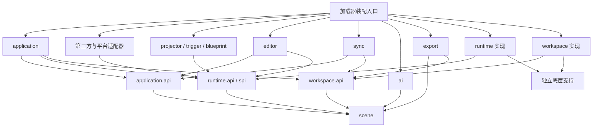
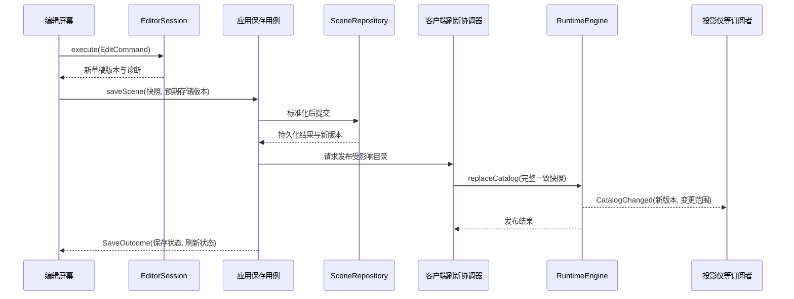

# Ponderer 功能模块化与运行库提取方案

状态：阶段 1–6 已实施并分阶段提交。实际边界及调整见 [实施记录](MODULARIZATION_IMPLEMENTATION.md) 与 [归属说明](MODULARIZATION_OWNERSHIP.md)。阶段 7 未实施；阶段实施时按用户要求未运行测试与验收，后续构建与 smoke 结果见实施记录。

基线：2026-10-27，当前 `1.21.1` 分支，HEAD `457d0619`，Minecraft 1.21.1、Java 21。实际活动模块为 `Common / NeoForge / Fabric`，以 [settings.gradle](D:/Files/ponderer/settings.gradle) 和 [gradle.properties](D:/Files/ponderer/gradle.properties) 为准；磁盘中的 `Forge/` 不属于本方案的当前构建范围。

本文保留实施前的调研基线、拟定包名与后续阶段设计；历史源码链接可能已随迁移失效。阶段 1–6 的实际位置以归属清单为准，阶段 7 的 Gradle 项目仍为建议。未以构建产物证明当前源码能够通过构建。

## 1. 目标与总体策略

最终形成三种可组合的使用方式：

| 使用方式 | 所需能力 | 依赖边界 |
| --- | --- | --- |
| 完整 Ponderer | 播放、编辑、资源管理、同步，以及启用的功能扩展 | 由产品装配入口组合各模块 |
| 场景运行库 | 加载宿主提供的场景与结构，编译并播放，提供必要的播放 UI 和界面沙盒 | 依赖 Minecraft/Ponder 及必要平台适配，独立于编辑器、AI、同步、投影仪和产品目录布局 |
| 第三方接入 | 注册场景来源、结构来源、步骤处理器或播放宿主 | 使用稳定的运行 API/SPI，不访问实现类和产品静态单例 |

先在现有 `Common` 中建立功能包边界，再提取物理构建模块。阶段 0—6 保持当前三个 Gradle 模块和发布形式；阶段 7 才改变打包与依赖关系。

模块独立以四项条件衡量：依赖方向明确、状态有唯一所有者、入口与清理可独立执行、缺少其他可选功能时仍能工作。配置开关只代表功能启停，物理独立还需要阶段 7 的构建与装配验证。

## 2. 现有耦合与对应处理

| 当前代码 | 已核实的耦合 | 目标归属与处理 |
| --- | --- | --- |
| [DynamicPonderPlugin](D:/Files/ponderer/Common/src/main/java/com/nododiiiii/ponderer/ponder/DynamicPonderPlugin.java:612) | 同时注册场景、处理步骤、编译编辑预览；直接引用蓝图、投影仪、JEI、存储和 UI 坐标类型 | 注册适配、编译器、步骤处理器分别归运行层；编辑预览控制归编辑层；资源和兼容能力通过接口注入 |
| [SceneStore](D:/Files/ponderer/Common/src/main/java/com/nododiiiii/ponderer/ponder/SceneStore.java:1217) | 文件与资源包管理、服务端路径、数据修正、运行目录发布混合；标准化读取全局配置 | 拆为场景编解码/标准化、工作区仓库、资源包服务和应用刷新协调器 |
| [SceneEditorScreen](D:/Files/ponderer/Common/src/main/java/com/nododiiiii/ponderer/ui/SceneEditorScreen.java:911) | 保存、读盘、重建预览，并借用投影仪缓存服务刷新全局 Ponder 索引 | 屏幕调用编辑会话和保存用例；应用层发布目录；投影仪自行订阅目录变化 |
| [SetInterfaceSlotsInstruction](D:/Files/ponderer/Common/src/main/java/com/nododiiiii/ponderer/interfaces/instruction/SetInterfaceSlotsInstruction.java:40) | 运行指令直接使编辑预览状态失效 | 运行会话发布槽位变化；编辑工具按需订阅 |
| [ProjectorSceneBounds](D:/Files/ponderer/Common/src/main/java/com/nododiiiii/ponderer/projector/ProjectorSceneBounds.java:172) | 投影仪读取结构信息依赖 `ai.StructureDescriber` | 提取共享结构检查能力；AI 与投影仪分别消费 |
| [SyncResponsePayload](D:/Files/ponderer/Common/src/main/java/com/nododiiiii/ponderer/network/SyncResponsePayload.java:1) | 传输对象同时包含同步会话、写盘、业务状态和 UI/缓存刷新 | 分离协议、处理器、同步服务和界面展示 |
| [PlatformHelper](D:/Files/ponderer/Common/src/main/java/com/nododiiiii/ponderer/platform/services/PlatformHelper.java:1) | 通用平台接口直接引用投影仪方块实体 | 环境能力与投影仪菜单能力分开，后者由投影仪自己的平台接口声明 |
| [WorldFeedback](D:/Files/ponderer/Common/src/main/java/com/nododiiiii/ponderer/feedback/WorldFeedback.java:1) | 反馈组件主动驱动坐标采集、重置 NBT 采集并观察界面捕获状态 | 反馈组件只管理显示优先级；工具自身执行 tick/清理并提交提示 |
| [SceneStepCatalog](D:/Files/ponderer/Common/src/main/java/com/nododiiiii/ponderer/ai/SceneStepCatalog.java:1)、[StepEditorFactory](D:/Files/ponderer/Common/src/main/java/com/nododiiiii/ponderer/ui/StepEditorFactory.java:1) 与运行/导出分派 | 步骤词汇、字段说明和能力支持散落在不同功能中 | 下沉共用步骤定义，各消费方保留自己的处理器注册表 |

当前两端都将 Common 源码合并编译。这是多加载器共享源码机制；新增包目录本身不会形成编译或发布边界，阶段 7 必须明确每个类最终由哪个 JAR 提供。

## 3. 各层功能总表

“层”表示职责和依赖边界。运行层的三个子模块可以先存在于同一个构建模块内；同步、AI、导出等按功能组织，不要求串成一条调用链。

| 层 / 功能模块 | 包含的功能 | 允许依赖的项目能力 | 对外接口与状态所有权 | 未来进入运行库 |
| --- | --- | --- | --- | --- |
| 场景契约 `scene` | 场景/分场景/步骤数据，翻译文本，物品绑定与触发配置描述，界面描述，JSON 编解码，兼容迁移，标准化，结构引用收集，基础诊断，步骤字段定义 | JDK、必要的 JSON/注解库 | 输出场景快照与诊断；不保存全局场景列表 | 是 |
| 运行核心 `runtime.core` | 场景查找、Ponder 注册适配、编译、步骤执行、时间线、暂停/恢复/跳转、文本与粒子、相机/结构变换、执行策略、编译缓存 | `scene`、所需底层支持、Minecraft/Ponder、自身 API/SPI | `RuntimeEngine`、`SceneCompiler`、`PlaybackSession`；拥有运行目录与播放状态 | 是 |
| 界面执行 `runtime.interfaces` | `show_interface` 等步骤处理器，界面宿主、沙盒世界/玩家、菜单状态与槽位回放、网络隔离、界面覆盖层、兼容扩展点 | `runtime` 的 API/SPI、`scene`、底层支持、Minecraft/Ponder | `InterfaceSession` 与界面执行 SPI；拥有沙盒、回放菜单和运行覆盖数据 | 是 |
| 播放呈现 `runtime.viewer` | 普通播放窗口、进度/速度/缩放、文本布局、播放所需坐标与 Z 层、插值和渲染桥接；与 PonderUI 交互的基础钩子 | `runtime` 的 API/SPI、底层 UI 支持、Minecraft/Ponder | `PlaybackHost`、视口/输入接口、播放窗口扩展槽；拥有视图与输入订阅 | 是 |
| 工作区 `workspace` | 本地与服务端场景读写、路径与命名、结构文件读写、只读资源包来源、导入导出 ZIP、目录迁移、备份与文件变更结果 | `scene`、文件/结构支持；路径通过构造参数传入 | `SceneRepository`、`StructureRepository`、`PackService`；拥有磁盘组织和存储版本 | 默认实现留在产品；可按需提供适配器 |
| 应用编排 `application` | 保存/删除/导入用例，权限与可编辑性策略，加载来源组合，目录发布，配置快照、功能可用性、命令入口，刷新与错误反馈协调 | 各模块公开 API；客户端与服务端用例分开 | `SceneApplicationService`、`SceneRefreshCoordinator` 等；拥有用例执行顺序和本地目录版本 | 产品协调器不进入；运行库仅保留自己的最小启动入口 |
| 编辑 `editor` | 编辑会话、可变草稿、撤销/重做、步骤表单、插入/删除/排序、标签编辑、编辑预览交互、坐标/NBT/槽位/界面采集、跨屏返回 | `scene`、应用 API、运行 API/SPI、底层 UI 支持 | `EditorSession`、`EditCommand`、`PreviewController`、`CaptureResult`；拥有草稿和工具状态 | 否 |
| 同步 `sync` | 远程目录、上传/下载/删除、增量同步、权限管理、历史/回滚、自动同步偏好、冲突与分块会话 | `scene`、工作区 API、相应用例 API、传输 SPI | `SyncService`、`RemoteWorkspaceClient`；拥有连接范围内的请求与同步元数据 | 否 |
| AI `ai` | 提示组织、模型配置、提供商适配、工具执行、预算/取消、过程记录、草稿生成、AI 质量检查 | `scene`、结构只读能力、自身提供商接口；通过应用/编辑接口提交候选结果 | `GenerationTask`、`GeneratedDraft`；拥有请求、预算和临时产物 | 否 |
| 转换与代码导出 `export` | Java 模块扫描/生成、PonderJS 导入导出、输出规划与模板、目标后端支持诊断 | `scene`、共享语义分析、工作区只读接口；导入结果交给应用层保存 | `SceneConverter`、`ExportService`；拥有一次转换/导出任务 | 否 |
| 投影仪 `projector` | 方块/物品/菜单、服务器播放信号、投影渲染、距离/边界、投影文本、原生 Ponder 场景适配与专属缓存 | `scene`、运行 API/SPI、共享结构能力、自身平台接口 | `ProjectorPlaybackController`；拥有每台投影仪状态和缓存 | 否 |
| 触发 `trigger` | 坐标/结构触发判断、提示频率、首次/已读状态、按键打开播放 | 场景查询与播放 API、提示接口、自身持久化接口 | `TriggerService`；拥有触发与已读状态 | 否；可作为运行库使用者 |
| 蓝图 `blueprint` | 蓝图物品与配置、载体规则、世界交互、结构采集/导出、进入编辑流程 | 编辑/应用公开接口、运行绑定 SPI、自身平台接口 | `BlueprintService`、`CarrierBindingProvider`；拥有工具状态 | 否 |
| 底层支持 `support` | 独立的 `structure` 检查、通用 UI 控件、反馈调度、NBT 文本处理、文件名/路径工具 | 各自必需的基础库；不导入上述业务实现 | 小而明确的工具/API；反馈仅拥有显示队列，结构检查不拥有产品目录 | 仅打包运行层实际需要的部分 |
| 加载器适配、第三方适配与装配入口 | NeoForge/Fabric 生命周期、注册、线程调度、网络注册；JEI/AE2/Resourcify 适配；创建服务与注入实现 | 所实现的消费者 SPI；装配入口可引用各模块实现 | 实现 SPI、注册功能、负责启动/关闭顺序 | 运行部分进入对应加载器运行库；产品部分保留 |

补充边界：

- `scene` 保存“如何触发、是否可编辑”等数据描述；触发判断归 `trigger`，权限决策归应用层。
- 界面描述、迁移与基础校验归 `scene`；打开/回放归 `runtime.interfaces`；真实界面采集和编辑采集结果归 `editor.capture`。
- 播放所需 UI 归运行层；编辑按钮、编辑屏幕、采集遮罩和编辑返回路径归编辑层。当前整个 `ui` 包需要逐项归属。
- 结构解析从 AI 包提取。`support.structure` 接收流或明确的资源句柄，产品目录查找由工作区实现。
- `support` 下各子包保持独立，不建立统揽所有业务的公共上下文或工具类。

## 4. 编译依赖与装配关系

箭头表示“编译时依赖”，不表示所有通信都沿箭头直接调用实现类。



图中省略了各模块到 `scene`、底层支持的重复边，以及特定功能自己的 SPI。实际 import 约束如下：

1. 运行实现只依赖自身契约、场景契约、底层支持和游戏依赖。运行代码不导入 `editor / ai / sync / projector / blueprint / application`，也不读取产品工作区目录。
2. `workspace` 负责读写并返回结果；应用层决定何时刷新运行目录。工作区不调用 `PonderIndex.reload()`、屏幕和投影仪缓存。
3. 同级功能消费对方的公开能力接口。例如蓝图进入编辑器使用 `editor.api`；投影仪播放使用 `runtime.api`。禁止访问对方的静态状态、屏幕字段或实现类。
4. 接口放在需求方的 `api/spi` 包：运行层声明 `StructureSource`，编辑层声明采集扩展接口，投影仪声明打开其菜单的平台接口。
5. 跨模块转换适配器放在装配边界。例如 `WorkspaceStructureSource` 同时依赖工作区 API 与运行 SPI，由装配入口注入。两侧实现包不互相引用。
6. 启动时显式创建服务和注册能力；保留现有 `ServiceLoader` 作为平台发现手段时，只在装配边界使用，不把它扩展为业务服务定位器。
7. 共用步骤 ID 和字段定义，运行处理器、编辑表单、AI 提示与导出后端各自注册。共用定义不包含 Screen 工厂、PonderInstruction 或模型提供商代码。

### 4.1 推荐逻辑目录

阶段 0—6 的共享实现仍放在 `Common/src/main/java/com/nododiiiii/ponderer/`：

```text
scene/                         数据、codec、migration、validation、step 定义
runtime/
  api/                         宿主调用的公开能力
  spi/                         宿主实现的资源、呈现与兼容能力
  core/                        编译、目录、会话、步骤处理
  interfaces/                  界面执行与沙盒
  viewer/                      播放呈现
  mixin/                       运行必要的共享注入
workspace/                     api、local、server、pack
application/                   api、client、server、commands
editor/                        api、session、screen、preview、capture、mixin
sync/                          api、client、server、protocol
ai/                            生成流程与提供商
export/                        java、ponderjs
features/                      projector、trigger、blueprint
support/                       structure、widgets、feedback、nbt、paths
compat/                        按目标能力继续细分
bootstrap/                     共享装配与桥接适配器
```

平台专有实现继续放在活动的 `NeoForge/`、`Fabric/` 中。每个需要服务端支持的功能分开 `client / server / protocol`，客户端 Screen、渲染和 Ponder 会话不得由服务端入口提前加载。

## 5. 各层如何通信

采用四种明确机制：请求/响应接口、只读数据快照、局部订阅通知、网络消息。需要返回成功/失败的操作直接返回结果或可取消任务；事件用于已发生的变化通知。

### 5.1 通信总表

| 发起方 → 接收方 | 通信契约 | 携带的数据 | 执行与返回 | 关键约束 |
| --- | --- | --- | --- | --- |
| 编辑屏幕 → 编辑会话 | `execute(EditCommand)` | 步骤/字段修改与目标位置 | 客户端线程执行，返回草稿版本与诊断 | 屏幕不直接写运行场景对象 |
| 编辑/导入 UI → 应用层 | `saveScene(SaveSceneRequest)` / 导入用例 | 场景快照、目标来源、预期存储版本 | 可取消的 I/O 任务；返回 `SaveOutcome` | 保留当前保存时机；不要同时改成另一套交互流程 |
| 应用层 → 工作区 | `SceneRepository.save/read/delete`、`PackService` | 明确的存储键、快照与版本 | I/O 执行器操作；返回持久化结果 | I/O 成功与运行刷新成功分别报告 |
| 应用客户端协调器 → 运行层 | `replaceCatalog(CatalogSnapshot)` | 目录版本、场景快照、来源与绑定信息 | 客户端主线程发布并更新 Ponder 注册 | 统一收敛刷新入口；不借用某个功能的缓存服务 |
| 运行层 → 场景/结构来源 | `SceneSource` / `StructureSource` | `SceneRef` / `StructureRef` | 来源提供只读数据或资源；I/O 准备与游戏对象构造分开 | 运行层不知道 `_packs`、只读缓存和服务端目录 |
| 编辑预览 → 运行层 | `compile`、`createSession`、`seek` | 独立草稿快照、分场景、执行策略 | 主线程构建会话；返回进度、步骤映射与诊断 | 预览不覆盖正式运行目录 |
| 投影仪/触发器 → 运行层 | 查找、创建会话、宿主呈现接口 | 场景引用、播放参数、宿主与执行策略 | 创建各自的播放会话 | 一个宿主不占用或修改其他宿主的播放状态 |
| 运行层 → 编辑/投影仪 | `subscribeCatalogChanged` / `PlaybackListener` | 目录版本、会话 ID、进度、结束/失败、界面状态变化 | 所有者线程通知；订阅返回可关闭句柄 | 运行层只认识监听接口；订阅者负责更新自身状态 |
| AI → 编辑/应用接入器 | `GeneratedDraft` / `DraftProposal` | 候选场景、诊断、生成时草稿版本 | 后台生成；主线程核对版本后应用 | 取消或草稿已变化时不覆盖用户编辑；沿用现有应用策略 |
| 导出 → 场景/资源读取接口 | `export(ExportRequest)` | 固定场景与资源快照、目标后端参数 | 后台输出，返回文件清单和不支持项 | 不依赖打开的编辑屏幕，也不主动修改运行目录 |
| 网络接收器 → 功能处理器 | 功能自己的协议处理入口 | 已解码 DTO、连接/玩家上下文 | 切换到正确线程，调用服务后发送响应 | 传输对象只保留字段、codec 和协议约束 |
| 功能 → 提示组件 | `FeedbackSink` / 可关闭提示句柄 | 消息、级别、显示目标、优先级、作用域 | UI 线程展示；工具自己更新和撤销提示 | 提示组件不读取或驱动编辑/触发工具状态 |
| 运行/编辑 → 第三方能力 | `IngredientResolver`、`InterfaceAdapter`、编辑拖放 SPI 等 | 公开值对象与上下文 | 注册的适配器返回结果或“不支持” | 未安装第三方模组时，核心类不加载其 API 类型 |
| 装配入口 → 全部模块 | 构造参数、注册方法、`close()` | 平台能力、配置快照、所需服务 | 按生命周期安装与逆序关闭 | 不通过全局事件总线隐式查找服务 |

### 5.2 主要契约与归属

以下为语义约定，不要求在同一阶段一次性创建全部接口。

| 契约 | 所属模块 | 用途 |
| --- | --- | --- |
| `SceneDocument` / `SceneSnapshot` / `SceneDiagnostic` | `scene` | 可编辑输入与独立运行快照；诊断包含场景、步骤、字段与原因 |
| `SceneRef` / `StructureRef` | `scene` | 明确场景、分场景、来源和资源引用；旧字符串键继续由适配器读写 |
| `StepDefinition` | `scene` | 步骤 ID、字段和基础语义；AI 文案与编辑控件仍由各自模块维护 |
| `SceneSource` / `StructureSource` | `runtime.spi` | 宿主提供资源的最小能力；由工作区、资源包或内存适配器实现 |
| `CompileRequest` / `CompilationResult` | `runtime.api` | 输入固定快照和环境，输出编译产物、步骤时间映射与诊断 |
| `PlaybackSession` / `PlaybackHost` | `runtime.api/spi` | 运行会话控制与视口呈现；宿主可为普通窗口、编辑预览或投影 |
| `ExecutionPolicy` | `runtime.api` | 声明声音、交互界面、输入、时间推进等允许能力 |
| `SceneRepository` / `StructureRepository` | `workspace.api` | 显式范围内的读写与存储版本；不包含 UI 类型 |
| `SaveSceneRequest` / `SaveOutcome` | `application.api` | 保存用例的成功、失败、版本冲突及刷新状态 |
| `EditorSession` / `CaptureResult` | `editor.api` | 编辑工具应用结果与草稿版本；运行层不引用 |
| 功能请求/响应 DTO 与 codec | 各功能的 `protocol` | 网络边界与版本兼容，平台代码负责注册和投递 |

持久化 JSON DTO 与内部快照可以在迁移期并存。保留现有字段名、旧步骤别名、包前缀、场景 ID、分场景后缀和界面 schema 2 兼容；先用转换边界隔开可变对象，再逐步改善内部类型。文件来源、读写权限和本地路径作为外部元数据，不再混入运行实体的职责。

`SceneNormalizer` 接收明确的默认值和标准化选项，不直接读取全局 `Config`；标准化在输入边界执行，编译器不再调用 `SceneStore.sanitizeScene()` 或修改调用方对象。

### 5.3 运行核心与功能扩展的连接

- 核心步骤编译器使用 `StepHandlerRegistry`。基础步骤由核心注册，界面步骤由 `runtime.interfaces` 注册；可选功能仅在装配阶段贡献处理器或观察器。
- 将通用文本标记、时间线提示和叠加层数据归运行契约。投影仪转换这些数据为自己的呈现结果，编译器不再创建 `ProjectorCueMarkerInstruction`。
- 将 `ProjectorRenderContext` 中通用的时间和执行能力抽为会话上下文。投影仪与编辑预览分别传入明确策略；指令查询允许能力，不判断自己属于哪个产品功能。
- 为编辑入口提供播放窗口扩展槽。编辑模块安装按钮和动作；运行 Mixin 不直接创建 `SceneEditorScreen`。
- 运行界面槽位和覆盖层数据归 `InterfaceSession`。编辑采集与槽位工具订阅该会话的变化，不由运行指令刷新 `InterfaceSlotEditState`。
- 载体物品通过绑定提供者传入；蓝图功能安装自己的实现，运行核心不访问 `BlueprintFeature` 和产品注册表。
- JEI 的运行配料解析、编辑拖放分别适配对应 SPI；AE2 接入界面适配 SPI；Resourcify 接入资源获取/导入用例。按消费者划分适配器，避免一个兼容入口把编辑器依赖带入运行库。

## 6. 数据、线程与生命周期规则

### 6.1 状态归属

| 状态 | 唯一所有者 | 对其他模块开放的形式 |
| --- | --- | --- |
| 编辑草稿、撤销栈、选择/采集状态 | `EditorSession` 或它拥有的工具会话 | 命令、结果与快照 |
| 存储内容、资源包布局、同步存储元数据 | 工作区与同步模块各自的仓库 | 仓库接口与提交结果 |
| 已发布场景目录和 Ponder ID 映射 | `RuntimeEngine` 的目录组件 | 只读目录快照与版本 |
| PonderScene、沙盒菜单、时间线、文本叠加与播放状态 | 每个 `PlaybackSession` | 会话 API 和局部通知 |
| 投影仪专属状态与缓存 | 每台投影仪控制器及其缓存组件 | 功能自己的查询接口 |
| 触发/已读状态 | `TriggerService` | 触发查询与状态更新 |
| AI 请求、预算、取消和暂存文件 | 生成任务 | 可取消句柄、过程事件、最终候选稿 |
| 配置定义、有效配置与服务器可用性 | 对应功能配置模块与应用配置协调器 | 带作用域的配置快照 |

`SceneRuntime` 当前只对列表做不可修改包装，列表中的 `DslScene` 仍可变。目标需要复制或冻结场景树，确保编辑草稿与正式运行数据不共享可变对象。

Ponder 的实际播放对象具有可变状态。每个宿主创建自己的 `PlaybackSession/PonderScene`；可共享不可变的资源、分析结果或编译描述。无法证明可安全复用的原生播放对象不进入跨会话缓存。缓存键至少区分场景版本、资源版本及影响编译的策略。

### 6.2 线程约定

1. 文件、ZIP、JSON 处理、网络 HTTP 和代码生成可在后台进行；访问世界、注册表、构造游戏对象、Ponder 索引与渲染状态在其要求的主线程执行。
2. 客户端目录发布、播放会话和 UI 通知统一在客户端主线程；服务端权限检查与世界相关操作在服务器线程。工作区写入按工作区/资源键串行协调。
3. 后台任务捕获不可变请求、连接/世界作用域和操作标识。返回前检查作用域是否仍有效，AI 应用结果还需检查草稿版本。
4. 本地目录版本、编辑草稿版本、远程存储版本分别定义。不同服务器和不同作用域的版本值不直接比较。
5. 输入错误和编译错误返回结构化诊断；可选监听器失败单独记录，不回滚已成功的磁盘提交，也不阻止其他监听器清理。

### 6.3 生命周期

- 客户端启动：装配平台能力、配置和模块；建立来源；注册运行能力与 UI 扩展。
- 进入世界或连接服务器：创建对应作用域、同步客户端、触发器与会话管理；客户端运行服务按需启用。
- 打开编辑器：创建草稿和工具会话；预览占用独立播放会话。
- 关闭编辑器：关闭预览与订阅、撤销采集提示；按现有行为处理尚未持久化的状态。
- 断开连接/切换世界：使旧任务作用域失效，取消后台任务，关闭播放/沙盒，清理场景绑定和各功能缓存。
- 资源重载：准备新资源与目录版本，再在主线程发布；按现有播放行为重建或关闭受影响会话。

所有订阅、临时输入接管和沙盒作用域都有明确关闭路径。Mixin 的临时上下文在 `finally` 中恢复；核心沙盒隔离、网络阻断和世界状态还原规则在拆分时完整保留。

## 7. 典型通信流程

### 7.1 编辑保存与正式目录刷新



工作区成功保存后，若运行刷新失败，界面展示“已保存、刷新失败”并保留重试入口。不会将磁盘成功误报为全部失败，也不会把旧运行目录标为新版本。目录准备/发布失败时保留最近可用状态；涉及 Ponder 全局索引无法原子更新的部分，由统一适配器显式记录并重试，实施阶段验证其恢复行为。

迁移初期保持完整重载。首先统一入口和通知顺序，再在实际需要时优化为局部失效，避免同时改变刷新算法。

### 7.2 编辑预览与投影播放

编辑器提交独立的草稿快照 → 运行编译器返回步骤时间映射与诊断 → 编辑器创建预览会话 → `PreviewController` 处理选步、拖动、点选与视角 → 通过会话 API 操作播放。

投影仪根据服务器播放信号和自身参数 → 查询运行目录或原生场景适配器 → 创建投影宿主与执行策略 → 创建独立会话 → 读取通用覆盖层/时间线数据并在世界中呈现。

两者共用编译和播放语义，草稿、视图交互、会话和功能缓存各自独立。编辑预览不再借用投影仪命名的上下文或缓存管理器。

### 7.3 同步与远程管理

客户端界面/自动同步调度 → `RemoteWorkspaceClient` → 功能协议编码 → 加载器传输 → 服务端功能处理器 → 权限与版本检查 → 工作区提交 → 响应 DTO → 客户端同步服务暂存/冲突处理 → 本地提交完成 → 应用刷新用例 → 运行目录发布 → UI 读取同步结果。

传输对象不直接更新屏幕。分块会话属于连接作用域的同步服务，沿用现有大小限制、冲突策略和最终分块语义，完成一次一致提交后再刷新。处理器不信任客户端传入的权限或可编辑性声明。

重构初期保留现有 payload ID、codec 字段与顺序。内部操作标识先在服务内部使用；需要在线协议新增请求 ID/版本字段时，单独设计兼容能力协商或新协议版本，不能直接改旧包布局。

### 7.4 AI、采集与导入导出

AI 接收场景/资源快照和草稿版本 → 生成候选稿与诊断 → 编辑/应用接入器核对任务有效性和草稿版本 → 沿用当前产品的结果应用方式 → 进入统一保存流程。

采集工具接收编辑上下文的轻量标识和回调 → 在世界或真实菜单中采集 → 返回 `CaptureResult` → 编辑会话转换为命令并更新草稿。采集层不保存父 Screen 作为运行依赖；跨屏返回由编辑导航适配器处理。

Java/PonderJS 导出接收固定输入和只读资源接口 → 公共语义分析 → 后端生成/不支持诊断 → 输出结果。导入产生场景文档后交给统一用例。现有导出的独立源码模式继续保留，未来“依赖运行库”的导出模式在运行库 API 稳定后单独增加。

## 8. 分阶段实施方案

每个阶段可拆成数个独立提交。默认先委托旧实现、迁移调用方，最后删除旧入口；一个阶段同时混入 JSON 协议、播放语义和打包变化时，应进一步拆分。

### 阶段 0：建立迁移基线与归属清单

**内容**：按第 3 节给现有类、资源、payload、Mixin 和配置分配唯一责任模块；记录已有保存/刷新、编辑返回、同步冲突和播放行为；核对现有测试覆盖。明确客户端与服务端入口、正常退出和清理路径。

**产出**：类与资源迁移清单、接口候选清单、已有行为检查清单；确认当前构建与相关既有测试基线。只记录已有失败，不在模块拆分提交中夹带无关修复。

**验收**：活动模块、来源与现有行为明确；后续每个待迁移类都有目标归属。建立基线时执行当前两端 scoped build，按需执行既有 JUnit。

### 阶段 1：提取场景契约和共享叶子能力

**内容**：迁移 `DslScene`、`LocalizedText`、界面描述与迁移；从 `SceneStore` 提取 codec、标准化和结构引用收集；把 `StructureDescriber` 中通用结构读取/检查移至结构支持包；提取 UI 锚点等运行值对象。将通用步骤词汇从 AI 层下沉，保留各消费方注册表。

**产出**：独立的 `scene` 与小型支持包；明确的数据转换边界；原入口可短期委托新实现。

**验收**：基础场景契约不导入 Minecraft、加载器、编辑器、AI、网络和工作区实现；标准化无全局配置读取；原有 JSON/别名/界面 schema 与保存行为兼容。运行现有场景存储、界面模型/步骤、导出和 NBT 测试中受影响的部分。

### 阶段 2：拆工作区与应用用例，统一刷新入口

**内容**：将 `SceneStore` 分解为场景仓库、结构仓库、资源包服务、目录布局/迁移和输入处理；明确本地、服务端、只读来源。应用层集中保存/删除/导入、配置默认值与目录发布流程；提取通用刷新协调器，迁移屏幕、命令、同步和转换中的重载调用。

**产出**：`workspace.api`、用例接口、`SaveOutcome`、目录快照和版本；`SceneStore` 只剩临时兼容门面。

**验收**：工作区不发布运行静态状态、不刷新 UI 或 Ponder；编辑保存不调用 `ProjectorClientCaches`。明确磁盘成功但刷新失败的结果。既有包布局、备份、只读资源和同步文件路径保持兼容；运行受影响的存储/同步/导出既有测试。

### 阶段 3：建立可独立使用的运行服务

**内容**：拆分 `DynamicPonderPlugin` 的注册、编译、资源解析、步骤处理和分析；建立资源 SPI、会话 API、执行策略和通用覆盖层。将 `SceneRuntime` 分为场景目录与 Ponder ID 映射，冻结输入。编辑与投影的特殊上下文通过通用执行能力表达。

**产出**：可通过内存场景和结构来源创建的 `RuntimeEngine`；完整编译结果与独立播放会话；薄的 Ponder 插件注册适配器。

**验收**：运行实现不引用产品工作区、AI、投影仪、蓝图或编辑实现；普通播放与编辑/投影使用一致的步骤语义。检查暂停/跳转、非阻塞效果、结构边界、文本与声音策略；受影响既有测试和两端构建通过。修改 Mixin 时执行双端 smoke 与相应映射检查。

### 阶段 4：分离编辑器、播放 UI 与界面采集

**内容**：引入 `EditorSession`，由命令维护草稿与撤销；屏幕逐个改为调用会话。编辑预览使用运行 API，选步/点选/镜头交互保留在编辑控制器。将 `interfaces` 拆为场景描述、运行执行、编辑采集三块；分离运行覆盖状态与编辑槽位状态。

**产出**：`editor.api/session/preview/capture`；播放器编辑扩展槽；运行/编辑 Mixin 各自清单与所有权。

**验收**：普通播放不加载任何编辑 Screen 和采集状态；关闭编辑器可释放预览、输入接管、提示和订阅；运行指令不操作编辑单例。沿用保存与返回交互，避免此阶段重做产品流程。执行已有界面模型/步骤测试、相关构建、Mixin smoke 与现有界面沙盒 smoke。

### 阶段 5：拆分同步与产品功能，收敛平台和兼容接口

**内容**：同步协议与处理器/服务分离；迁移远程目录、权限、历史、自动同步和冲突状态。投影仪、触发器、蓝图分别使用公开 API；AI 输出候选稿、导出使用固定输入。拆通用平台环境与功能平台接口；反馈组件不再驱动工具。按消费者划分 JEI/AE2/Resourcify 适配器，梳理配置所有权与服务器可用性快照。

**产出**：可分别装配的功能服务、连接范围内的同步会话、功能各自的 protocol 与配置入口；平台入口只注册和调度。

**验收**：传输 DTO 不写文件或打开屏幕；核心无需知道有哪些产品功能；停用某个功能不会使其他模块调用缺失实现。保持现有 payload 格式、服务器权限与功能可用性语义。执行现有同步、投影仪、导出、AI 管线测试中相关部分；不主动启用真实 LLM 集成测试。

### 阶段 6：完成依赖收口与逻辑独立验收

**内容**：移除已迁移的兼容门面、遗留跨包静态调用和双份状态；收敛 `SceneStore`、`SceneRuntime`、`PondererServices` 的产品级职责。用 import 搜索、类引用和构建依赖核对第 4 节规则；明确 API 与内部实现包。保留必要委托时标明唯一删除条件。

**产出**：无业务依赖环的逻辑模块，稳定的公开契约，完整的资源/Mixin/注册归属清单。

**验收**：核心通过内存/只读来源运行；编辑器、同步、AI、投影仪可分别停止/不装配；草稿与播放状态隔离，切换世界与断开连接可完整清理。本阶段仍为原发布形式，尚不宣称已有独立运行库产物。

### 阶段 7：提取 Gradle 模块与独立运行库

**内容**：将已稳定的边界变成编译边界；共享代码仍安排在 `Common/` 目录树内，平台专有代码留在各平台目录树内。建议最终项目关系如下：

| 目标项目 | 建议位置 | 作用 |
| --- | --- | --- |
| `:SceneModel` | `Common/scene-model/` | 无 Minecraft 类型的模型/codec/基础校验开发产物 |
| `:RuntimeCommon` | `Common/runtime/` | 共享运行 API、核心、界面执行、播放 UI 与必要共享支持 |
| `:RuntimeNeoForge` / `:RuntimeFabric` | `NeoForge/runtime/`、`Fabric/runtime/` | 各加载器的运行库适配与发行产物 |
| `:Common` | 现有 `Common/src/main/` | 产品应用、工作区、编辑器及功能扩展共享代码 |
| `:NeoForge` / `:Fabric` | 现有平台项目 | 完整 Ponderer 的加载器接入与产品发行产物 |

这些是未来新增项目，必须先更新 `settings.gradle` 和构建配置后才属于活动模块。阶段 0—6 不提前把对应目录当成构建模块。

**打包规则**：

1. 运行共享源码只进入对应运行库的加载器编译；产品只编译产品 Common 源码并依赖运行库开发接口。取消产品对运行源码的重复合并。
2. 场景契约类每个运行实例只提供一份。若采用嵌套依赖，由运行库统一携带；产品不再重复打包相同类。
3. 拆分 runtime/editor/projector 等 Mixin 配置和客户端注册入口；运行库只携带运行所需配置、访问声明、服务描述、纹理与翻译。核对不同配置不重复注入同一职责。
4. Ponder/Flywheel 依赖和嵌套规则在运行发行端统一处理，沿用加载器版本选择机制；不把当前 NeoForge JarJar 坐标兼容处理遗漏或机械复制到两个产品包。
5. 保留场景 JSON、注册资源和存档中的既有标识。运行库独立容器的身份、产品 mod ID 和序列化命名空间分别管理；不能因为更换 JAR 或包名而批量改场景/物品 ID。
6. API/SPI 有独立的兼容约定；声明 Minecraft/Ponder/加载器支持范围。脱离当前仓库的外部版本支持需要单独验证，本文不推断其他分支适用性。
7. 资源来源、步骤扩展和 UI 扩展有最小使用说明；文档示例可提供内存场景和资源包场景，但按仓库约束不新增测试文件或测试专用脚本。

**产出**：每个平台的运行库产物、依赖它的完整产品产物、接入说明及发行依赖声明。

**验收**：仅运行库与必要依赖能够播放宿主提供的世界型和界面型场景；完整产品正常接入；编辑、同步、AI、蓝图和投影仪未被运行库类引用或打包。验证缺少可选兼容模组、双端加载、资源重载、关闭会话及服务端启动的类加载边界。运行库的独立播放需由实际最小装配配置验证，配置开关和成功 build 都不能单独证明这一点。

## 9. 验证矩阵与执行纪律

下列命令用于实施阶段。本次文档编写未运行它们；所有长运行命令应由执行器设置外层期限，超时终止本次启动的进程树并记录日志。

| 改动范围 | 最小验证 | 补充条件 |
| --- | --- | --- |
| 本文档、迁移清单 | 检查路径、活动模块、表格、依赖方向与 diff | 不需要 Gradle |
| 小范围共享实现、阶段迁移 | `./gradlew.bat :NeoForge:build :Fabric:build` | 当前默认；两端覆盖共享源码合并编译 |
| 纯 Common 局部逻辑且编译已足够 | `./gradlew.bat :Common:compileJava :NeoForge:compileJava :Fabric:compileJava` | 仅在编译确为最小充分验证时使用；涉及行为则加相关既有测试 |
| 单个平台接入 | `./gradlew.bat :NeoForge:build` 或 `./gradlew.bat :Fabric:build` | 可以证明 compile 已足够时按仓库规则缩小 |
| 场景存储、界面模型、同步、投影仪、导出、AI 管线 | `./gradlew.bat :Common:test --tests <现有测试类全名>` | 只选受影响的既有测试；Common 当前显式启用 JUnit；不新增测试、不默认调用真实 LLM |
| Mixin、注入归属或描述符变化 | 受影响模块编译 + 映射/配置检查 + `./gradlew.bat quickPlaySmoke -PsmokeTimeout=180` | smoke 本身构建两端；确认每端实际启动、入世界与清理 |
| 沙盒/界面运行 Mixin 变化 | 上项 + `./gradlew.bat quickPlaySmoke -PsmokeTimeout=180 -PsmokeInterfaces` | 使用现有 `InterfaceSmokeTest`，不能用普通入世界代替界面检查 |
| 阶段 7 构建/打包 | 新模块 scoped build、发行 JAR 类/资源清单、依赖元数据核对、最小装配运行 | 仍需外层超时与退出清理；不新增测试专用脚本 |

现有测试可按范围选择：`SceneStoreTest`、`InterfaceModelTest`、`InterfaceStepSpecsTest`、`NbtTextPipelineTest`、`SyncResponsePayloadTest`、`ProjectorConfigUpdatePayloadTest`、`ProjectorSceneTimelineTest`、`ProjectorBlockEntityPlaybackStateTest`、`JavaModuleExportServiceTest`、`AiSceneAgentPipelineTest`。类位置以 [Common/src/test](D:/Files/ponderer/Common/src/test) 的实际目录为准。

执行时须区分以下情况：

- Fabric 当前声明 refmap；Mixin 改动后检查其实际生成文件与映射目标。NeoForge 当前配置未声明 refmap，不机械要求生成旧版 Forge 的 `m_*` 名称；核对当前工具链生成映射、发行注解目标及实际注入。目标有映射类型时遵循仓库 `remap` 规则。
- 当前 `test.py` 的 smoke 客户端阶段有定时和进程树清理，但其 Gradle 构建调用未设置独立 timeout。`smokeTimeout` 不是整个验证命令的期限，构建和全流程仍需外层超时；执行时定期返回进展，不能长时间阻塞通信。
- 当前 smoke 将存档已被占用记为跳过成功。该结果不能作为本次变更已完成运行验证的证据，应安排可用实例/存档后重新执行。
- 客户端 smoke 不能证明专用服务端类加载正确，也不能覆盖所有编辑操作、远程冲突、导出语义和投影效果。复用既有验证与人工行为检查清单；需要实际观察时使用有超时和清理的运行方式，不使用未经用户要求的 GUI 自动化。
- 验证失败时注明阶段、准确命令、退出状态、证据文件及下一项检查。不要为了推进阶段绕过失败或引入新测试。

## 10. 阶段里程碑与完成标准

| 里程碑 | 完成阶段 | 可观察的结果 |
| --- | --- | --- |
| 数据与存储边界成立 | 0—2 | 输入标准化、文件管理、运行目录发布各有唯一入口；屏幕不再编排全局刷新 |
| 运行与创作边界成立 | 3—4 | 同一运行引擎支持普通窗口、独立编辑预览和投影宿主；运行不加载编辑工具 |
| 可选功能边界成立 | 5—6 | 网络对象无业务副作用，功能可分别装配与清理，平台接口和兼容接口按消费者归属 |
| 物理独立与发布成立 | 7 | 两端都有独立运行库产物，完整产品依赖接入，最小装配实际加载并播放 |

开始实施时优先处理阶段 1—2，再进入运行与编辑迁移。不要先搬空目录再追修引用；每次提交围绕一个可验证的职责变化，保留可回退边界，最后才改变发布结构。

阶段 1–6 的实施已完成，详见实施记录。上述验证命令保留原方案建议；后续已补跑两端构建、Mixin 检查与界面 smoke，详见实施记录。阶段 7、独立宿主、专用服务器和完整功能等价性仍未验证。
