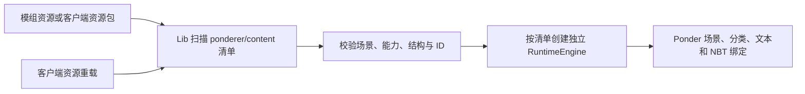

# Ponderer Lib

Minecraft 1.21.1，Java 21，当前支持 NeoForge 与 Fabric。Lib 扩展上游 Ponder，不 fork Ponder。库版本为 `0.1.1`，内容格式版本为 `1`。原场景、物品、方块、语言键和存储 ID 保持不变。

## 构建与分发边界

| Gradle 项目 | 目录 | 职责 |
| --- | --- | --- |
| SceneModel | Common/scene-model | 不依赖游戏的场景模型、格式与编解码 |
| RuntimeCommon | Common/runtime | 公共 API、执行、播放、界面沙盒 |
| RuntimeNeoForge | NeoForge/runtime | NeoForge Lib 入口、平台服务与 Mixin |
| RuntimeFabric | Fabric/runtime | Fabric Lib 入口、平台服务与 Mixin |
| Common | Common/src | 编辑、工作区、AI、同步、导出与产品组合 |
| NeoForge / Fabric | 原平台目录 | 完整 Ponderer 的平台入口与分发 |

两个 Lib JAR 的加载器身份都为 `pondererlib`。完整产品将对应加载器的 Lib 作为外置必需依赖，不再内嵌 Lib，也不在外层重复打包场景模型和运行类。玩家需将产品 JAR 与对应的 `pondererlib-1.21.1-<loader>-0.1.1.jar` 一起放入 `mods`；多个宿主共用同一份 Lib。开发运行保留项目依赖，快速启动脚本构建、复制并清理旧版独立 Lib。Ponder、Flywheel 后备依赖仍由 Lib 携带；Fabric 的 Ponder 后备包本身携带 ForgeConfigAPIPort。产品自己的配置依赖保留在产品中。Fabric 的 Flywheel 仅客户端加载，因此通用元数据使用建议依赖，客户端入口按其中的版本条件强制检查；专服不被要求加载客户端渲染库。

运行包不依赖产品、编辑器、工作区、AI、同步、投影仪、蓝图或 JEI/AE2/Resourcify 实现。共享叶子工具位于 `runtime.support`，平台 Mixin 位于 `runtime.platform.mixin`，防止 NeoForge 模块层的 split-package 冲突。`api` / `spi` 是消费入口，Mixin 所需的 public 实现类不自动成为稳定 API。

```powershell
.\gradlew.bat :RuntimeNeoForge:build :RuntimeFabric:build :NeoForge:build :Fabric:build :Common:test --offline
.\gradlew.bat :RuntimeNeoForge:publishMavenJavaPublicationToLibStagingRepository :RuntimeFabric:publishMavenJavaPublicationToLibStagingRepository --offline
```

第二条发布到项目内的 `build/lib-repository`，没有上传远端仓库。当前 Maven 坐标为 `com.nododiiiii:RuntimeFabric:0.1.1`、`com.nododiiiii:RuntimeNeoForge:0.1.1`。发布仓库地址仍由维护者决定。

### 发布 Minecraft 1.21.1

在 `1.21.1` 分支更新 `gradle.properties` 和 `CHANGELOG.md`，将提交推送到 GitHub，再推送与 `mod_version` 一致的 `release-1.21.1-v<版本>` 标签。Actions 构建并检查 Fabric 和 NeoForge 的本体与 Lib，然后分别发布到 Modrinth 和 CurseForge。Modrinth 的 Lib 公开列在 Ponderer 项目中，CurseForge 的 Lib 走独立项目，两站都先处理 Lib。

发布使用 GitHub 环境 `release-1.21.1` 的 `MODRINTH_TOKEN` 和 `CURSEFORGE_TOKEN`。如果 CurseForge 的 Lib 仍在审核，等它公开后重跑失败任务即可。工作流会复用保存的 CurseForge 文件 ID。若要复用手动上传的文件或找回超过保留期的文件，可在同一环境用 `CURSEFORGE_EXISTING_FILES` 提供从 JAR 文件名到数字 ID 的 JSON 对象。Modrinth 的已发布文件按加载器和文件名识别。

独立宿主按加载器声明外置 Lib 依赖，并在模组元数据中将 `pondererlib` 声明为必需依赖。Gradle 编译/开发运行使用以下依赖，不配置 `include` 或 `jarJar` 内嵌 Lib；安装时单独放置 Lib JAR，保留原身份：

```groovy
// Fabric Loom，repositories 先加入实际发布仓库。
modImplementation "com.nododiiiii:RuntimeFabric:0.1.1"

// NeoForge ModDevGradle。
implementation "com.nododiiiii:RuntimeNeoForge:0.1.1"
```

Ponder 的旧坐标 `Ponder-NeoForge-1.21.1` 与新坐标 `ponder-neoforge` 指向同一模组身份。Lib 的 JarJar 元数据统一使用后者，让 Create 携带的较新版参与同一次版本选择。仅 Support 的宿主自行配置上游依赖时也需要处理这项版本协调；不能让旧坐标强选低于 Create 最低要求的 Ponder。

## 三档导出

Java 模组导出界面可切换以下模式：

| 模式 | 产物 | 能力边界 |
| --- | --- | --- |
| JSON + Lib | 内容清单、场景 JSON、NBT 结构、语言和许可资源 | Lib 自动发现、校验、注册和重载；不生成 Java |
| Java + Lib | Java 构造的类型化场景文档、结构和资源 | 原宿主引擎统一注册和执行步骤，编辑器直接写回源码并在本次游戏中热重载 |
| Java + Support | 原生故事板、GeneratedPonderSupport、结构和资源 | 不依赖 Lib；不支持的界面、镜头等能力明确报告降级 |

Lib 档保留界面描述、NBT 挂载、运行时物品标签、shared_text、自定义步骤与未知步骤扩展字段。自定义 Java 提供者仍需在宿主编译；JSON 中的数据不作为 Java 代码执行。Support 档继续给出精确到场景/段落/步骤的省略诊断。

Java 两档写入加载器入口；JSON 档只写 Lib 依赖元数据，不添加加载器入口，也不要求 `src/main/java` 或 Java 包名。生成 `.ponderer-export/DEPENDENCIES.md` 提示宿主的 Gradle 接入；它不擅自改写宿主 build.gradle。切换模式必须选中此前导出的全部场景。生成器只移除自身记录的 Lib 依赖，保留宿主手写的依赖声明。切回 Support 时清理未修改的 Lib 扩展骨架；若扩展已有手写内容则保留并拒绝转换，提示先移植或移出。

Java + Lib 的归属标签委托 `runtime.api.PonderAttribution.register(namespace, helper)`，与 JSON 内容使用同一 Lib 实现；`PonderAttribution.tag(namespace)` 返回宿主命名空间下的原有标签 ID。旋转观察者图标的模型、纹理与加载器模型注册由 Lib 提供，不再导出宿主副本。Java + Support 继续携带独立渲染代码、资源和模型注册。

完整产品的 `product.catalog.PondererAttribution` 同样委托 Lib，仅负责产品分类关联和本地化文本。预览与注册均使用 Lib 的模型和渲染实现；产品资源中的图标仍供无 Lib 的 Support 导出使用。

三档导出及仅导出 Support 均写入 `src/main/resources/META-INF/licenses/ponderer/LICENSE`，包含 Ponderer 的版权声明与完整 MIT 许可文本，随宿主资源打包进入 JAR，不覆盖宿主根目录的 `LICENSE`。文本直接来自本仓库根目录的 `LICENSE`。

Java + Lib 的 `<basePackage>.ponderext.PonderExtensions` 只创建一次。再次导出不会覆盖它。生成源文件的上次文本保存在 manifest；检测到手改后拒绝覆盖或删除，并报告路径。稳定步骤 `id` 保留在数据中，旧文档会分配 `legacy_<序号>`；编辑器复制步骤时分配新 ID，替换步骤时保留原锚点。

`PonderActions` 和 Support 来自 `Common/runtime/src/main/templates/ponderer/generated_ponder_support.java.template`。Gradle 将分区归属和附加结构规划的源实现注入模板，生成正常编译的 Lib 动作类与导出模板。JSON 执行器只适配参数，避免另外维护一套分区、实体与结构算法。

原生 `PonderActions.showText` 与 JSON `text` 现在共用字幕构建和 `PonderText` 索引标记，每条字幕只记录一次；启用 `text` 能力后重播仍由原有生命周期清理索引。无 Lib 的 Support 模板不包含索引钩子。`ParticleEffects.emit` 也委托 `PonderActions.spawnParticles`，编辑器保留粒子参数解析与校验。

`runtime.api.PonderPlayerElement` / `PonderPlayerSupport` 提供玩家皮肤展示、朝向及淡出，宿主无需复制元素渲染类。`PonderEntityAnimations` 为原生 Java 提供入场、退场和原地行走便捷方法，底层使用同一 `PonderActions.Context` 的实体创建、链接、位移与清理；这些方法按传入时长推进场景时间。宿主方块、物品和专属动画留在宿主。Create: Biotech 已使用这些接口，并自行声明和申请播放器增强；普通导出内容仍按下述启动策略运行。

编辑器的“放置实体”、JSON `create_entity` 和 `PonderActions.createEntity` 均接受 `player` / `minecraft:player`，展示当前观看者的玩家模型。玩家通过 `PonderActions.createPlayer(level, profile)` 创建，与 `PonderPlayerElement` 共用玩家身份解析和客户端模型创建；传入空 profile 时优先使用当前玩家身份，无当前玩家时使用默认身份。玩家仍加入普通场景实体与链接流程，支持位置、朝向、NBT、入场动画，以及后续按类型、区域或 `linkId` 移动和清除。Java + Support 导出携带同一实现。

Lib 接管的场景在整个 `PonderScene.renderScene` 期间，将实体渲染分发器的朝向临时切换到当前插值后的场景相机，并通过 `finally` 恢复原朝向。普通实体与方块实体中的相机朝向贴图统一跟随思索视角，不再因读取主游戏相机方向而侧向或被背面剔除；宿主无需为储罐等方块实体另算思索相机，也无需调整实体自身的 yaw/pitch。该适配位于 `core` 的 `PonderSceneCameraMixin`：上游在绘制方块实体后才初始化场景相机，Lib 在整个场景绘制开始前初始化同一相机。依据本地 `ref/1.21.1/Ponder/common/src/main/java/net/createmod/ponder/api/level/PonderLevel.java` 与 `foundation/PonderScene.java` 的渲染调用关系；同时核对 Biotech 实际使用的 Ponder `1.0.82` 源码包，调用关系一致。

## 纯资源接入

单独安装 Lib 后，在模组资源目录或客户端资源包中放置：

```text
assets/example/ponderer/content/tutorials.json
assets/example/ponderer/scenes/tutorial.json
assets/example/ponder/tutorial.nbt
```

内容清单 `tutorials.json`：

```json
{
  "formatVersion": 1,
  "scenes": ["example:ponderer/scenes/tutorial.json"],
  "extensions": [],
  "attribution": true
}
```

场景文件沿用 `DslScene` 格式：物品/物品标签、NBT 挂载条件、结构、分类及分类的图标/标题/描述、段落、步骤和能力要求全部由数据描述。结构 ID `example:tutorial` 对应 `assets/example/ponder/tutorial.nbt`。场景的注册命名空间由清单所在的 assets 命名空间决定；场景 ID 的路径必须在该命名空间内唯一。资源包需要正常的 `pack.mcmeta` 并由用户启用；仅服务器数据包不会被客户端资源监听器扫描。



两端使用相同的发现与注册实现。首次启动与资源重载完成后，在客户端 tick 重建 Ponder 注册表，避开上游启动注册时序；旧 engine 的会话、NBT 绑定和结构句柄先释放。删除/停用资源包会移除其内容。清单遵循资源包覆盖顺序，不合并同名清单；无效场景记录清单和场景资源位置后跳过，其余有效场景继续注册。清单格式错误或缺少整个清单所要求的扩展时，整个清单不可用。

普通内容无需宿主 Java。新增执行能力仍由已编译的提供者实现：宿主可调用 `ResourceSceneContents.registerExtension("example:machines", engine -> { ... })`，再在清单 `extensions` 引用该 ID；资源不会加载任意 Java 类。导出时保留已有清单的扩展 ID。JSON 档迁移旧版本时必须选择全部旧场景；只删除未手改的生成 Java 和空扩展骨架，遇到手写扩展则保留并报告迁移位置。

## 宿主与扩展

```java
RuntimeEngine engine = RuntimeEngine.create(
    "example", new AssetStructureSource("example"),
    IngredientResolver.NONE, RegistrationContribution.NONE, () -> false);
engine.replaceCatalog(() -> List.of(SceneSnapshot.of(document)));
PonderIndex.addPlugin(engine.plugin());
// 在正常 Ponder 生命周期中注册/刷新，不在构造阶段直接调用游戏界面。
```

`StructureSource` 也可由宿主提供内存或工作区来源。普通 Ponder 注册通过各实例独占的内部结构句柄路由；资源类宿主可用 `AssetStructureSource` 加载 `assets/<namespace>/ponder/...nbt`。流由调用方关闭。JSON 内容统一使用客户端 ResourceManager 读取，遵循模组资源和资源包的覆盖优先级。

注册扩展必须早于场景注册和编译：

```java
engine.steps().register("example:pause", new StepType<Integer>() {
    public StepCodec<Integer> codec() {
        return new StepCodec<>() {
            public Integer decode(JsonObject data) { return data.get("ticks").getAsInt(); }
            public JsonObject encode(Integer ticks) {
                JsonObject data = new JsonObject();
                data.addProperty("ticks", ticks);
                return data;
            }
        };
    }
    public void build(Integer ticks, StepBuildContext context) {
        context.builder().idle(Math.max(0, ticks));
    }
});
```

对应步骤数据为 `{"type":"example:pause","parameters":{"ticks":40}}`，步骤 ID 由 API 内部补齐。注册返回独立关闭句柄；重复类型 ID 明确报错。`StepBuildContext` 暴露原生 builder/util、分区/实体链接、场景内共享 state 及同一 `PonderActions.Context`。

原生 Java 可用 `try (var program = engine.program(sceneId, segmentId, builder, util)) { ... }` 自由交织 builder 调用、PonderActions 和 `program.step(step)`，步骤 ID 自动补齐。JSON 与 Java 可通过 `engine.fragments().beforeScene(sceneId, segmentId, body)` / `afterScene(...)` 在分段开始或结束插入手写指令；原生 program 在创建和关闭时执行这些回调。分段中间的自定义动作通过 `javaStep` 放置。以上接口均不需要步骤 ID。应构建可重播的 Ponder 指令，避免把播放时副作用直接写进故事板构建阶段。

### Java + Lib 编辑与热重载

新版 Java + Lib 导出通过 `EditableScenes.register(engine, documentSupplier)` 暴露类型化文档，并委托原引擎的插件注册故事板。安装完整 Ponderer 后，可从该宿主的思索界面进入编辑器；预览使用宿主原有的结构源、步骤提供者和 Java 片段。导出文档的场景 ID 使用宿主命名空间，与注册后的 Ponder ID 对齐。

Java 场景按分段生成方法，普通步骤使用 `JavaScene` 的直接参数调用，不再展开成 `data0、data1…` 对象赋值。例如：

```java
var scene = new JavaScene("scene_1", LocalizedText.ref("example:demo", "scene_1.title"));
scene.showStructure("example:generated/ponderer/base", null, null, null, null);
scene.idle(20);
scene.keyframe().showText(
    LocalizedText.ref("example:demo", "scene_1.text_1"), new Vec3(2.5, 1.5, 2.5), 80, null, true);
scene.javaStep("example:machine_animation", new JsonObject());
return scene.build();
```

这些调用只构建可编辑数据，执行仍由同一个 runtime engine 完成；`keyframe` 保留关键帧。步骤 ID 在 `build()` 时由 API 根据步骤内容生成，相同内容的重复步骤自动区分；插入不同内容的步骤不会重编号其他步骤。ID 随编辑文档保存，Java 源码无需声明或维护，也没有单独的 ID 对照资源。复杂步骤和未识别字段通过 `raw` / `fields` 携带完整数据。生成代码需要新版 Lib；自定义 Java 提供者继续放在 `PonderExtensions` 中。旧的 `.at(...)` 和按步骤 ID 注册 Java 片段的接口已移除。

Java + Lib 与 JSON + Lib 会把标题、注释、提示及自定义分类文本抽取到 `assets/<namespace>/ponderer/texts/<scene>/<locale>.json`。例如 `assets/example/ponderer/texts/demo/zh_cn.json`：

```json
{
  "scene_1.title": "演示",
  "scene_1.text_1": "说明文字"
}
```

生成 Java 提供场景内的 `text(key)` 简写，普通调用形如 `scene.showText(text("scene_1.text_1"), ...)`。首次导出自动分配文本键，已有引用在插入、重排和修改文字时保持原键；手写内容可使用 `rotation_direction` 等语义键。文本键独立于步骤 ID。Lib 不再向宿主的总 `lang/*.json` 添加场景或署名条目；迁移时仅清理导出清单记录的旧条目及旧署名条目，其余翻译保留。无需 Lib 的 Java + Support 模式继续使用上游语言文件。

Lib 随客户端资源重载读取这些文件，按当前语言 → `en_us` → 首个可用语言回退。资源包可以替换某个场景的单个语言文件，其他语言继续可用；同一文件按资源包优先级整体替换。缺失引用显示 `namespace:scene#key`，再次导出遇到完全缺失的引用会报错，避免生成丢失翻译的资源。`/ponderer reload` 同时刷新已有资源管理器内的文本；增加资源包或新资源文件时使用资源重载。

Java 场景的编辑保存会直接更新目标工程中的 Java 数据方法和独立文本文件，同时更新导出清单与能力声明。Java 中仍只保留文本引用，不改写正在运行的宿主 JAR。场景标题、播放注释与分类文本均使用 Lib 已解析的值。所需 Ponder 文本 Mixin 随 Lib 分发，由导出内容声明的 `core` 能力启用，宿主无需复制 Mixin 类或配置。

`RuntimeScenes.adopt(scene)` 只接管区块、实体 Tick 和缓存回收，不改变原生 Ponder 的语言键。复用 Create/Ponder 故事板时可继续调用它，标题和正文仍由 `PonderLocalization` 翻译。JSON / Java + Lib 文档编译器通过 `SceneTexts.useResolvedText(scene)` 显式声明整个场景的文本已经解析；标记按场景实例弱引用保存，重播保留、重建时重新声明，释放后不保留场景，也不影响相同 ID 的其他原生场景。

`engine.program(...)` 允许原生与 Lib 指令混用，因此只接管运行设施；其中的 Lib 文本步骤在注册字幕时临时选择已解析文本路径，原生标题和字幕继续使用上游语言键。直接调用 `PonderActions.showText` 与原生 `.text(...)` 一样保留上游翻译；传入 `LocalizedText.resolve()` 等已解析值时，可用 `SceneTexts.withResolvedText(scene.getScene(), () -> PonderActions.showText(...))` 明确限定注册范围，正常返回或抛出异常均恢复原状态。该选择不改变独立文本资源的语言回退、资源包优先级或重载流程；资源重载后的新场景仍重新解析文本。

先在编辑列表标题下方的按钮栏首位点击“源码工程”（仅 Java 场景显示，共五个按钮），选择包含 `.ponderer-export/manifest.json` 的 Java + Lib 导出工程；也可执行 `/ponderer java bind D:\Files\example`，路径有空格时可加双引号。通过导出界面完成 Java + Lib 导出也会自动绑定。只保存本机的命名空间与工程目录关联（`config/ponderer/java-projects.properties`），未绑定或源码不可写时场景只读。

游戏内保存直接写回该工程，随后通过原宿主引擎更新本次进程的场景并重建 Ponder 注册，不生成本地场景 JSON。手改目标 Java 后，在 V 功能界面点击“重载”才会读取；不通过客户端 tick 监听文件或自动重载。也可执行 `/ponderer reload` 或 `/ponderer java reload`，两条命令与该按钮共用手动重载入口。编辑列表在重新进入时更新。支持增删、重排 `JavaScene` 步骤调用、修改参数、`keyframe/fields/raw/javaStep` 以及调整 `loadDocument()` 中的数据和分段列表。支持导出器使用的字面量、局部变量、列表、映射、坐标和文本引用；数据方法中的循环、条件、任意 Java 调用或闭包会明确报错，保留上一份可用场景。Java 步骤实现及扩展安装代码仍需编译。

临时场景和文本只保留到游戏进程退出，切换世界不会释放。下一次启动读取目标模组已编译的默认文档；绑定工程时只记录源码基线，不自动恢复未编译的上次修改。要让新内容随模组发布，需重新编译并加载目标模组的新产物。若主动执行 `/ponderer java reload` 或 `/ponderer reload`，可在当前进程重新读取工程内尚未编译的源码。旧版本遗留的 `runtimeSource` 本地 JSON 不再参与 Java 场景加载，文件保留以供手动迁移。Lib 不包含工程绑定与编辑器，单独安装 Lib 时仍播放编译内容。

外部手改解析失败或编辑页持有较旧源码版本时，保存会拒绝覆盖，避免丢失源码修改；修正源码并重载后重新打开编辑页。源码写回只替换场景数据方法，保留类内运行装配和扩展安装代码。完整再次导出仍检查手改冲突；通过编辑器保存的数据方法会同步记录到清单，纯手改源码则须先在编辑器确认保存，或自行处理完整导出提示的冲突。

Java 宿主文档也会出现在物品场景列表和导出选择中。再次导出到同一宿主时，保留 `runtimeSource` 对应的场景 ID；已有 `宿主:generated/...` 结构路径直接复用，不再重复嵌套 `generated` 目录。导出器可从目标项目已有资源或当前客户端资源包读取结构，不要求它们另存于编辑器工作区。

自定义步骤仍实现 `StepType<P>` / `StepCodec<P>`。它们会出现在新增步骤的“自定义步骤”页；编辑器提供 JSON 参数输入，并调用提供者 codec 校验，不执行构建回调。未识别的类型和 `editableParameters() == false` 的步骤显示“自定义 Java / 未知步骤 · 已跳过解析，原样保留”，跳过参数表单，保留原始字段。未知步骤缺少运行提供者时仍按原规则报告不可播放，不伪造执行结果。

在保留的 `PonderExtensions.install(engine)` 中可加入纯 Java 步骤和默认文档修改，无需手改生成文件：

```java
engine.steps().registerJava("example:machine_animation", "机器动画", context -> {
    context.builder().idle(30); // 这里可以构建任意可重播的 Ponder 指令
});
EditableScenes.customize(engine, document -> {
    // 对此 engine 的每份新默认文档执行；本次进程的编辑文档优先于默认文档。
    var segment = document.scenes.getFirst();
    var steps = new java.util.ArrayList<>(segment.steps);
    var java = new DslScene.DslStep();
    java.type = "example:machine_animation";
    steps.add(java);
    segment.steps = steps;
});
```

`registerJava` 的回调在播放与预览时正常构建指令，编辑器仅跳过解析其实现。`JavaFragments` 在步骤列表的开始或结束显示只读占位行，不写入虚假 DSL 步骤；删除或插入普通步骤不会影响这些回调的位置。任意 Java 源码、闭包、循环或方法调用不会被反编译为步骤，须通过上述接口显式提供。这里的热重载作用于场景数据；修改 Java 实现仍须重新编译宿主。

每个 engine 独占目录、步骤、片段、NBT 绑定、结构路由和直接编译会话。`replaceCatalog` 关闭本实例会话；`close()` 释放本实例拥有的注册和资源，不清空其他实例。生成的 `GeneratedPonderIndex.close()` 汇总关闭生成场景；关闭是终止操作，正常资源重载使用原有插件注册流程。上游 Ponder 没有插件移除 API，关闭后的插件保持为空，不能宣称热卸载整个模组。

`formatVersion` 和 `requiredCapabilities` 是内容声明。内建能力为 core、java_steps、view、nbt_bindings、interfaces（均带 `pondererlib:` 前缀）。第三方能力由 `engine.steps().provideCapability(id)` 申明。未知格式、缺步骤提供者、重复锚点、启动时禁用界面均给出位置诊断；依赖界面的整个场景不可用，数据继续保留。

场景的 `internalId` 在导出改写公开 ID、包名时保持不变，`exported` 标记导出版本。旧原稿首次读写时以原场景键补齐内部标识；已有 Java 导出需要重新导出才能带上该关联。原稿与导出版本同时存在时，目录和原生 Ponder 注册默认只使用导出版本，步骤编辑列表标题栏的“切换”可选择另一版本，原稿仍保留。复制为新思索会分配新的内部标识。Java + Support 在存在 Lib 时通过可选桥接参与版本选择，独立运行仍无需 Lib。

自定义标签保留原始标签 ID 作为内部标识，导出后的命名空间别名在注册时合并；归属标签统一使用 `ponderer:ponderer_exported`。Java 编辑列表不显示场景开始片段的额外提示行，自定义行的灰色文本统一为“自定义步骤”。

## 启动策略

配置文件为游戏目录的 `config/pondererlib.properties`：

```properties
player=AUTO
interfaces=AUTO
```

也可用 `-Dpondererlib.player=OFF`、`-Dpondererlib.interfaces=OFF` 覆盖，或用 `-Dpondererlib.config=<路径>` 指定配置文件。配置在启动时读取，需要重启。

- 播放器 AUTO：存在至少一个 `RuntimeFeatures.requestPlayerEnhancements(owner)` 申请时启用。Ponderer 申请，导出内容默认不申请。多个申请独立关闭，用户 ON/OFF 优先。单个已打开屏幕在初始化时固定策略，避免中途改变申请导致渲染状态失衡。
- 所有 Mixin 现按启动能力分组：AUTO 没有需求时不应用，ON 请求该组及依赖，OFF 排除该组和依赖它的组。完整产品、Java 导出与资源内容在启动时提供需求，手写 Java 宿主需要声明后才能在客户端初始化时申请播放器。
- `editor`、`application`、`feedback` 的配置与 Mixin 决策属于本体，使用 `config/ponderer.properties` 和 `-Dponderer.<开关>`；旧 Lib 配置键仍由本体兼容读取。Lib 只保留通用能力，共享进度条和灯光访问器分别由 `timeline`、`shader_lights` 控制。本体通过显式的 `StartupFeatureProvider` 在能力冻结前提交需求，避免初始化顺序影响。仅安装 Lib 不包含完整编辑器。
- 全量分组、声明方式、资源包发现及重启要求见 [Mixin 按需加载](MIXIN_LOADING.md)。
- 界面 OFF：Mixin 插件在目标类转换前排除 Sandbox 系列和界面捕获注入；不安装界面平台、不注册界面事件、不执行第三方菜单/屏幕代码。Fabric 已去掉永久生效的界面 Access Widener，改为同组条件访问器。
- 沙盒打开前要求网络防火墙与屏幕拦截已实际生效，缺失则给不可用占位，不先调用目标代码再降级。渲染缓存维护独立于界面，跟随 render_cache；实体安全 Tick 和缓存记录缩小到接入 Lib 的场景/独立渲染上下文。
- `core` 包含思索半透明场景区块的绘制顺序修复：`WorldSectionElementImplMixin` 将 `RenderType.translucent()` 输出送入 `SuperRenderTypeBuffer.getLateBuffer()`，其他渲染层和普通缓冲保持原调用。该修复从 Create: Biotech 迁入，启用后覆盖所有思索场景，宿主无需再复制对应 Mixin；NeoForge 与 Fabric 共用实现，Minecraft 调用点保持映射。

## 验证记录与范围

2026-11-16 原生场景接管与本地化分离：

- `build/localized-text-build.log`：`:RuntimeNeoForge:build :RuntimeFabric:build :NeoForge:build :Fabric:build --offline` 通过。文本 Mixin 的目标均为 Ponder 自有成员，描述符仅含 JDK / Ponder 类型，保留 `remap = false`；Fabric refmap 的其他 Minecraft 目标仍有 intermediary 描述符，NeoForge ModDev 不生成 refmap。未新增测试；现有 Common JUnit 仅覆盖 AI，与本次修改无关。
- `build/localized-text-smoke.log`：`quickPlaySmoke -PskipBuild -PsmokeTimeout=180 --offline` 两端实际进入 `PondererJavaLibEdit-20261115` 并退出清理，每端 180 秒、外层 600 秒超时。NeoForge 实例使用 21.1.244、Create 6.0.10 和其内嵌 Ponder 1.0.82，Fabric 使用 Ponder 1.0.69。日志保留 Curios 槽位错误与 Iris uniform 警告，未见本次文本注入失败。
- `python sync_biotech.py --skip-instance --timeout 900` 构建并同步 Ponderer / Lib 到 Biotech 的 `libs/` 和 `build/quickplay/mods/`；未改 Biotech 的源码、文本资源或游戏实例，临时取消 `adopt` 的规避保留。使用新 Lib 后可以恢复 `adopt`。
- 未操作界面；原生强力胶的中文标题/正文、混合故事板的两类文本、格式化文本、重播、语言回退、资源包覆盖及重载仅完成调用链核查，仍需在更新 Lib 并恢复 `adopt` 后人工验收。

2026-11-16 半透明场景区块修复从 Biotech 迁入：

- `build/biotech-sync/ponderer.log`、`build/translucent-sections-fabric-build.log`：NeoForge、Fabric 及共享运行时构建通过，Fabric refmap 含 `renderLayer` 和 `MultiBufferSource#getBuffer` 的映射描述符；NeoForge ModDev 不生成 refmap。
- `build/translucent-sections-smoke.log`：`quickPlaySmoke -PskipBuild -PsmokeTimeout=120 -Pworld=PondererJavaLibEdit-20261115` 两端实际入世界通过并自动清理，NeoForge debug 日志确认 Lib 的 `WorldSectionElementImplMixin` 应用成功。未自动打开思索，具体透明遮挡效果仍需手动查看场景。
- Biotech 的 `build/translucent-sections-build.log`：`build syncQuickPlayMods` 通过；新 Lib 已同步到开发依赖和暂存目录，Biotech 成品 JAR 不再包含重复类或配置项。用户运行中的 Biotech 实例未替换或重启。

2026-11-15 Java 源码写回与会话重载：

- `build/java-source-hot-reload-build-final.log`：`:Common:build :RuntimeNeoForge:build :RuntimeFabric:build :NeoForge:build :Fabric:build --offline` 通过；现有 Common 测试 5 项通过，真实 LLM 1 项按原条件跳过，未新增测试或修改 Mixin。
- `build/java-source-hot-reload-observations.log`：Java 21 中读取并往返生成 Biotech 的 19 份场景和两端已有全步骤宿主，共 21 份场景、950 个步骤，数据一致。内存中检查手改增删步骤、增加分段、自定义调用、保留宿主方法、拒绝不支持的调用和语法错误，以及临时版本不写入持久文档。
- 源码重载入口已统一到 V 功能界面的“重载”按钮及两条重载命令，移除 Java 文件轮询、计时和时间戳状态；游戏内保存仍直接刷新当前会话。源码读取失败由手动入口报告，每次点击均可重试。
- `build/java-source-manual-reload-build.log`：调整后 `:Common:build :NeoForge:build :Fabric:build --offline` 通过；静态检查确认 Java 源码重载只有显式入口，编辑页版本更新不再挂在 tick。
- 本轮未启动游戏，V 界面手动重载、播放器更新、退出后恢复编译内容仍需人工验收。已有 Biotech 工程和实例中的旧场景文件未改写。

2026-11-15 Java + Lib 编辑桥接验证：

- `build/java-lib-edit-build.log`、`build/java-lib-edit-build-final.log`：两端 Lib 与产品构建通过，最终产品构建覆盖参数表单和未知扩展字段输出；未新增测试。
- `build/java-lib-edit-export.log`：使用现有全步骤示例，Fabric、NeoForge 的 Java + Lib 实际导出均成功；`build/java-lib-edit-host-fabric-final.log`、`build/java-lib-edit-host-neoforge-final.log`：两个独立导出宿主最终构建通过。
- Fabric 生成 refmap 的编辑入口仍含 `method_25426`、`method_25432` 和 `class_332` 等映射；NeoForge 1.21.1 使用 Mojang 名称，本轮未改变任何注入目标或映射声明。
- `build/java-lib-edit-smoke.log`：`quickPlaySmoke -PskipBuild -Pworld=PondererJavaLibEdit-20261115 -PsmokeTimeout=180` 两端普通入世界通过，存档使用副本，两个测试 PID 均退出。
- 未自动操作界面；自定义参数表单、Java 片段显示、实际播放与播放期间热重载仍需人工验收。Java 代码实现本身不属于数据热重载范围。

2026-11-15 外置依赖调整：两端产品移除 Lib 的 `jarJar` / `include`，宿主与导出说明统一要求单独安装 Lib。`test.py` 构建并复制对应的产品和独立 Lib，保留原有启动与超时行为。`:NeoForge:clean :Fabric:clean :RuntimeNeoForge:build :RuntimeFabric:build :NeoForge:build :Fabric:build --offline` 通过；成品检查确认两端产品不包含内嵌 Lib 或运行类，元数据仍声明必需的 `pondererlib`。Create: Biotech 的 `build syncQuickPlayMods --offline` 通过，80 项现有测试通过，独立 Lib 已暂存。两个启动脚本语法检查通过；此次未启动客户端，以下旧记录中的“嵌入 Lib”描述属于此前分发方式。

2026-11-14 纯数据接入补充验收（日志同在 `build/lib-split/`）：

- `data-content-build-final.log`：两端 Lib、两端产品、Common 现有测试及本地 Maven 发布通过，AI 5 项通过、真实 LLM 1 项按原条件跳过。
- `data-export-generation.log`：两端旧 JSON 导出迁移成功，删除其记录的生成 Java 和未修改扩展骨架；`data-export-resources-only.log` 确认删除宿主 `src/main/java` 后仍可导出。
- `data-host-build-final-exports.log`、`data-host-build-final-nfexports.log`：两个资源宿主构建通过，Java 编译均为 NO-SOURCE；JAR 外层 0 个 class，嵌入 Lib 含自动发现实现。
- `data-content-override-smoke.log`：两端普通入世界通过；覆盖包将一份场景的物品挂载改为标签、加入数据分类，将另一份场景改为缺少能力。两端日志确认只加载 1 份有效场景，错误定位到另一份资源，物品标签同步后再次刷新注册。
- `data-resource-pack-smoke.log`：两端仅装 Lib 与普通客户端资源包、不装完整 Ponderer 或内容模组，均入世界并加载 2 份场景；Fabric 同时移除 JEI，NeoForge 保留 Create 等原有模组。
- 全部实际启动只用 `quickPlaySmoke -PskipBuild -PnoCopy -PsmokeTimeout=180`，使用存档副本，每次结束恢复 JAR、资源包和 options。首次验收的 NeoForge 因旧副本占用被脚本跳过，后两轮使用新副本实际启动；跳过不计入通过。
- 本轮未自动打开 Ponder/第三方界面；逐帧效果、播放期间重载和停用资源包仍需人工验收。

此前拆库验收：

2026-11-14，最终记录以 `build/lib-split/` 下日志为准：

- `build-21.log`：Fabric Lib、产品及本地发布通过，包含客户端 Flywheel 分侧依赖检查；NeoForge 与 Common 的最终结果见下一项。
- `build-20.log`：两端 Lib、两端产品、现有 Common 测试和本地 Maven 发布最终通过（23 秒）。现有 AI 测试 5 项通过，真实 LLM 1 项按原条件跳过；没有新增测试。
- `export-generation-4.log`、`nf-export-generation-1.log`：使用项目现有 69 步示例和本地界面场景实际导出三档。两档 Lib 无省略；Support 对两个界面步骤给出降级说明。
- `export-target-build-4.log`、`nf-export-target-build-2.log`：六个独立目标 Gradle 工程构建通过；Support 不依赖 Lib。
- `api-observations-2.log`：自定义步骤参数执行为 7；未知字段和 interface 别名往返保留；关闭/重载实例 A 后 B 仍有场景和步骤；播放器无请求关闭、两个请求开启、关闭一个仍开启、全部关闭后关闭。
- `host-smoke-JSON_LIB.log`、`host-smoke-JAVA_LIB.log`：两个 Lib 档都在不安装完整 Ponderer 时，两端普通入世界通过。Fabric 同时移除了 JEI，未安装 Create/AE2/Resourcify。NeoForge 保留现有其他模组，检查与 Create 的共存。
- 独立宿主使用存档副本，实例 JAR 在 finally 中恢复；原存档不用于缺失产品注册的验收。旧投影仪注册在副本中缺失会产生预期的恢复告警，不作为 Lib 播放验证。
- `host-smoke-JAVA_SUPPORT-retry.log`：Support 两端入世界通过（55 秒），没有安装 Lib。第一次 NeoForge 失败由宿主旧 Ponder JarJar 身份导致 Create 最低版本不满足，`nf-support-target-build-3.log` 与重跑确认协调后的结果。
- `export-protection-conversion.log`、`converted-support-build.log`：两端从 Support 切到 Lib 再切回 Support 成功；修改扩展或生成源文件均拒绝覆盖并保留内容；生成器自有依赖与未改动骨架正确清理。转换后两端无 Lib 构建通过。
- `startup-policy-off.log`：用户 OFF 覆盖全部播放器请求；Sandbox 与界面捕获 Mixin 返回不应用，核心桥接保留；界面步骤得到带场景/段落/步骤位置的不可用诊断。
- `smoke-final.log`、`smoke-off-final.log`：最终产品默认策略与两个功能均 OFF 时，两端普通入世界全部通过（57 秒、65 秒），每端上限 180 秒，外层上限 600 秒，进程已退出。
- `smoke-final-client-dependencies.log`：Fabric 分侧依赖修正后的最新产品两端入世界通过（52 秒），两个客户端 PID 均已退出。
- 最终制品检查：Fabric 产品/Lib 分别 744/226 个类，NeoForge 为 743/225；两端外层与 Lib 的类、包交集均为 0，没有产品实现泄漏。六个导出 JAR 的 Lib 档只嵌入运行模组，Support 档不包含 Lib。Mixin 配置所列类全部存在，公共/server Mixin 列表为空；Fabric 结构加载与三个条件访问器的 refmap 含预期 class_*/field_* 映射。

`quickPlaySmoke` 是唯一启动游戏的自动验证，只检查普通入世界、超时与进程清理。遵循当前仓库约束，不添加或恢复自动打开界面、播放或捕获的自检。历史自动界面 smoke 结果不作为最新实现的完整验收。

仍需人工验收原生/JSON 故事板的逐帧效果、界面打开/交互/重播，以及独立服务器实际加载。当前只静态核对客户端入口分侧与 Mixin client 列表；没有用普通客户端入世界代替专用服务器验证。远端发布、版本兼容矩阵和长期 API 兼容承诺也不包含在本次本地验证中。
